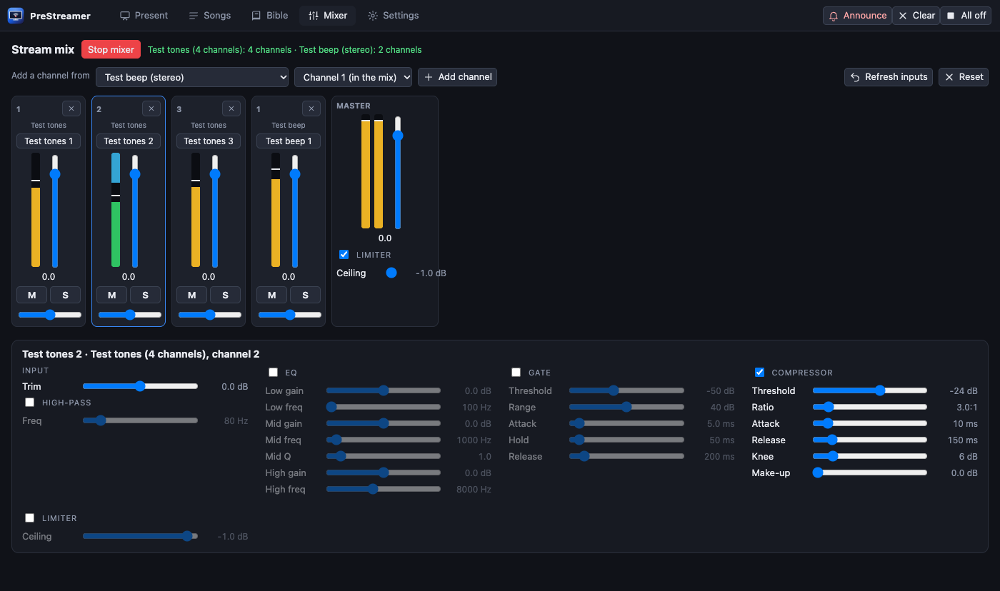
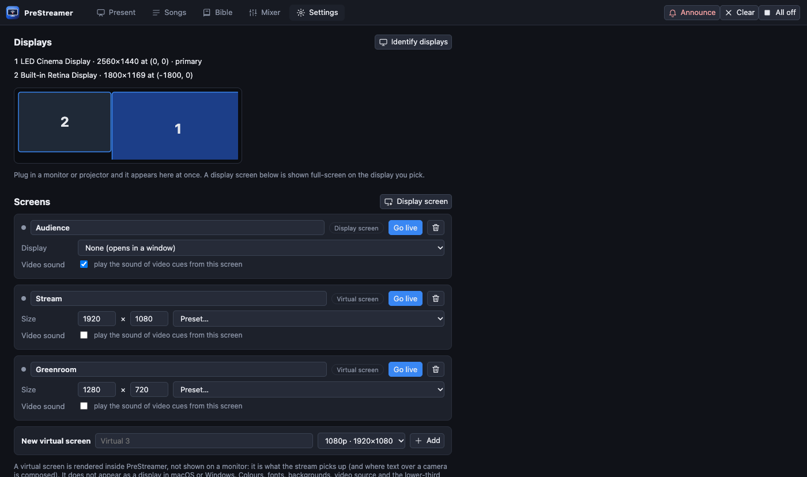
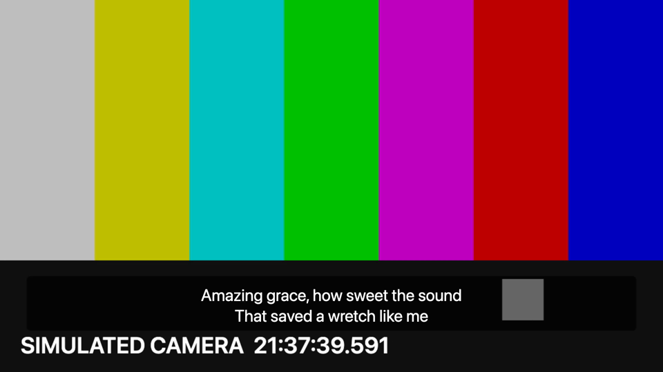

# PreStreamer

Presentation software for church services with a built-in live streamer: **presenter + streamer**.

Run a Sunday service from one window: a run sheet of songs and videos, lyrics with image or video backgrounds on any number of physical and virtual screens, a mixing console for the stream audio, and one-click streaming to YouTube. Built with Electron for macOS and Windows; so far it has only been run on macOS (see *What is tested*).

| Present | Songs |
|---|---|
|  |  |

| Mixer | Settings |
|---|---|
|  |  |

## Features

- **Run sheet.** A service is an ordered list of songs and videos. Reorder, add and remove with icon buttons; the arrow keys carry on from one item into the next.
- **Songs.** A separate tab with search and an editor. Write `[Verse 1]` to start a section and a blank line to start a new slide. Each song has a background: a gradient, an imported image, or an imported video loop.
- **Video cues.** Add mp4, mov, mkv, webm and more to the run sheet. Files the browser cannot play (HEVC, ProRes, odd containers) are converted once on import; others are copied or re-wrapped without re-encoding. One shared clock keeps every screen on the same frame; play, pause, stop and seek from the transport bar (Space toggles).
- **Screens.** A screen is a logical output, independent of any monitor: bind it to a physical display or make it virtual (rendered off-screen, the source of the stream). Each screen has its own look (background, font, colours, whether to show backgrounds, whether it plays video sound) and a live preview in the operator window.
- **Settings tab.** Lists the connected displays (with an arrangement map and an **Identify displays** button that flashes a number on each monitor), and lets you name screens, bind them to a display, resize virtual screens, and add or remove screens. Screens are saved, and a display binding is restored by name if the system renumbers displays.
- **Text over video.** A screen can show a live camera (or any video source) with the lyrics on top, either centred or as a **lower-third** caption bar with an adjustable semi-transparent box. An ATEM Mini attached over USB appears as a webcam, so it is just another camera.
- **Mixer.** One strip per USB channel (a Behringer Wing exposes 48): trim, high-pass, 3-band EQ, gate, compressor with make-up gain, limiter, fader, pan, mute, solo and meters, plus a master limiter. Everything applies live; settings are saved.
- **Streaming.** The virtual screen plus the mixer's stereo mix, encoded to H.264/AAC 1080p30 and sent to YouTube over RTMP (or recorded to a file). A hardware encoder (VideoToolbox, NVENC, Quick Sync, AMF) is used when one works, with software x264 as the fallback. The stream key is stored encrypted by the OS keychain.

## Getting started

Requirements: Node.js 22+. For development, `ffmpeg` and `ffprobe` on your `PATH` (installers bundle their own).

```bash
npm install
npm start          # builds and launches
```

On macOS `npm start` also renames the development Electron bundle to PreStreamer, so the menu bar and Dock say PreStreamer instead of Electron (packaged installers already do). Restart the app after the first run to see it.

The first launch downloads the Electron binary (about 100 MB; Electron has no install script). On npm 11 you may see a notice that some packages' install scripts were skipped (`npm install-scripts ls`). Running and testing the app does not need them. Building installers needs the bundled ffmpeg binary: if `npm run package` stops with "bundled ffmpeg is missing", run `node node_modules/ffmpeg-static/install.js` and try again.

First steps: **Present** tab → pick or create a service → add songs (♪ icon) and videos (film icon). Click a slide, or press → / Space. Press **Live** on a screen to open it.

### Screens, displays and virtual screens

Open the **Settings** tab to set up outputs.

- **Display screen.** Shown full-screen on the display you pick (or in a window while none is chosen). Use *Identify displays* to see which monitor is which. If you bind a screen to the display your operator window is on, the live screen covers the controls; the page warns you.
- **Virtual screen.** Rendered inside PreStreamer at a size you choose (1080p, 720p, 4K, vertical, or custom). It is not a monitor: it does not appear in macOS or Windows display settings. It is what the stream picks up, and where text over a camera is composed. A real extra monitor without hardware needs an OS-level virtual display tool or an HDMI dummy plug; PreStreamer cannot create one.
- Colours, fonts, backgrounds, the video source and the caption layout are set per screen in the **Look** panel of the Present tab.

### Text over camera (captions, "alpha")

1. Settings: make sure there is a virtual screen for the stream (there is one by default, "Stream").
2. Present tab → select that screen → **Look**: *Video source* = your camera (*Detect cameras*), *Text layout* = *Lower third*, *Text box* = about 0.5-0.6.
3. Start streaming from that screen. The captions are composed over the camera picture inside PreStreamer and encoded together.

This is real compositing (the text box is semi-transparent over the live picture), not an alpha channel sent to another device. If you would rather let an **ATEM keyer** do the overlay, PreStreamer can output the lyrics on a plain colour for chroma keying (the green swatch, `#00b140`) or white on black for a luma key, on a display screen wired to an ATEM input. A true alpha output (key + fill, or NDI with alpha) is not built; it is on the roadmap.



### Streaming to YouTube

1. In YouTube Studio create a **reusable RTMP stream key** (resolution *Variable* or 1080p30) and enable **auto-start** on the broadcast bound to it, otherwise the stream connects but does not go live.
2. Stream panel → target *YouTube (RTMP)* → paste the key once → *Start streaming*. It is remembered (encrypted); *Forget saved key* removes it.
3. Try it with a private or unlisted broadcast first.

### Stream audio from a mixer (Behringer Wing)

The Wing's USB interface is 48 in / 48 out at 48 kHz and appears to the computer as one multichannel audio device. Route the bus you want on the stream (for example your STREAM bus) to USB outputs 1-2 on the console, then in the **Audio** panel choose the device, *Apply*, and open the **Mixer** tab. The panel shows how many channels the system actually delivered. On Windows the manufacturer's ASIO/USB driver is probably required. *This path has not been tested with real hardware; see below.*

Use *Multichannel test tones* as a source to try the mixer without any hardware.

## How it works

```
 operator window ──IPC──▶ main process ──▶ ScreenManager ──▶ output windows (physical displays)
   (Present/Songs/Mixer)       │                          └─▶ virtual screen (off-screen, 30 fps frames)
                               │                                        │ raw BGRA
                               ├─▶ Playback clock ──▶ every window      ▼
                               ├─▶ ListStore (songs, services)       Streamer ──▶ ffmpeg ──▶ YouTube / file
                               └─▶ AudioBridge ◀── hidden audio window       ▲
                                      loopback TCP, raw f32 PCM ─────────────┘
                                      (Web Audio: device → strips → master)
```

- Electron main process owns state and processes; renderers are sandboxed with context isolation and a strict CSP.
- The mixer runs in a hidden window using the Web Audio API, with custom AudioWorklets for the gate and the compressor/limiter (the built-in compressor node applies automatic make-up gain that cannot be disabled).
- Video position is a single clock `(position, time, playing)`; each window extrapolates it locally, so there is no per-frame messaging.
- Media (backgrounds, videos) is served to the windows by a `media://` protocol with HTTP range support (needed for seeking).

## Testing

```bash
npm run typecheck
npm test                # 96 unit tests
npm run test:coverage   # + coverage report in coverage/
npm run e2e             # drives the real app: mixer, streaming, video (needs a display and ffmpeg)
```

### Unit tests: 96 tests, 11 files

Coverage of the logic that can run without Electron or audio hardware (`npm run test:coverage`):

| File | Statements | Branches | Functions | Lines |
|---|---|---|---|---|
| **Total** | **94.3%** | **93.7%** | **94.7%** | **96.0%** |
| `src/shared/screens.ts` (screen/look validation, defaults) | 100% | 100% | 100% | 100% |
| `src/shared/mixer.ts` (console model, validation) | 100% | 100% | 100% | 100% |
| `src/shared/songs.ts` (song text format) | 100% | 100% | 100% | 100% |
| `src/shared/types.ts` | 100% | 100% | 100% | 100% |
| `src/main/playback.ts` (video clock) | 100% | 100% | 100% | 100% |
| `src/main/video-plan.ts` (copy / remux / transcode) | 100% | 100% | 100% | 100% |
| `src/main/range.ts`, `media-path.ts` (HTTP ranges, path-traversal guard) | 100% | 100% | 100% | 100% |
| `src/main/store.ts` (atomic JSON storage) | 96.7% | 100% | 90.9% | 96.2% |
| `src/main/streamer.ts` (ffmpeg args, process handling) | 87.1% | 79.0% | 88.0% | 91.7% |
| `src/main/tools.ts` (ffmpeg lookup) | 92.8% | 91.7% | 100% | 90.9% |

> **How to read this number.** These eleven files are about **25%** of the source (≈900 of ≈3,600 lines); they are the parts that are pure logic. The other ~76% (operator UI, windows and screens, the audio graph, IPC, packaging) cannot run in plain Node, so it has **no line coverage**; it is exercised only by the end-to-end scripts below and by manual checks. The streamer's process tests use a fake `ffmpeg` and run on macOS/Linux only; the real-ffmpeg path is covered by the end-to-end scripts.

### End-to-end tests: 26 checks against the real app

| Script | Checks | What it proves |
|---|---|---|
| `npm run e2e:mixer` | 12 | Steps the mixer through scripted settings on four test tones, records the PCM it produces and measures each tone with a Goertzel filter: unused channels silent, fader −12 dB, EQ +12 dB, compressor 20:1 reduces level, make-up adds exactly 10 dB, limiter holds its ceiling, gate closes, mute, solo, 500 Hz high-pass. Independent of the encoder and machine load. |
| `npm run e2e:stream` | 5 | Streams the animated test pattern with audio to a file for 8 s and inspects it with ffprobe: clean stop, H.264 1920×1080, AAC track, most of the run captured, frames delivered. |
| `npm run e2e:video` | 9 | Generates mp4/mov/mkv/HEVC/ProRes samples; checks the import decision for each, then plays one on all screens and checks every window follows the clock through play, pause and seek (screens within 0.75 s of each other). |

Last run: 96/96 unit tests, 12/12 + 5/5 + 9/9 end-to-end checks, on macOS (Apple silicon).

### What is tested, and what is not

| Area | Automated | Checked by hand (screenshots) | **Not tested** |
|---|---|---|---|
| Song format, services, persistence | unit | editor, picker, run sheet UI | |
| Screens: validation, saving, restart round trip | unit + restart check by hand | Settings tab | |
| Identify displays overlay | | seen on both displays (screen capture) | |
| Text over camera, lower-third caption | | frame of an encoded stream, simulated camera | **a real camera or ATEM** |
| True alpha / key + fill output | | | **not built** |
| PreStreamer name in the macOS menu bar | | bundle name and process name checked | **not seen in the menu bar itself** (could not bring the app to the front from the test script) |
| Slide backgrounds (image/video) | scripted hook run manually, not in CI | | |
| Video import and playback sync | unit + e2e | transport bar, previews | **video sound** (output device routing) |
| Mixer DSP | unit (model) + e2e | console UI | |
| Streaming to a file | unit + e2e | | |
| Hardware encoding | | VideoToolbox on macOS | NVENC / Quick Sync / AMF (Windows) |
| macOS installer | | built and run, bundled ffmpeg verified | signed/notarised build |
| **Windows** | unit tests only in CI config | | **everything else** |
| **YouTube RTMP** | ffmpeg arguments (unit) | | **a real live stream** |
| **Behringer Wing capture (48 ch)** | | | **no hardware** (mixer verified on synthetic channels) |
| **ATEM Mini** | | | **no hardware** (any camera works the same way in principle) |
| **Stream-key encryption** | | | needs a real OS keychain prompt |
| **GitHub workflows** | YAML parses; scripts exist | | **never run on GitHub** |

Known measured behaviour: audio lags the picture by roughly 150 ms and drifts by a few milliseconds per 20 s (audio clock versus system clock) in the synthetic flash-and-beep test; a video-delay control and drift correction are not built yet.

## Build, CI and releases

```bash
npm run package        # installers for the current OS into release/
npm run package:dir    # unpacked app, faster, for checking
```

- **`.github/workflows/ci.yml`** (every push and pull request): typecheck, unit tests with coverage, build; end-to-end tests on macOS and Windows (reported but non-blocking until proven stable on hosted runners, which may lack a display or audio stack); installers uploaded as build artifacts.
- **`.github/workflows/release.yml`**: push a tag like `v0.2.0` to build macOS and Windows installers and attach them to a GitHub release.
- Installers bundle `ffmpeg` and `ffprobe` (`ffmpeg-static`, `ffprobe-static`), pruned to the target platform. **Licensing:** the bundled ffmpeg includes GPL components (libx264); if you distribute installers, check the licence files of those packages and your obligations.
- **Builds are unsigned.** macOS shows an "unidentified developer" warning and Windows SmartScreen warns until you add code signing (an Apple Developer ID and a Windows certificate, configured in `package.json` → `build`). On a managed machine this warning may block the app entirely.

## Development notes

Scripted scenarios used by the tests (see `src/main/devhooks.ts`), switched on by environment variables:

| Variable | Effect |
|---|---|
| `PRESTREAMER_USER_DATA=dir` | Use a scratch data folder (songs, services, mixer, key). **Always set by the tests.** |
| `PRESTREAMER_SNAPSHOT=out.png` | Capture the operator window and quit |
| `PRESTREAMER_EVAL="js"` | Run JavaScript in the operator before the snapshot (prints the result) |
| `PRESTREAMER_STREAMTEST=out.mkv` | Stream the test pattern to a file (`PRESTREAMER_SECONDS`, `PRESTREAMER_AUDIO=test`) |
| `PRESTREAMER_BGTEST=dir` · `PRESTREAMER_VIDEOTEST=dir` · `PRESTREAMER_MIXERTEST=out.f32` | The scenarios behind the e2e scripts |
| `PRESTREAMER_ENCODER=libx264\|h264_videotoolbox\|…` | Force a video encoder (default: first working hardware encoder, else x264) |
| `PRESTREAMER_FFMPEG_LOG=info` | Print ffmpeg's own log |
| `FFMPEG_PATH`, `FFPROBE_PATH` | Use specific ffmpeg/ffprobe binaries |

## Security notes

- The YouTube stream key is encrypted with the OS keychain (`safeStorage`), never logged, and redacted from ffmpeg output shown in the UI. Do not commit keys; the repository contains none.
- Windows are sandboxed with context isolation and a CSP; the only permission granted is camera/microphone, for local pages.
- `media://` serves only plain file names from the app's media folder; anything that could escape it (`..`, separators, bad encoding) is rejected (unit-tested).

## Roadmap

Video-delay control and audio drift correction · alpha/key+fill output (NDI) · an app icon · per-channel names/presets pulled from the Wing (OSC, UDP 2223) · ATEM control (`atem-connection`) · Quelea song import and ProPresenter export · NDI/Syphon outputs · code signing and auto-update.
