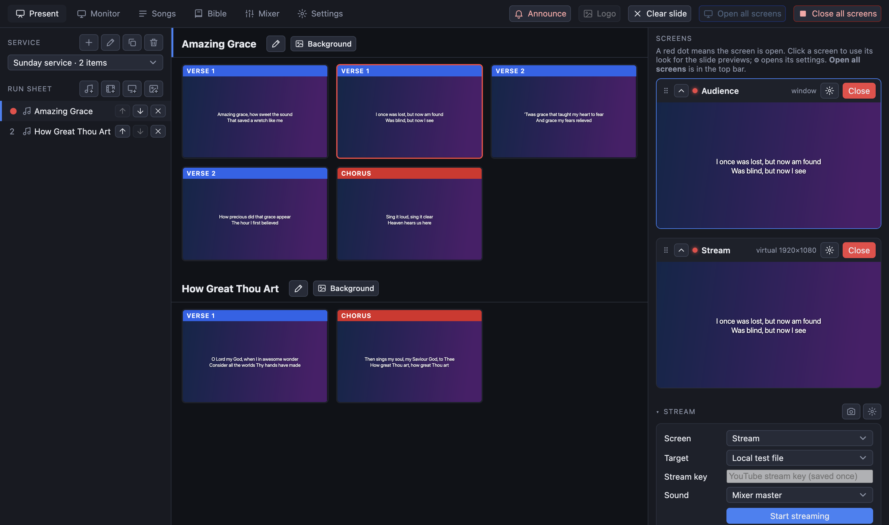
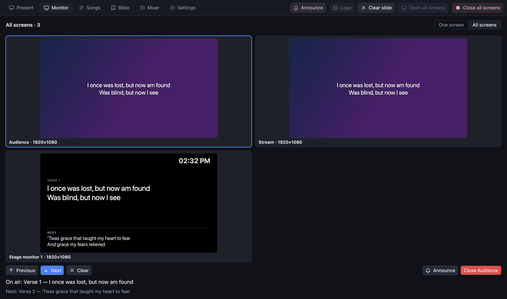
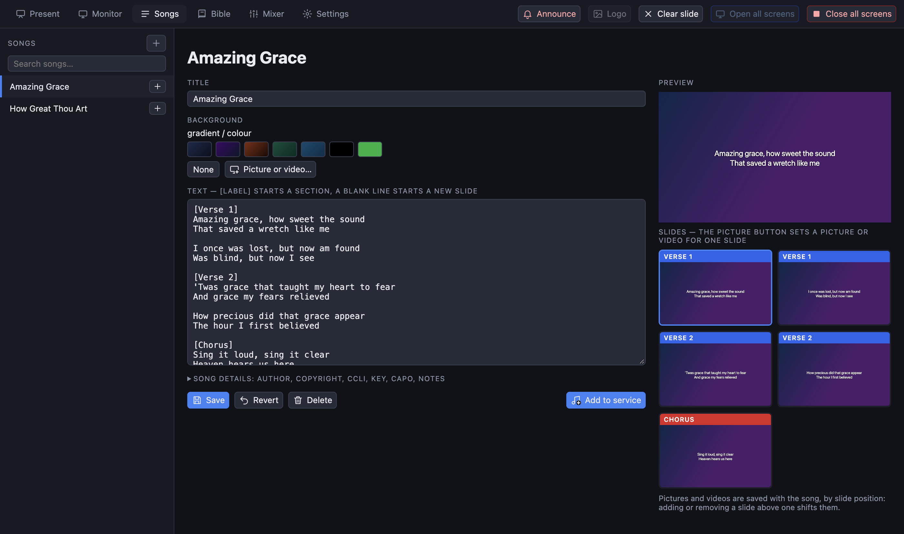
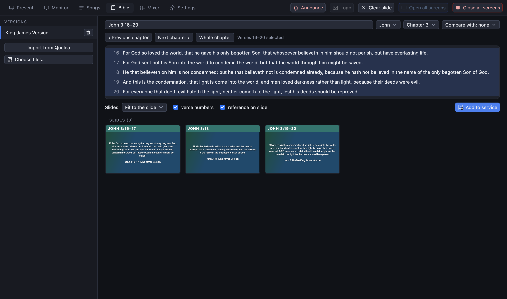
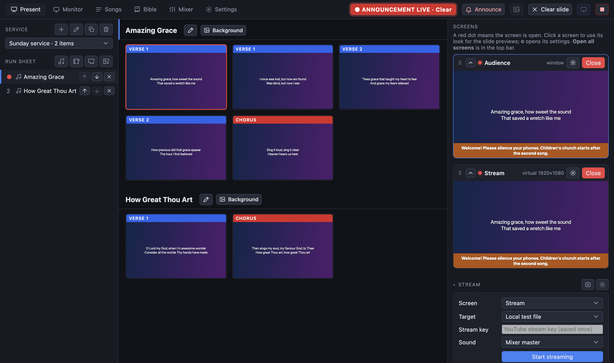

# PreStreamer

Presentation software for church services with a built-in live streamer: **presenter + streamer**.

Run a Sunday service from one window: a run sheet of songs, Bible passages, videos, presentations and pictures; lyrics over picture or video backgrounds on any number of physical and virtual screens; a stage monitor; live announcements; a mixing console for the stream audio; ATEM switcher control; and one-click streaming to YouTube. Built with Electron for macOS and Windows.

**Download:** installers for macOS (Apple silicon and Intel) and Windows are on the [Releases page](https://github.com/AC-Dubnica/prestreamer/releases). They are not code-signed yet, so the first start needs one extra step (see *Build, CI and releases*).

| Present | Monitor (all screens) |
|---|---|
|  |  |

| Songs | Bible |
|---|---|
|  |  |

| Mixer: a chain of effects per channel | Settings |
|---|---|
|  |  |

| A live announcement on every screen |
|---|
|  |

## Features

**Presenting**
- **Run sheet.** A service is an ordered list of songs, Bible passages, videos, presentations and pictures. Reorder, add and remove with icon buttons. The arrow keys carry on from one item into the next; slides are shown in a full-width grid, and clicking an item in the run sheet jumps to it and pins it to the top. **Cmd/Ctrl + 1–9** jump to the Nth item from any tab.
- **Songs.** A separate tab with search and an editor. Write `[Verse 1]` to start a section and a blank line to start a new slide. Each song can have its own picture or video, and so can each slide: the editor shows every slide as a card with a picture button, and everything is saved **with the song** by *Save* (the editor says *Unsaved changes* until then). The same buttons exist on the Present tab; the schedule only points at the song, so a song's visuals are never stored in the schedule. Songs also carry the details Quelea keeps (author, copyright, CCLI, year, publisher, key, capo, notes). The structure deliberately matches Quelea's so its songs can be brought over: a Quelea section (title and lines) is one slide here, its theme's picture or video is that slide's own picture, and the song's theme is the song's picture. Readings are the exception: they are not library songs, so a reading's pictures are stored in its schedule item.
- **Bible.** Pick a translation, book and chapter and put verses on air. Bibles are Zefania XML files: import them from the Bible tab, or let PreStreamer import the ones Quelea already has on this computer on first start (it only reads those files). The Roháček and Ekumenický translations cannot be bundled with the app for licensing reasons.
- **Videos.** Add mp4, mov, mkv, webm and more. Files the browser cannot play (HEVC, ProRes, odd containers) are converted once on import; others are copied or re-wrapped without re-encoding. One shared clock keeps every screen on the same frame; play, pause, stop and seek from the transport bar (Space toggles). The sound of a video goes through the mixer's built-in *video* input.
- **Presentations and pictures.** Import PowerPoint (`.pptx`, `.ppsx`), PDF, and a folder or selection of pictures: each slide becomes a picture shown whole, never cropped. `.pptx` is read by PreStreamer itself, so PowerPoint does not need to be installed and is never launched. Old `.ppt`, OpenDocument and Keynote (`.key`, macOS only) go through LibreOffice, PowerPoint or Keynote if installed; otherwise export a PDF from the program you made the deck in.
- **Backgrounds.** A library of pictures and looping videos, shared by everything: set one per screen, per song, per slide, or for all slides of a song at once; remove entries again. A screen can also show plain pictures as run-sheet items the same way as a presentation.
- **App-wide backgrounds.** Settings → *Backgrounds and logo* sets one picture or looping video for **all songs** and another for **all Bible readings**. A song's or slide's own picture or video always wins; next comes the one chosen here, then the screen's own background, then its colour.
- **Logo.** Choose a logo picture in the same place; the **Logo** button in the top bar (or the **L** key) puts it on every screen and takes it off again. It is a picture slide, so the camera-only stream does not carry it. Deleting the picture from the library clears every use of it.
- **Announcements.** Press **A** (any tab) for a live message over every screen, with quick messages you can save and reuse. While one is on air a red button in the top bar clears it.
- **Monitor tab.** Watch what is on the screens, larger than the Present tab can show. **One screen** fills all the room with the selected screen (in its own shape), with a strip of the others to pick from; **All screens** shows every screen at once in a grid that fits the room, like a multiviewer (click selects, double-click shows one large). Below: Previous/Next, Clear, video play/pause, Camera only (stream screen), Announce and Open/Close; the arrow keys work there too. The choice is remembered, and the previews exist only while the tab is open.
- **Stage monitor.** A display screen for the people on stage: current slide, the **next** slide and the clock. Add it from Settings → *Stage monitor*.

**Screens**
- **Screens.** A screen is a logical output, independent of any monitor: bind it to a physical display or make it virtual (rendered off-screen, the source of the stream). Each screen has its own look (background, font, colours, whether to show backgrounds, whether it plays video sound, lower-third caption box) and a live preview in the Present tab. The chevron on a screen card folds its preview away (the title bar and buttons stay), for screens you rarely need to watch; it is remembered per screen. Drag a screen by its ⠿ handle in the Present tab (or press ↑ ↓ on the handle) to change the order; Settings shows the same order, and moving screens there changes the Present tab.
- **Stream mirror.** A display screen that shows exactly what the stream shows (look, size and camera-only), for a monitor in the room or the control booth.
- **LIVE badge.** A screen can show a "LIVE" badge while the stream runs, so the room knows the service is being broadcast.
- **Settings tab.** Categories are listed down the left side: **Visuals** (app-wide backgrounds and the logo), **Screens** (add, order, bind and remove outputs, below the connected monitors and their arrangement map); the open one is remembered.
- **Displays.** The Settings tab shows the connected displays on an arrangement map with an **Identify displays** button, and new or removed monitors and audio devices are picked up automatically.
- **Text over video.** A screen can show a live camera with the lyrics on top, centred or as a **lower-third** caption bar with an adjustable semi-transparent box. Nothing is drawn when there is no slide (no empty box).
- **Remembers how it was left.** Window position, tab, service, selected screen and which screens were open come back at the next start. A full-screen output is never reopened on the main display, and a stream is never started automatically.

**Streaming and audio**
- **Streaming.** The virtual screen plus the mixer's stereo mix, encoded to H.264/AAC (resolution, frame rate, bitrate and encoder in *Stream → Settings*) and sent to YouTube over RTMP, or recorded to a file. A hardware encoder (VideoToolbox, NVENC, Quick Sync, AMF) is used when one works, with software x264 as the fallback. The stream key is stored encrypted by the OS keychain.
- **Camera only.** An icon button in the Stream header makes the stream carry just the live camera, without text, backgrounds, videos or announcements, while the room screens keep presenting.
- **Stream health.** Bitrate against target with a two-minute graph, frame rate, dropped frames (including the share dropped in the last 60 seconds), encoding speed, data sent, and advice when something is wrong. The Stream section and the statistics collapse to a one-line summary.
- **Mixer.** One strip per channel (a Behringer Wing exposes 48) with trim, fader, pan, mute, solo and meters, and a **chain of effects** that you build: select a strip and the signal is drawn as a chain, Input → effect → effect → … → Fader, left to right. **Add effect** puts one at the end; drag a card by its ⠿ handle (or press ← →) to change the order, the switch on a card bypasses it, ✕ removes it, and **Start from…** fills the chain with a ready-made one (*Worship vocal*, *Speaker / preacher*, *Instrument*, *Room / audience mic*). Each strip shows its chain at a glance, and compressors, limiters, gates and de-essers show how much they are turning the signal down. The **master** is selectable too and has a chain of its own (a limiter at -1 dB to start with; *Stream loudness* and *Safety limiter* presets) for effects on the whole mix. Effects: **High-pass**, **EQ** (3 bands, with a response graph you can drag), **Gate**, **Compressor** (with make-up gain and a transfer curve), **Limiter**, **De-esser** (softens harsh "s" sounds on vocals and speech), **Reverb** (for close microphones and direct feeds that sound dry on a stream) and **Delay** (a soft echo for worship). Strips can be reordered by dragging. Every change applies at once and is saved. **Undo / Redo** (the arrows in the Mixer bar, or Cmd/Ctrl+Z and Cmd/Ctrl+Shift+Z) step back and forward through the changes made since the app opened: a whole knob drag or a new effect is one step. Mixer files from before chains came along are converted when the app opens.
- **ATEM control.** A panel on the Present tab drives an ATEM switcher over the network: program and preview buttons per input, **Cut** and **Auto**. While no switcher is found the panel is greyed out and says why. See *ATEM switcher* below.

## Getting started

Requirements: Node.js 22+. For development, `ffmpeg` and `ffprobe` on your `PATH` (installers bundle their own).

```bash
npm install
npm start          # builds and launches
```

On macOS `npm start` also renames the development Electron bundle to PreStreamer, so the menu bar and Dock say PreStreamer instead of Electron (packaged installers already do). Restart the app after the first run to see it.

The first launch downloads the Electron binary (about 100 MB; Electron has no install script). On npm 11 you may see a notice that some packages' install scripts were skipped (`npm install-scripts ls`). Running and testing the app does not need them. Building installers needs the bundled ffmpeg binary: if `npm run package` stops with "bundled ffmpeg is missing", run `node node_modules/ffmpeg-static/install.js` and try again.

First steps: **Present** tab → pick or create a service → add songs (♪ icon), Bible passages, videos, presentations or pictures. Click a slide, or press → / Space. Press **Open** on a screen (or **Open all screens** in the top bar) to show it.

### Screens, displays and virtual screens

Open the **Settings** tab to set up outputs.

- **Display screen.** Shown full-screen on the display you pick (or in a window while none is chosen). Use *Identify displays* to see which monitor is which. If you bind a screen to the display your operator window is on, the live screen covers the controls; the page warns you.
- **Virtual screen.** Rendered inside PreStreamer at a size you choose (1080p, 720p, 4K, vertical, or custom). It is not a monitor: it does not appear in macOS or Windows display settings. It is what the stream picks up, and where text over a camera is composed. A real extra monitor without hardware needs an OS-level virtual display tool or an HDMI dummy plug; PreStreamer cannot create one.
- **Stage monitor and Stream mirror** are one-click additions in Settings (see *Features*).
- Colours, fonts, backgrounds, the video source and the caption layout are set per screen with the gear button on its card in the Present tab.

### Text over camera (captions, "alpha")

1. Settings: make sure there is a virtual screen for the stream (there is one by default, "Stream").
2. Present tab → the gear on that screen → *Video source* = your camera (*Detect cameras*), *Text layout* = *Lower third*, *Text box* = about 0.5-0.6.
3. Start streaming from that screen. The captions are composed over the camera picture inside PreStreamer and encoded together.

This is real compositing (the text box is semi-transparent over the live picture), not an alpha channel sent to another device. If you would rather let an **ATEM keyer** do the overlay, PreStreamer can output the lyrics on a plain colour for chroma keying (the green swatch, `#00b140`) or white on black for a luma key, on a display screen wired to an ATEM input. A true alpha output (key + fill, or NDI with alpha) is not built.


### ATEM switcher

An ATEM Mini attached over **USB** appears to the computer as a webcam, so it is just another camera source (*Video source* above). That USB port cannot carry control. To switch inputs from PreStreamer, connect the ATEM to the same network over **Ethernet**:

1. Find its IP address in ATEM Software Control (or set one there). A factory-fresh ATEM answers on `192.168.10.240`, which is what PreStreamer tries first.
2. In the **ATEM** section of the Present tab press the gear and enter the address. It is remembered.
3. The panel lights up when the switcher answers: its model, one **Program** row and one **Preview** row of buttons for the inputs (labels as set on the switcher), and **Cut** / **Auto**. Red is on air, green is on preview, and the buttons follow changes made on the switcher itself. The first mix effect is controlled.

If no switcher is found, or the cable is unplugged, the whole panel is greyed out with "No ATEM found at …" and keeps looking every few seconds. *Not tested with real hardware; see below.*

### Streaming to YouTube

1. In YouTube Studio create a **reusable RTMP stream key** (resolution *Variable* or 1080p30) and enable **auto-start** on the broadcast bound to it, otherwise the stream connects but does not go live.
2. Stream section → target *YouTube (RTMP)* → paste the key once → *Start streaming*. It is remembered (encrypted); *Forget saved key* removes it.
3. Try it with a private or unlisted broadcast first. Never share or commit a stream key: if one has been pasted somewhere it should not be, reset it in YouTube Studio.

### Stream audio from a mixer (Behringer Wing)

The Wing's USB interface is 48 in / 48 out at 48 kHz and appears to the computer as one multichannel audio device. Route the bus you want on the stream (for example your STREAM bus) to USB outputs 1-2 on the console, then open the **Mixer** tab and pick the device for the strips. The panel shows how many channels the system actually delivered. On Windows the manufacturer's ASIO/USB driver is probably required. *This path has not been tested with real hardware; see below.*

Use *Multichannel test tones* as a source to try the mixer without any hardware.

## How it works

```
 operator window ──IPC──▶ main process ──▶ ScreenManager ──▶ output windows (physical displays)
   (Present/Songs/Bible/        │                          └─▶ virtual screen (off-screen, 30 fps frames)
    Mixer/Settings)             │                                        │ raw BGRA
                                ├─▶ Playback clock ──▶ every window      ▼
                                ├─▶ stores (songs, services, Bibles…)  Streamer ──▶ ffmpeg ──▶ YouTube / file
                                ├─▶ AtemController ◀──UDP──▶ ATEM        ▲
                                └─▶ AudioBridge ◀── hidden audio window  │
                                       loopback TCP, raw f32 PCM ────────┘
                                       (Web Audio: device → strips → master)
```

- Electron main process owns state and processes; renderers are sandboxed with context isolation and a strict CSP.
- `SlideView` draws everything (outputs, thumbnails, previews); layers from the bottom: backdrop, live source, video, picture, text, stage extras, LIVE badge, announcement.
- The mixer runs in a hidden window using the Web Audio API, with custom AudioWorklets for the gate and the compressor/limiter (the built-in compressor node applies automatic make-up gain that cannot be disabled).
- Video position is a single clock `(position, time, playing)`; each window extrapolates it locally, so there is no per-frame messaging.
- Imported media lives in the app's media folder and is served to the windows by a `media://` protocol with HTTP range support (needed for seeking).
- Presentations are turned into one picture per slide by hidden helper windows: pdf.js for PDFs and [pptx-preview](https://github.com/501351981/pptx-preview) for `.pptx`.
- The ATEM link uses [`atem-connection`](https://github.com/Sofie-Automation/sofie-atem-connection) (UDP, port 9910). `CLAUDE.md` has the architecture notes for working on the code.

## Testing

```bash
npm run typecheck
npm test                # unit tests (pure logic, no display needed)
npm run test:coverage   # + coverage report in coverage/
npm run e2e             # builds, then drives the real app through every end-to-end script (needs a display and ffmpeg)
node scripts/e2e-stage.mjs   # or one script at a time
```

### Unit tests

They cover the logic that can run without Electron or audio hardware: everything in `src/shared` (screens, songs, Bible, announcements, mixer model, effect chains and migration of old mixer files, curves and the reverb impulse, presentation planning, session, media library, stream settings and statistics, ATEM model) plus the pure parts of `src/main` (atomic storage, HTTP ranges, path guard, video import plan, playback clock, streamer arguments and process handling with a fake ffmpeg, ffmpeg lookup, Bible import, the ATEM controller against a fake switcher). Run `npm run test:coverage` for the current numbers.

The audio worklets (gate, de-esser) are the exception: their DSP runs in Node against synthetic signals (`tests/worklets.test.ts`). The operator UI, windows and screens, the audio graph, IPC and packaging cannot run in plain Node, so they have **no line coverage**; they are exercised by the end-to-end scripts and by manual checks. The streamer's process tests use a fake `ffmpeg` and run on macOS/Linux only.

### End-to-end tests

Each script launches the real app against a scratch data folder (`PRESTREAMER_USER_DATA`), drives it through development hooks (see below) and prints PASS/FAIL lines.

| Script | What it proves |
|---|---|
| `e2e:ui` | Clicks through the real operator window: service dialogs and the per-screen settings popup, checking what is shown and what was saved |
| `e2e:bible` | Imports invented Zefania Bibles, then drives the Bible tab: reference box, pickers, a second version alongside, adding a reading to the service, showing and stepping through its slides |
| `e2e:announce` | The announcement popup and header controls, and what every screen's preview shows |
| `e2e:sources` | The Mixer tab lists every audio input plus test sources, strips from different inputs run together, and the stream panel says what it carries |
| `e2e:mixer` | Steps the mixer through scripted settings on four test tones, records the PCM and measures each tone with a Goertzel filter: fader, EQ, compressor, make-up gain, limiter, gate, mute, solo, high-pass, and the chain: the order of effects matters, a bypassed effect is transparent, de-esser, delay (an echo that lines up adds 6 dB), reverb, a limiter in the master chain |
| `e2e:mixer-ui` | Strips reorder by drag and drop and by keyboard (and the order is saved); a strip's chain: effects are added from a menu, moved by dragging or with the arrow keys, bypassed, removed, or replaced by a preset (asking first); the master has its own chain; knobs, switches and graphs edit the saved settings |
| `e2e:stream` | Streams an animated pattern with audio to a file and to a local RTMP server and inspects the result with ffprobe (H.264 1920×1080, AAC, frames delivered, health numbers) |
| `e2e:video` | Import decisions per format, then synchronised playback on every screen through play, pause and seek |
| `e2e:camera-only` | A slide and an announcement are on air, yet the camera-only stream frame is plain black |
| `e2e:stage` | Stage monitor (current, next, clock), screen order, lower-third without a slide, camera-only button, removing screens, stream mirror |
| `e2e:session` | Runs the app twice on the same data: the tab, service, selected screen and open screens come back as left |
| `e2e:slides` | The whole service is one list of full-width slides, the arrow keys flow from one song into the next, a click on a song in the run sheet scrolls to it and pins its title |
| `e2e:presentation` | A PDF is imported with the real button, every page is a slide, the arrow keys step through them, the deck survives a restart, and the stream shows it over the camera (camera-only removes it) |
| `e2e:backgrounds` | The picker (library, import, none), a background for a whole screen and for a song, and what the stream shows behind the text |
| `e2e:monitor` | The Monitor tab: big preview that fills the room, One screen / All screens, slide controls, picking a screen, open/close, camera only |
| `e2e:appearance` | App-wide song and scripture backgrounds, the logo and the Logo button/key, deleting a library picture clears them |
| `e2e:songeditor` | The song editor: a card per slide, a picture for one slide saved with the song only on Save, song details kept, pictures of removed slides dropped |
| `e2e:atem` | The ATEM panel with no switcher: greyed out, nothing pressable, address dialog |

### What is tested, and what is not

| Area | Automated | **Not tested** |
|---|---|---|
| Song format, services, Bibles, announcements, screens, session, media library | unit + e2e | |
| Mixer DSP | unit (model, curves) + e2e | |
| Streaming to a file and to a local RTMP server | unit + e2e | **a real YouTube stream** |
| Video import and playback sync | unit + e2e | video sound reaching the stream (no automated check yet) |
| PDF and `.pptx` import | unit + e2e (macOS; the `.pptx` renderer is also exercised by a built-in test deck) | very complex decks (rendering is an approximation), Keynote and PowerPoint/LibreOffice fallbacks |
| Stage monitor, stream mirror, camera-only, LIVE badge, backgrounds | e2e | |
| ATEM control | unit (model and controller against a fake switcher), e2e (no-switcher state) | **a real ATEM** |
| Behringer Wing capture (48 ch) | mixer verified on synthetic channels | **no hardware** |
| Hardware encoding | | VideoToolbox verified on macOS; NVENC / Quick Sync / AMF untested |
| **Windows** | unit tests in CI, installer builds | **running the app**: everything else |
| Installers | built in CI for macOS (arm64, Intel) and Windows; the Apple silicon build was run | the Intel and Windows builds, signed/notarised builds |
| Stream-key encryption | | needs a real OS keychain prompt |

Known measured behaviour: audio lags the picture by roughly 150 ms and drifts by a few milliseconds per 20 s (audio clock versus system clock) in the synthetic flash-and-beep test; a video-delay control and drift correction are not built yet.

## Build, CI and releases

```bash
npm run package        # installers for the current OS into release/
npm run package:dir    # unpacked app, faster, for checking
```

- **`.github/workflows/ci.yml`** (every push and pull request): typecheck, unit tests on macOS and Windows, end-to-end tests (reported but non-blocking until proven stable on hosted runners, which may lack a display or audio stack), installers uploaded as build artifacts.
- **`.github/workflows/release.yml`**: builds the installers and attaches them to a GitHub release. To release:

  ```bash
  npm version patch          # or minor / major: bumps package.json and creates the tag vX.Y.Z
  git push --follow-tags     # the pushed tag starts the workflow
  ```

  It builds macOS for Apple silicon (`*-mac-arm64`) and for Intel (`*-mac-x64`), and Windows x64 (`*-win-x64` installer and portable zip), each on a runner of its own kind because ffmpeg is bundled per architecture. It stops if the tag does not match the version in `package.json`. A tag with a dash (`v0.3.0-beta.1`) is marked as a pre-release. **Run workflow** in the Actions tab does a trial build with the installers as downloadable artifacts and publishes nothing.
- Installers bundle `ffmpeg` and `ffprobe` (`ffmpeg-static`, `ffprobe-static`), pruned to the target platform. **Licensing:** the bundled ffmpeg includes GPL components (libx264); if you distribute installers, check the licence files of those packages and your obligations. The `.pptx` renderer (`pptx-preview`) is a closed-source freely licensed package; check its terms before redistributing.
- **Builds are unsigned.** On macOS open the `.dmg`, drag PreStreamer to Applications, then right-click the app and choose **Open** once (or run `xattr -cr /Applications/PreStreamer.app`). On Windows SmartScreen shows a warning: choose **More info**, then **Run anyway**. Signing needs an Apple Developer ID and a Windows certificate, configured in `package.json` → `build`. On a managed machine the warning may block the app entirely.

## Development notes

`npm run screenshots` retakes the pictures above (`node scripts/screenshots.mjs mixer` for one): it launches the real app once per picture on a scratch data folder with generated backgrounds, a public-domain Bible (King James, John 3) and a made-up band in the mixer, so run it when the look of the app changes. It needs a display and ffmpeg, and windows open briefly.

Scripted scenarios used by the tests (the full list is at the top of `src/main/devhooks.ts`), switched on by environment variables:

| Variable | Effect |
|---|---|
| `PRESTREAMER_USER_DATA=dir` | Use a scratch data folder (songs, services, mixer, key). **Always set by the tests**; it also turns off the Quelea Bible auto-import and the ATEM search. |
| `PRESTREAMER_ATEM=1` | Look for an ATEM even with a scratch data folder |
| `PRESTREAMER_SNAPSHOT=out.png` | Capture the operator window and quit |
| `PRESTREAMER_EVAL="js"` | Run JavaScript in the operator before the snapshot (prints the result) |
| `PRESTREAMER_NO_AUTO_OPEN=1` | With the two above: do not open the screens or show a slide first |
| `PRESTREAMER_STREAMTEST=out.mkv` | Stream the test pattern to a file (`PRESTREAMER_SECONDS`, `PRESTREAMER_AUDIO=test`, `PRESTREAMER_CAMERA_ONLY`, `PRESTREAMER_ANNOUNCE`, `PRESTREAMER_LOOK_BG`, `PRESTREAMER_LAYOUT`) |
| `PRESTREAMER_RTMP_URL=url` | Send the stream to a local RTMP server instead of YouTube (tests) |
| `PRESTREAMER_PRESENTATION_FILE`, `_MEDIA_FILE`, `_PICTURE_FILES`, `_PICTURE_PDF`, `_MAKEPDF` | Stand in for file dialogs / make test files |
| `PRESTREAMER_BGTEST=dir` · `_VIDEOTEST=dir` · `_MIXERTEST=out.f32` · `_PDFTEST` · `_PPTXTEST` | The scenarios behind the e2e scripts |
| `PRESTREAMER_ENCODER=libx264\|h264_videotoolbox\|…` | Force a video encoder (default: first working hardware encoder, else x264) |
| `PRESTREAMER_FFMPEG_LOG=info` | Print ffmpeg's own log |
| `FFMPEG_PATH`, `FFPROBE_PATH` | Use specific ffmpeg/ffprobe binaries |

## Security notes

- The YouTube stream key is encrypted with the OS keychain (`safeStorage`), never logged, and redacted from ffmpeg output shown in the UI. Do not commit keys; the repository contains none.
- Windows are sandboxed with context isolation and a CSP; the only permission granted is camera/microphone, for local pages.
- `media://` serves only plain file names from the app's media folder; anything that could escape it (`..`, separators, bad encoding) is rejected (unit-tested).
- The ATEM link only goes to the address you enter (or the factory default). It is unauthenticated, as the ATEM protocol is: use it on a network you trust.

## Roadmap

Video-delay control and audio drift correction · alpha/key+fill output (NDI) · more of the ATEM (keyers, transitions, macros, an on-air tally on the screens) · an automatic ATEM search on the network · per-channel names/presets pulled from the Wing (OSC, UDP 2223) · Quelea song import and ProPresenter export · NDI/Syphon outputs · code signing and auto-update.
