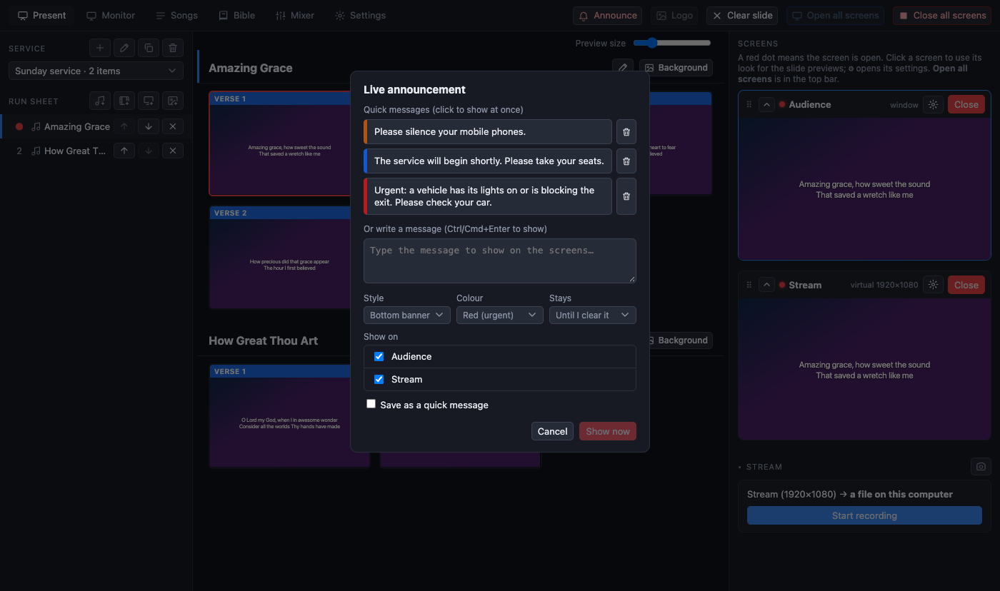
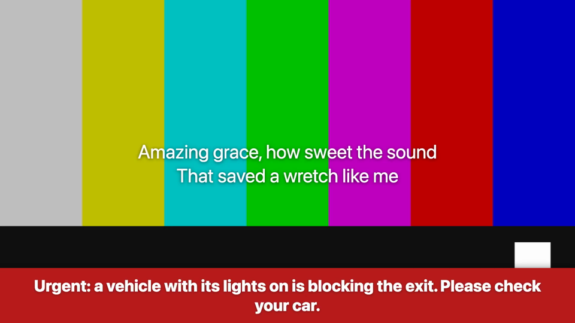

[← Guide home](index.md)

# Announcements

An announcement is a short message shown over everything else on the screens you choose, for a notice that cannot wait: "Please silence your phones", "A car with its lights on is blocking the exit". The slides underneath keep running.

## Show one

1. Press **A** on the keyboard (from any tab) or the **Announce** button in the top bar.
2. Click a **quick message** to show it at once, or type your own in the box and press **Show now** (Ctrl/Cmd + Enter does the same).
3. Choose how it looks before you show it:
   - **Style**: *Bottom banner*, *Top banner* or *Full screen* (the message fills the screen);
   - **Colour**: *Red (urgent)*, orange for a notice, blue for information;
   - **Stays**: until you clear it, or for a set time.
4. **Show on** lists the screens: tick the room, the stream, or both. You can show a message in the room and keep it off the stream, or the other way round.

While an announcement is on air, the Announce button turns into a **red button that clears it**.

## Quick messages

Tick **Save as a quick message** before you show a message you will use again. The list is kept; the bin beside a message deletes it. Write the ones you need in the week, so on Sunday it is one click.

## Notes

- An announcement is part of the picture, so viewers of the stream see it too (unless you left the stream screen off).
- A **camera-only** stream shows no announcements.
