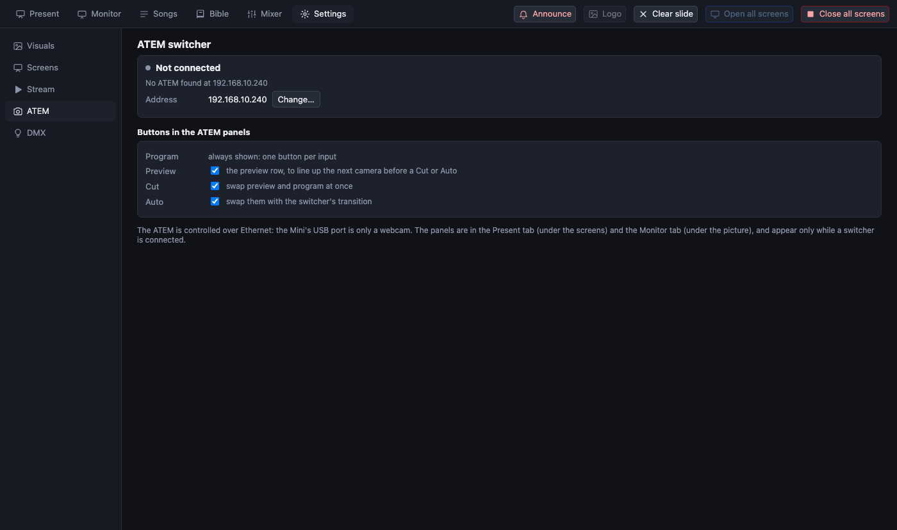

[← Guide home](index.md)

# ATEM video switcher

PreStreamer can switch the cameras on a Blackmagic **ATEM** from the Present and Monitor tabs: one button per input for *program* (what is on air) and *preview* (what is next), and **Cut** and **Auto**.

> **Not yet tried with a real switcher.** The control is tested against a simulated ATEM. Try it with the real one before a service.

## Connect

An ATEM Mini attached by **USB** looks to the computer like a webcam: it carries the picture, **not control**. To control it, also connect the ATEM to the same network by **Ethernet** (cable to the same router or switch as the computer).

1. Find the ATEM's IP address in *ATEM Software Control*. A new ATEM answers on `192.168.10.240`, which is what PreStreamer tries first.
2. Open **Settings → ATEM**, press **Change…** and type the address. It is remembered.
3. Make sure the computer and the ATEM are on the same network range (for example both `192.168.10.x`). A computer on wifi in a different network cannot reach the switcher.

Until the switcher answers, **nothing about the ATEM is shown anywhere else**; Settings says "No ATEM found at …" and keeps looking every few seconds. If the cable is pulled, the panels disappear again.

## Use

When the switcher answers, the **ATEM** panel appears in the Present tab under the screens (and under the picture in the Monitor tab):

- **Program** row: one button per input, named as on the switcher. **Red** is on air now.
- **Preview** row: **green** is what is next.
- **Cut** swaps preview and program at once. **Auto** swaps them with the switcher's own transition.
- The buttons follow changes made on the switcher itself.

The first mix effect (ME 1) is the one controlled.

A normal routine: click the next camera in the **Preview** row, then press **Cut** or **Auto** at the right moment.

## Choose which buttons to show

In **Settings → ATEM**, *Buttons in the ATEM panels* lets you hide **Preview**, **Cut** or **Auto**. A person who only needs to take a camera can hide everything except the program row.

## Cameras and the stream

The ATEM's output (USB or HDMI into a capture device) is the *Live source* behind the stream screen: see [screens](screens.md#how-a-screen-looks) and [text over the camera](screens.md#text-over-the-camera).

Security: the ATEM protocol has no password. Use it on a network you trust.
