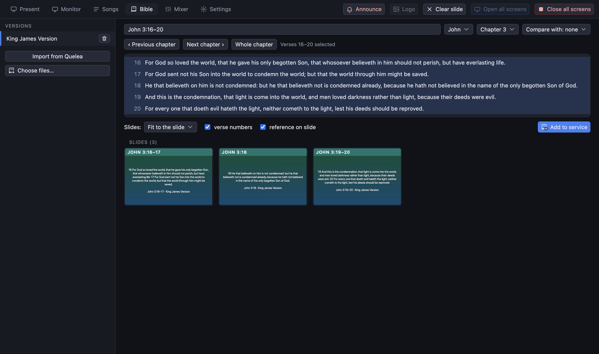

[← Guide home](index.md)

# Bible readings

## Before the first reading

The **Bible** tab needs at least one translation. Bibles are *Zefania XML* files:

- If you used Quelea on this computer, press **Import from Quelea** (it also happens by itself the first time the app starts).
- Otherwise import Zefania XML files from the same tab.

Some translations (for example Roháček and Ekumenický) cannot be shipped with the program for licensing reasons; import your own copy.

## Find a passage

- **Type a reference** in the box and press Enter: `John 3,16-20`, `Jn 3:16`, `1 Kor 13`. It reads the book names of the translation you picked, and common abbreviations.
- Or use the **pickers**: choose the book and the chapter. **‹ Previous chapter** and **Next chapter ›** walk through the Bible; **Whole chapter** shows every verse.
- **Click a verse** to choose it, **Shift + click** to extend the choice to a range.
- **Compare with** puts a second translation next to the first, so the screens show both.

If the program cannot understand the reference it says so and shows what it expected.

## Put it on the screens

The passage is cut into slides. **Click a slide** to show it on the screens. Or press **Add to service**: the reading becomes an item in the run sheet (named like "John 3:16–20") and then behaves like a song: arrow keys step through its slides.

Add readings *before* the service so they are in the right place in the run sheet.

## Look

Readings use the **Scripture** background chosen in Settings → Visuals, if there is one; or their own picture, which you set the same way as for a song (a *Background* button beside the reading's title). See [media](media.md#backgrounds).
