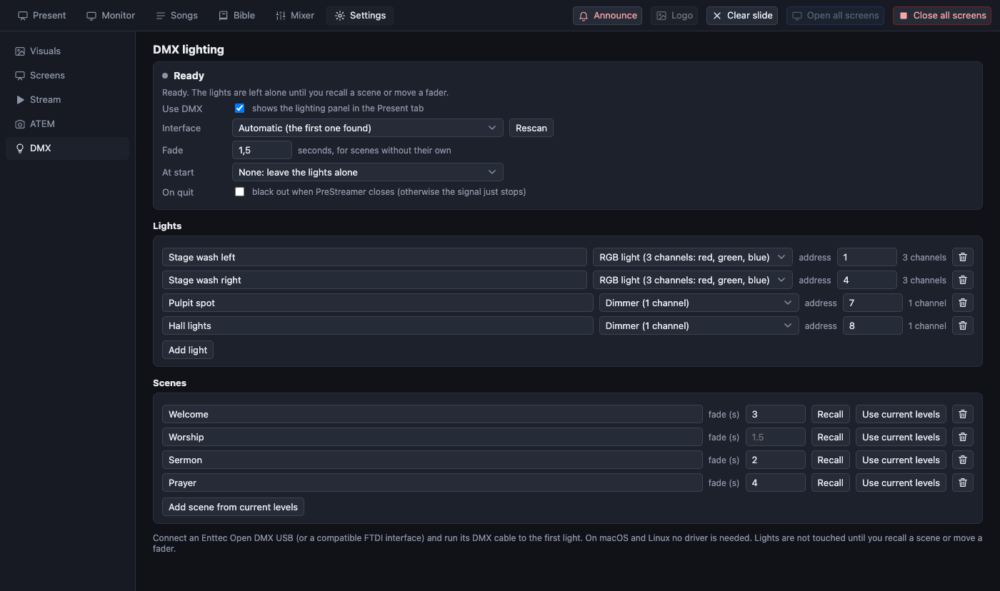
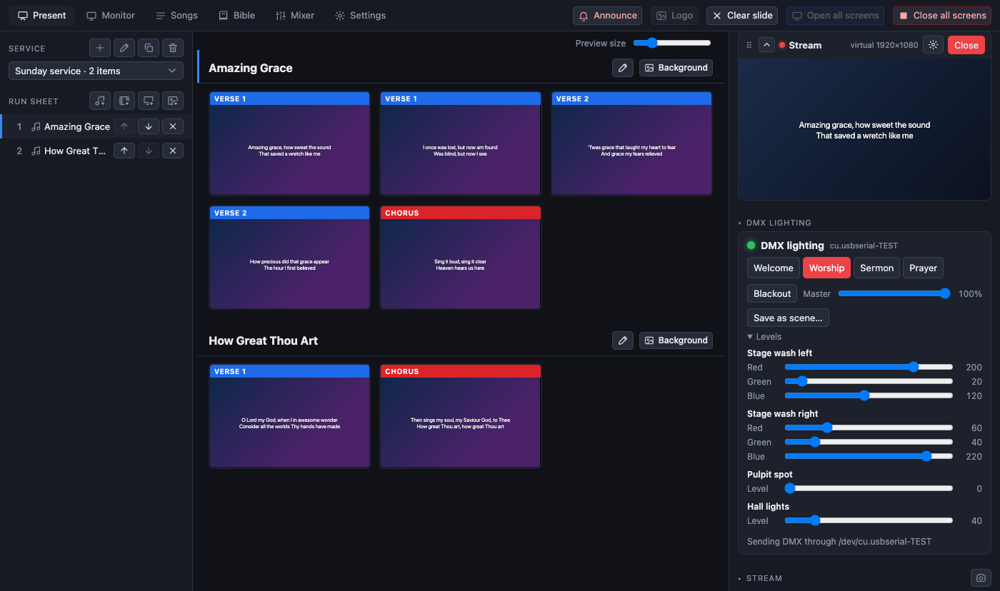

[← Guide home](index.md)

# DMX lighting

PreStreamer can control the room lights through a USB DMX interface: you describe your lights once, save a few **scenes** ("Welcome", "Worship", "Sermon", "Prayer"), and recall them with one click from the Present tab while the service runs. Scenes fade into each other, and there is a **Blackout** button and a **Master** fader.

It is built for the **Enttec Open DMX USB** (and the many compatible FTDI-based copies). That interface has no electronics of its own that make the DMX signal, so PreStreamer makes it itself, through a small helper program (`dmxsend`) that keeps sending the current levels about 30 times a second.

> **Status.** The software side is tested (unit tests, and an end-to-end test in which the real helper writes to a file). It has **not yet been run against a real Open DMX interface and real lights.** The signal timing is made by the computer, so how steady it is can depend on the machine. Try it with a spare light before the first service. It works on **macOS and Linux**; Windows needs FTDI's own driver library and is not supported yet.

## What you need

- An Enttec Open DMX USB (or compatible) and a DMX cable to the first light; lights are chained from one to the next, and the last one gets a terminator plug.
- Each light's **DMX address** set on the light itself (on its display or dip switches). Write the addresses down: you enter the same ones in PreStreamer.
- macOS or Linux. On macOS no driver is needed. On Linux your user must be allowed to open serial ports: add yourself to the `dialout` group (`sudo usermod -aG dialout $USER`) and log in again.

## 1. Connect and switch it on

Plug in the interface, then open **Settings → DMX**.

1. Tick **Use DMX**. This shows the lighting panel in the Present tab. Nothing is sent to the lights yet.
2. **Interface**: leave it on *Automatic*, which picks the first USB serial adapter found (`/dev/cu.usbserial-…` on macOS, `/dev/ttyUSB0` on Linux). If you have several, or none is listed, plug it in and press **Rescan**, then choose it from the list.
3. **Fade**: how many seconds a scene takes to arrive (1.5 by default). Each scene can have its own.
4. **At start**: a scene that is recalled when PreStreamer starts. The default, *None*, leaves the lights exactly as they are until you do something: opening the app never changes the room.
5. **On quit**: tick *black out* to send darkness when PreStreamer closes. Otherwise the signal just stops, and what the lights do then depends on the light (many keep their last level, some go dark).

## 2. Add your lights (the patch)

Under **Lights**, press **Add light** for each light or group of lights that share an address, and fill in:

| Field | What to enter |
| --- | --- |
| Name | What you call it: "Stage wash left", "Pulpit spot" |
| Kind | **Dimmer** (1 channel), **RGB** (3: red, green, blue), **RGBW** (4: plus white), or **Other** (you choose how many channels; each gets its own fader) |
| Address | The first DMX address set on the light (1–512) |

A new light gets the first free address. If two lights use the same channel, or one runs past channel 512, a warning appears under the list. Check the channel order of your RGB lights in their manual; PreStreamer assumes red, green, blue (and white last). A light with another layout can be added as *Other* instead.

## 3. Make scenes

1. Go to the **Present** tab. The **DMX lighting** section is in the right-hand column (click its title to fold it away). Open **Levels**: every light has a fader per channel.
2. Set the lights the way you want them.
3. Press **Save as scene…** and give it a name. It appears as a button.

Back in **Settings → DMX → Scenes** you can rename a scene, give it its own **fade** (leave it empty for the default, `0` for an instant change), press **Use current levels** to replace a scene with what is set now, and delete it.

## 4. Use it during the service

- Click a scene button to fade to it. The button of the scene that is on is highlighted.
- Moving a fader changes that channel at once; the scene highlight goes away, because the lights no longer match a saved scene.
- **Master** scales every light, for dimming the whole room. **Blackout** turns everything off at once and keeps the levels, so pressing it again brings the lights back.
- The small green dot and the interface name show that the signal is going out. A red dot and a message say what is wrong.

## Troubleshooting

| What you see | What to do |
| --- | --- |
| *No DMX interface found* | Plug in the USB cable and press **Rescan** in Settings → DMX. On macOS check that `/dev/cu.usbserial-…` appears (`ls /dev/cu.*`). |
| *cannot open the interface* (Linux) | Add your user to the `dialout` group and log in again. |
| *the driver does not accept 250000 baud*, or *does not support a break* | The adapter or its driver cannot make a DMX signal. Use an Enttec Open DMX USB or an adapter with the same FTDI chip. |
| *The DMX sender is missing from this build* | The build did not compile `src/native/dmxsend.c` (it needs `cc`). On Windows it is not built. |
| The panel is not there | Tick **Use DMX** in Settings → DMX. |
| Lights flicker | A cheap interface depends on the computer's timing. Close heavy programs, avoid long unterminated cable runs, and put the terminator plug on the last light. |
| A light does nothing | Check its address and mode on the light itself against the address in PreStreamer, and that it is in DMX mode (not sound or auto). |

If the interface is unplugged while lights are on, PreStreamer tries to reconnect by itself every few seconds.

## For developers

- Model and everything pure: `src/shared/dmx.ts` (tests: `tests/dmx.test.ts`). Controller (fades, output, retries): `src/main/dmx.ts`; it reaches the hardware through a small interface, and `src/main/dmx-helper.ts` is the real one (a `dmxsend` child process). The helper is `src/native/dmxsend.c`, built by `build.mjs` on macOS and Linux.
- Helper: `dmxsend <device> [raw]`. It reads 512-byte universes on stdin and answers `READY` or `ERROR …` on stderr. With `raw` the "device" is an ordinary file that always holds the newest frame (start code + 512 slots), which is how the tests run it.
- Settings are saved in `dmx.json` in the app's data folder. `PRESTREAMER_DMX_FAKE=<file>` runs the output into a file; without it, tests never open a real interface.
- End to end: `npm run e2e:dmx`. Pictures: `node scripts/screenshots.mjs dmx-present dmx-settings`.
- Not built yet: lighting cues linked to the run sheet (a scene per song or reading), chases and effects, more than one universe, Art-Net/sACN over Ethernet, Windows.
