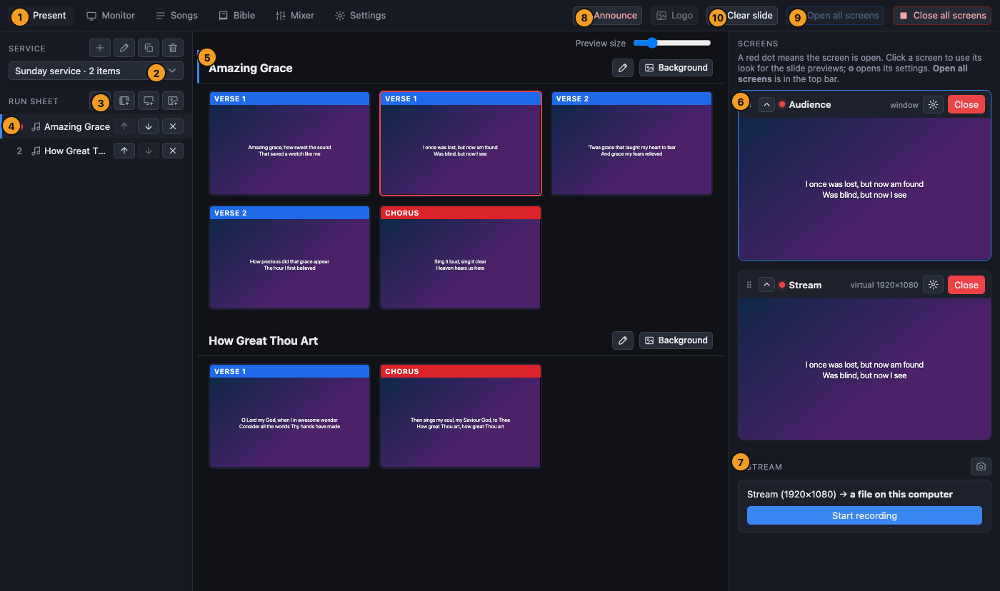

[← Guide home](index.md)

# Getting started

## Install

Download the installer for your computer from the [Releases page](https://github.com/AC-Dubnica/prestreamer/releases):

| Computer | File | First start |
| --- | --- | --- |
| Mac (Apple silicon: M1 and newer) | `…-mac-arm64.dmg` | Open it and drag **PreStreamer** to *Applications*. The first time, **right-click** the app and choose **Open** (the app is not signed yet). |
| Mac (Intel) | `…-mac-x64.dmg` | The same. |
| Windows | `…-win-x64` installer | Windows SmartScreen warns about an unknown publisher: choose **More info**, then **Run anyway**. |
| Linux | `.deb` or `.AppImage` | The AppImage needs FUSE 2 (`libfuse2` / `libfuse2t64`). |

If the Mac says the app is damaged, open Terminal and run `xattr -cr /Applications/PreStreamer.app`. On a computer managed by an organisation the warning can block the program completely; ask whoever manages it.

macOS asks for permission to use the **camera** and **microphone** when you first use a camera or a sound interface: allow it.

## First start

1. Start PreStreamer. A sample service and two sample songs are there so you can try things.
2. In the top bar press **Open all screens**. The room screens open (on the monitors you set up) and the stream screen opens too, but nothing is broadcast yet.
3. In the **Present** tab, click a slide. It appears on every open screen.

If you used the program *Quelea* on this computer, PreStreamer imports the Bible translations it finds there the first time it starts. (It only reads those files.)

## Language

PreStreamer speaks **English** and **Slovak** (*Slovenčina*). It starts in the language of the computer and uses English when it has no translation for that language.

To change it, open **Settings → Language** and choose *Automatic*, *English* or *Slovenčina*. The window reloads at once. Screens that are already open keep their old language until you close and open them again. Songs, Bible texts and the names you typed yourself are never translated.

## A tour of the window

| | |
| --- | --- |
| **1. The tabs** | **Present** (running the service), **Monitor** (watching all the screens, large), **Songs**, **Bible**, **Mixer** (sound for the stream) and **Settings**. |
| **2. Service** | The service that is open. The buttons beside it make a new one, rename, duplicate or delete the current one. |
| **3. Add to the run sheet** | Four buttons: a **song**, a **video**, a **presentation** (PowerPoint or PDF) and **pictures**. Bible readings are added from the Bible tab. |
| **4. Run sheet** | The order of the service. Click an item to jump to it. The arrows move it and ✕ removes it. A red dot marks what is on the screens now. |
| **5. Slides** | Every slide of the service, one after the other. **Click a slide to put it on the screens.** The preview size slider is above. |
| **6. Screens** | One card per screen with a live preview, a red dot when it is open, **Open / Close**, and a ⚙ button for how it looks. |
| **7. Stream** | Starts and stops the broadcast or the recording. |
| **8. Announce** | A live message over the screens (key **A**). |
| **9. Open all screens** | Opens every closed screen. **Close all screens** (next to it) closes them all and asks first. |
| **10. Clear slide** | Takes the slide off every screen. The screens stay open (key **Esc**). |

The **Logo** button next to Announce puts your logo on every screen (key **L**).

## Words used in this guide

- **Service**: a saved order of items for one gathering. You can keep many and duplicate last week's.
- **Run sheet**: the list of items in the service.
- **Item**: a song, Bible reading, video, presentation or set of pictures.
- **Slide**: what is on the screens at one moment: a few lines of a song, a verse, one picture of a presentation.
- **Screen**: an output with its own look. A screen shows on a monitor or projector in the room, or is **virtual** (drawn inside the program, for the stream).
- **Stream screen**: the virtual screen that is what viewers at home see.
- **Look**: a screen's background, font, colours and text layout.

Next: [Sunday checklist](sunday.md) or [the service and the run sheet](service.md).
