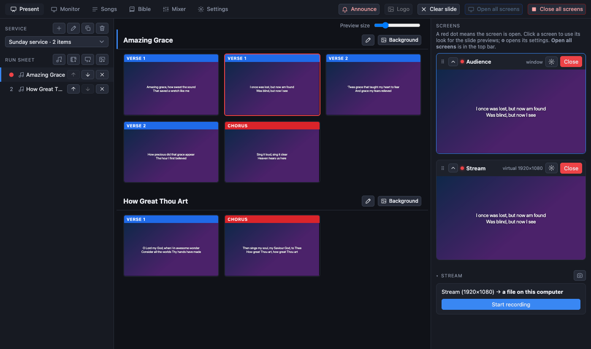

# PreStreamer guide

*Slovensky: [Príručka k PreStreameru](sk/index.md).*

PreStreamer runs a church service from one window: the songs, Bible readings, videos and presentations on the screens in the room, the live stream to YouTube, the sound mixer for the stream, the camera switcher and the stage lights.

This guide is for the people who run it on Sunday. Each chapter is one job, written as steps you can follow with the app open. Start with **Getting started**, print the **Sunday checklist**, and come back to a chapter when you need it.

## Chapters

| | |
| --- | --- |
| [Getting started](getting-started.md) | Install, first start, and a tour of the window |
| [Sunday checklist](sunday.md) | Before the service, during it, after it, and what to do when something goes wrong |
| [The service and the run sheet](service.md) | Building the order of service |
| [Songs](songs.md) | Finding, writing, importing and changing songs and their backgrounds |
| [Bible readings](bible.md) | Putting a passage on the screens |
| [Videos, presentations, pictures and the logo](media.md) | Everything that is not a song or a verse |
| [Announcements](announcements.md) | A live message over the screens |
| [Screens](screens.md) | The room screens, the stage monitor, the stream screen, and how each one looks |
| [Streaming and recording](streaming.md) | Going live on YouTube, recording to a file, camera only, captions over the camera |
| [YouTube broadcasts](youtube.md) | Start, preview, go live and end a scheduled broadcast from the app |
| [Sound for the stream](sound.md) | The mixer, effects, and the three different sounds |
| [ATEM video switcher](atem.md) | Switching cameras from PreStreamer |
| [NDI screens](ndi.md) | A screen fed over the network |
| [DMX lighting](dmx.md) | Stage lights, scenes and a blackout button |
| [Keyboard shortcuts](shortcuts.md) | The keys worth learning |
| [Troubleshooting](troubleshooting.md) | The problems you are most likely to meet |

## Who needs which chapter

A service usually has a few people; one person may do several jobs.

| Job | Read |
| --- | --- |
| **Projection**: songs, verses and slides on the screens | [Getting started](getting-started.md), [service](service.md), [songs](songs.md), [Bible](bible.md), [media](media.md), [announcements](announcements.md), [shortcuts](shortcuts.md) |
| **Preparing the service** during the week | [service](service.md), [songs](songs.md), [media](media.md) |
| **Streaming**: starting and watching the broadcast | [streaming](streaming.md), [Sunday checklist](sunday.md), [troubleshooting](troubleshooting.md) |
| **Sound**: what the people at home hear | [sound](sound.md) |
| **Cameras** | [ATEM](atem.md), [streaming](streaming.md) (camera only, captions) |
| **Lights** | [DMX](dmx.md) |
| **Setting it all up once** (screens, displays, stream key) | [screens](screens.md), [streaming](streaming.md), [sound](sound.md) |

## Good to know first

- **Nothing happens by itself.** The app never starts a stream, never opens a full-screen output on your main display and never changes the lights without you doing it.
- **Everything you change is saved.** Songs, services, screens and the mixer are saved as you go (a song's editor has a *Save* button and says *Unsaved changes* until you press it).
- **It remembers how you left it**: the window, the tab, the service, and which screens were open come back at the next start.
- Parts of the program have been tested on a Mac only. Where this guide describes something that has not yet been tried with real equipment (a real YouTube stream, an ATEM, DMX lights, NDI displays, Windows and Linux), it says so.
