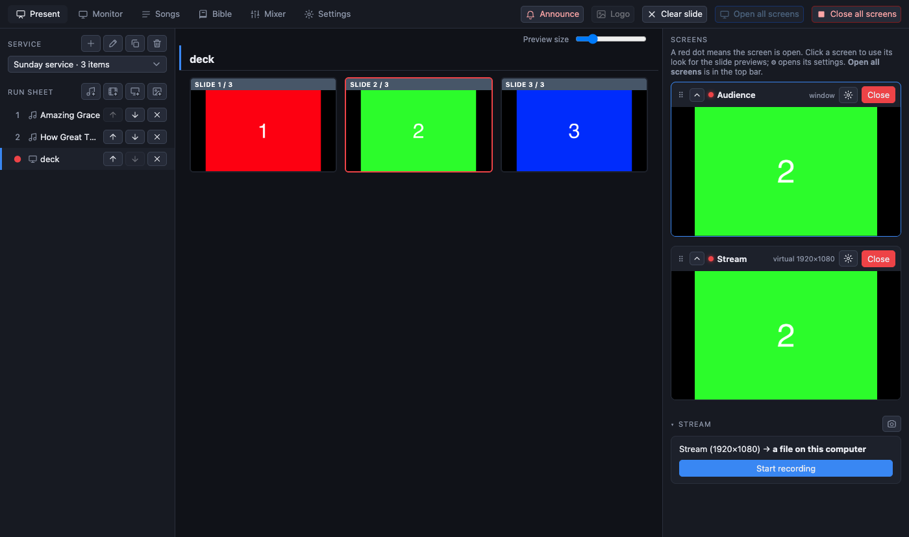
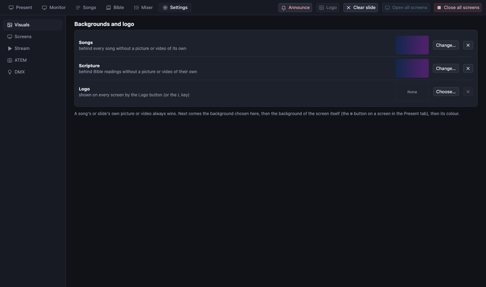

[← Guide home](index.md)

# Videos, presentations, pictures and the logo

## Videos

1. In the Present tab press the **film button** under *Run sheet* and choose the file. Most formats work (mp4, mov, mkv, webm and more).
2. A file the program cannot play directly (HEVC, ProRes, unusual containers) is **converted once** while it is imported. The status line under the run sheet shows the progress. Do this before the service; long videos take a while.
3. The video is now an item. Click it, then click its slide to cue it.
4. The **transport bar** has play, pause, **Stop** (stop and rewind) and a position slider. **Space** plays and pauses. Every screen stays on the same frame.

The **sound** of a video does not go through the stream's mixer by default; it plays in the room through the screen you chose for it, and reaches the stream through the mixer's *Video* inputs. See [sound](sound.md#three-sounds).

## Presentations and pictures

1. Press the **presentation button** (screen with a plus) and choose a file. Press the **pictures button** to choose several pictures at once.
2. Every page or slide becomes a picture, shown **whole, never cropped**, above the camera if one is used.
3. Click a slide, or use the arrow keys, as with any other item.

What can be imported:

| File | How |
| --- | --- |
| PowerPoint `.pptx`, `.ppsx` | Read by PreStreamer itself. PowerPoint is not needed and is never started. Very complex decks may look a little different: the slides are an approximation, so look at them before the service. |
| PDF | Every page is a slide. |
| Pictures (png, jpg, …) | Each picture is a slide. |
| Old `.ppt`, OpenDocument, Keynote (`.key`, Mac only) | Through LibreOffice, PowerPoint or Keynote if they are installed. **If anything looks wrong, export a PDF from the program you made the deck in and import that.** |

Imported slides are stored in the app; moving or deleting the original file later changes nothing.

## Backgrounds

A **background** is the picture, looping video or colour behind the words. The library of pictures and videos is shared by everything: import a file once, use it anywhere.

Where to set one (the most specific wins):

| Where | How |
| --- | --- |
| One slide of a song | The small picture button on the slide card |
| A whole song | *Background* beside the song's title in the Present tab, or *Picture or video…* in the song editor |
| **All songs** and **all Bible readings** | **Settings → Visuals** (below) |
| A whole screen | The ⚙ on the screen, *Picture or video…* |
| Colour | The colour swatches in those same places |

The order is: the slide's own, the song's own, the app-wide one from Settings → Visuals, the screen's own, and last the colour.

The picker shows the library. **Import picture…** and **Import video…** add to it, **No picture or video** clears it. A video background loops. Deleting a file from the library also removes it from every place that used it.

### App-wide backgrounds and the logo

**Settings → Visuals** has three rows:

- **Songs**: the background behind every song that has none of its own.
- **Scripture**: the same for Bible readings.
- **Logo**: the picture shown by the **Logo** button.

Use *Change…* to pick one, ✕ to remove it.

## The logo

Press **Logo** in the top bar, or the **L** key, to put the logo on every screen. Press it again to take it off. It is a picture slide, so a **camera-only stream does not carry it**.
