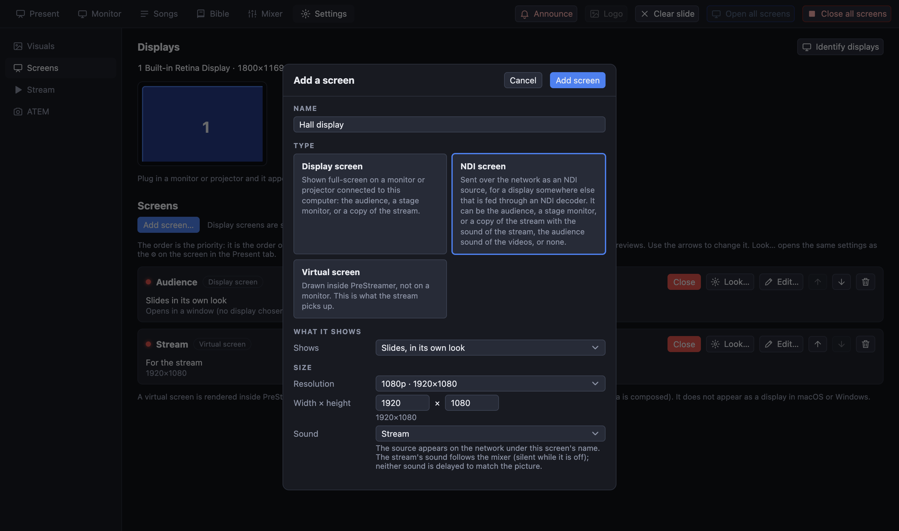

[← Guide home](index.md)

# NDI screens

An **NDI screen** is a screen that is sent over the **network** instead of to a monitor. Use it for a display that is not near the computer and is fed through an NDI decoder (a box, or a display with NDI built in).

> **Tested on a Mac through NDI's own library. Not yet tried with a real NDI display or decoder, and not available on Windows or Linux yet.**

## Set it up

1. **Settings → Screens → Add screen…**, kind **NDI screen**, give it a name ("Hall display") and a size (1080p is usual).
2. Choose *Shows*: its own slides, a **stage monitor**, or a **mirror** of another screen (for example the stream).
3. Choose its **sound**: the stream's sound (the mixer mix), the sound of the videos only, or none.
4. Press **Open** on its card (or *Open all screens*). It starts sending; the card shows the NDI name or what went wrong.
5. On the decoder or display, choose the source with that name.

## Things to know

- NDI needs a good **wired gigabit network**: about 100 Mbit/s or more per 1080p screen. Do not use wifi.
- Decoders that only support **NDI|HX** cannot receive it.
- The sound is not delayed to match the picture.
- NDI's own library is not part of the program. The installer includes it only if the people who built it added it; otherwise PreStreamer uses the *NDI Tools* or *NDI Runtime* installed on the computer, and says so on the card when there is none. Install **NDI Tools** from ndi.video if the card says the library is missing.
