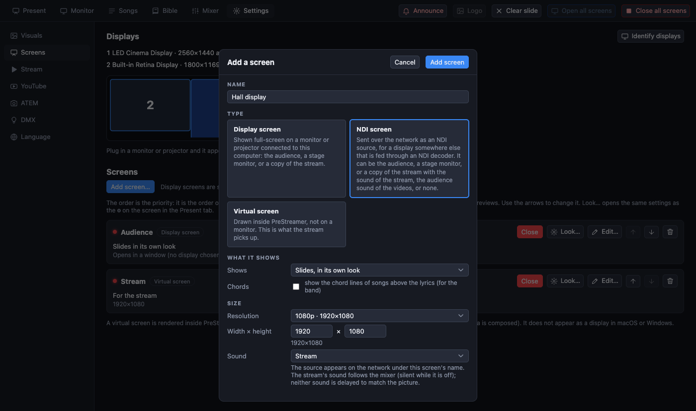
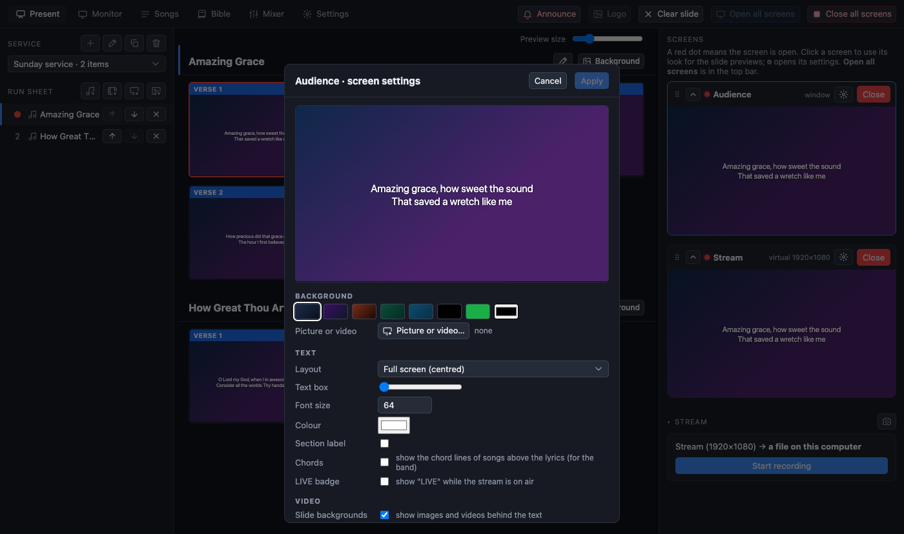
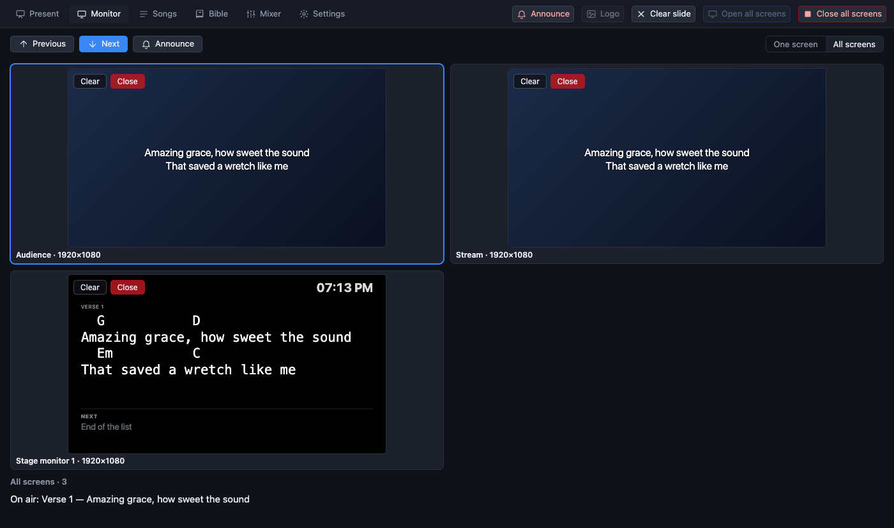
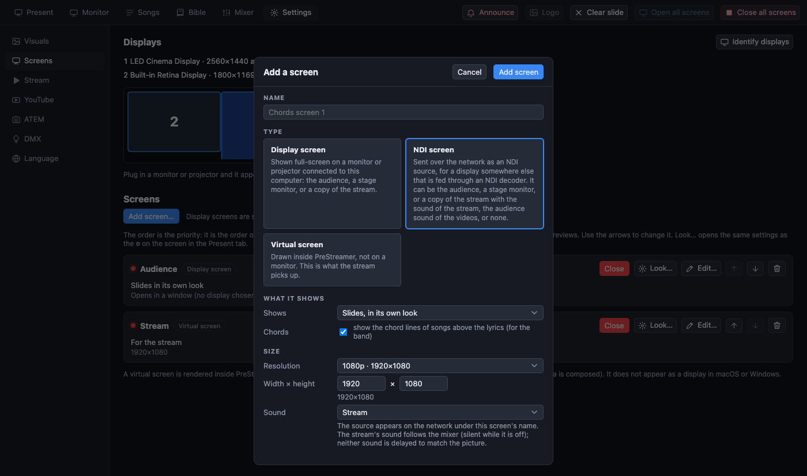
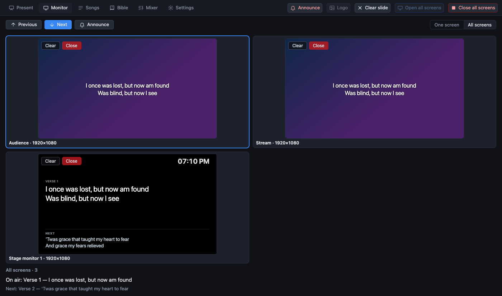
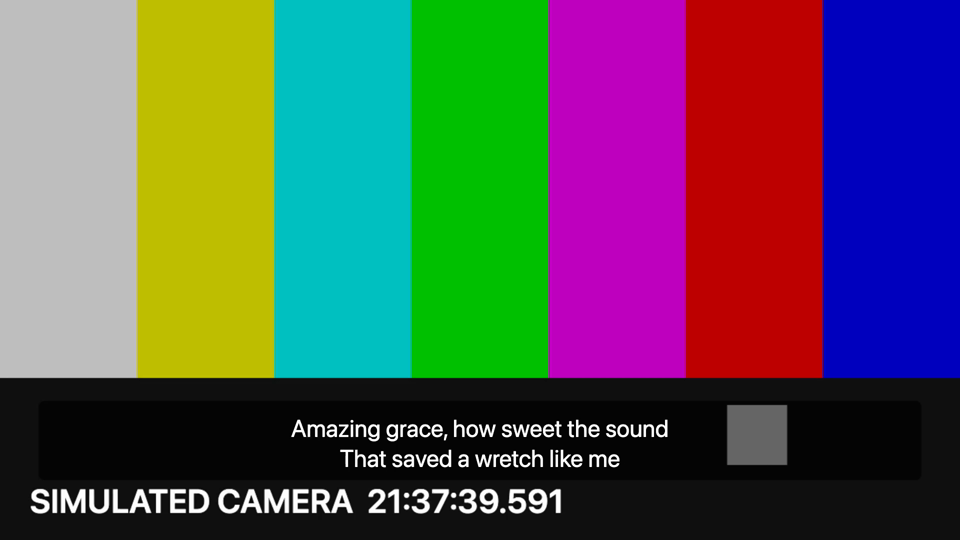

[← Guide home](index.md)

# Screens

A **screen** is an output with its own look. It is not the same thing as a monitor: you decide what each screen shows, and then attach it to a monitor or let it live inside the program.

| Kind | What it is |
| --- | --- |
| **Display screen** | Shown full screen on a monitor or projector you choose. Until you choose one it opens as a window. |
| **Virtual screen** | Drawn inside PreStreamer at a size you choose (1080p, 720p, 4K, vertical or custom). It is **what the stream shows**, and where text over a camera is put together. It does not appear in the computer's display settings. |
| **NDI screen** | Sent over the network to a display that is not plugged into this computer: see [NDI screens](ndi.md). |

A new install has two screens: **Audience** (a display screen) and **Stream** (the virtual one).

## What a screen shows

A display screen has a **role**, chosen with *Shows*:

- **Its own slides**: the normal case, in its own look.
- **Stage monitor**: for the people on stage. Shows the current slide, the **next** slide and the clock.
- **Mirror of** another screen: shows exactly what that screen shows, in its look and size. For example a monitor in the sound booth that mirrors the stream.

## Add or change a screen

Open **Settings → Screens**. The connected monitors are on a map above the list (press **Identify displays** to see a number on each real monitor).

- **Add screen…** asks for a name, the kind (fixed once you add it) and, for a display screen, which monitor and what it shows.
- **Edit…** on a screen changes the same things. Changes wait for *Apply*.
- **Open / Close** on a card opens or closes that screen. **Open all screens** and **Close all screens** are in the top bar.
- The arrows set the **order**. The top screen's look is used for the slide previews. Drag a screen by its grip (⠿) in the Present tab to reorder it there too.
- **Remove** deletes a screen and its look (it asks first).

Be careful with the display your own operator window is on: if you attach a screen to it, the live screen **covers the controls**. The page warns you. The program never reopens a full-screen output on the main display by itself.

## How a screen looks

Press the **⚙** on a screen's card in the Present tab (or *Look…* in Settings).

- **Background**: a colour, or *Picture or video…*.
- **Layout**: *Full screen (centred)* for lyrics, or **Lower third** for captions over a camera, with a **Text box** slider for how solid the box behind the text is.
- **Font size**, **Colour**, **Section label** (show "Verse 1" on the slide), **LIVE badge** (show "LIVE" while the stream runs, so the room knows).
- **Slide backgrounds**: untick it to show colour only, ignoring pictures and videos behind the text.
- **Live source**: show a camera behind the text. Use **Detect cameras**.
- **Sound**: whether this screen plays the sound of videos and on which output (see [sound](sound.md#three-sounds)).

The preview in the window shows the result. **Apply** puts it on the screen; **Cancel** or **Esc** throws it away.

## Chords on a screen

Songs can carry chords (see [songs](songs.md#chords)). Which screens draw them is a setting of each screen:

- **Add a screen for the band:** *Settings → Screens → Add*, choose a display or NDI screen, tick **Chords**. It then shows each slide with its chords above the lyrics, in a fixed-width font so they stay lined up.
- **A stage monitor with chords:** open the stage monitor's settings (the pencil on its card) and tick **Chords**; untick it to hide them again. The *Next* slide follows the same choice.
- The room screens and the stream keep it off, so the congregation and the viewers never see chords.

A song without chord lines looks the same everywhere.

## Watching the screens: the Monitor tab

The **Monitor** tab shows the screens larger than the Present tab can.

- **One screen**: the selected screen as large as it fits, with the others to choose from on the right.
- **All screens**: every screen in a grid, like a camera wall. Click one to select it, double-click to see it large.
- Above the picture: previous and next slide, play and pause for video, **Announce**, and **Camera only** for the stream.
- Each screen has **Clear** (takes the slide off that one screen; it turns into **Show** to bring it back) and **Open / Close**.

## Text over the camera

For captions over a live camera on the stream:

1. Present tab → ⚙ on the **Stream** screen.
2. **Live source**: your camera. **Layout**: *Lower third*. **Text box**: around half.
3. Start the stream from that screen.

The text is put together with the camera in PreStreamer. It is not a separate key signal. If you would rather have an ATEM overlay the text, use a plain-colour background for chroma keying on a display screen connected to the ATEM.
