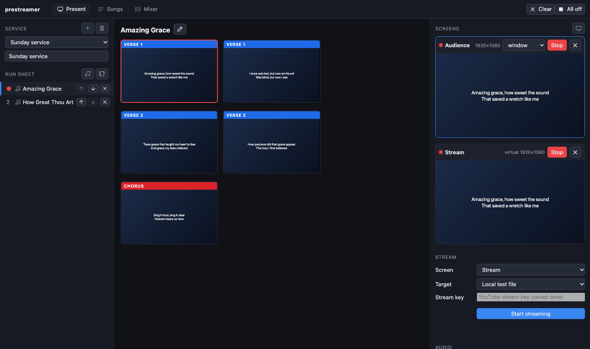

[← Guide home](index.md)

# The service and the run sheet

A **service** is the order of one gathering. The **run sheet** is its list of items, on the left of the Present tab.

## Make a service

1. In the **Service** box at the top left press **+** (*New service*) and give it a name, for example "Sunday 14 June".
2. Or start from last week: pick last week's service and press the **duplicate** button (*Duplicate this service*), then change what is different. The pencil renames, the bin deletes (it asks first).
3. Pick a service from the drop-down to open it. The one you open stays open next time.

## Add things to the run sheet

The four buttons under **Run sheet**:

| Button | Adds | More |
| --- | --- | --- |
| ♪ with a plus | A **song** from the library | [Songs](songs.md) |
| Film with a plus | A **video** | [Videos](media.md#videos) |
| Screen with a plus | A **presentation** (PowerPoint, PDF, Keynote) | [Presentations](media.md#presentations-and-pictures) |
| Picture with a plus | **Pictures**, each shown whole as a slide | [Pictures](media.md#presentations-and-pictures) |

**Bible readings** are added from the Bible tab with *Add to service*: see [Bible readings](bible.md). A song can also be added from the Songs tab, with the **+** beside it in the list or *Add to service* in its editor.

## Order the items

- Each row has **↑** and **↓** to move it and **✕** to remove it from the service. (Removing it from the service does not delete the song or the file.)
- A song in the run sheet only *points* at the song in the library. If you correct the song later, every service that uses it shows the correction.

## Move through the service

- All the slides of the whole service are in one long list in the middle. **Click a slide** to put it on the screens.
- **→**, **↓** or **Space** shows the next slide; **←** or **↑** the previous one. The keys go on from the last slide of one item into the first slide of the next.
- Click an item in the run sheet to jump to it. Its title stays at the top of the list.
- **Cmd + 1 … 9** (Ctrl + 1 … 9 on Windows and Linux) jump straight to the 1st … 9th item, from any tab.
- **Esc** takes the slide off every screen (the screens stay open).
- The **preview size** slider above the slides makes the previews smaller or bigger. Double-click it to go back to the usual size.

The side panels can be made wider or narrower by dragging their edge (double-click the edge to reset). The widths are remembered.

## Tips

- Add the items in the right order the first time; reordering is a click per step.
- Use one service per Sunday and keep the old ones: next month's "Communion Sunday" can be a duplicate.
- Put a **picture** or a **logo** slide at the start as the "welcome" screen, so the screens are not empty while people arrive.
