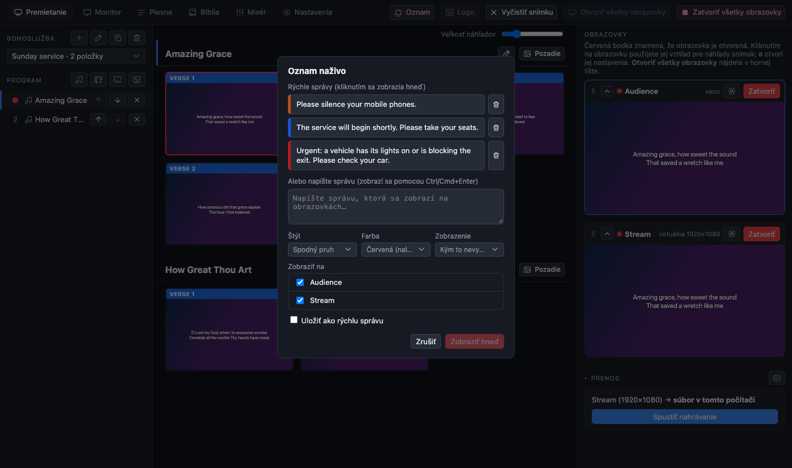
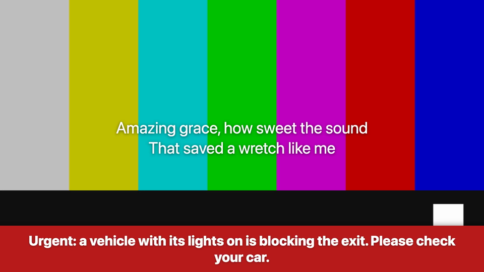

[← Domov](index.md) · [English](../announcements.md)

# Oznamy

Oznam je krátka správa zobrazená nad všetkým ostatným na obrazovkách, ktoré vyberiete, pre upozornenie, ktoré sa nedá odložiť: „Prosíme, stíšte si telefóny“, „Auto so zapnutými svetlami blokuje výjazd“. Snímky pod ním bežia ďalej.

## Zobrazenie oznamu

1. Stlačte **A** na klávesnici (na ktorejkoľvek karte) alebo tlačidlo **Oznam** v hornej lište.
2. Kliknutím na **rýchlu správu** ju zobrazíte hneď, alebo napíšte vlastnú do poľa a stlačte **Zobraziť hneď** (to isté urobí Ctrl/Cmd + Enter).
3. Pred zobrazením vyberte, ako bude vyzerať:
   - **Štýl**: *Spodný pruh*, *Horný pruh* alebo *Celá obrazovka* (správa vyplní obrazovku);
   - **Farba**: *Červená (naliehavé)*, oranžová pre upozornenie, modrá pre informáciu;
   - **Zobrazenie**: kým ho nevymažete, alebo na určený čas.
4. **Zobraziť na** uvádza obrazovky: zaškrtnite sálu, prenos, alebo oboje. Správu môžete zobraziť v sále a nechať ju mimo prenosu, alebo naopak.

Kým je oznam v živom vysielaní, tlačidlo Oznam sa zmení na **červené tlačidlo, ktoré ho vypne**.

## Rýchle správy

Pred zobrazením správy, ktorú budete používať opakovane, zaškrtnite **Uložiť ako rýchlu správu**. Zoznam sa uchová; kôš vedľa správy ju vymaže. Napíšte si tie, ktoré potrebujete počas týždňa, aby na to v nedeľu stačilo jedno kliknutie.

## Poznámky

- Oznam je súčasťou obrazu, takže ho vidia aj diváci prenosu (ak ste obrazovku prenosu nenechali vypnutú).
- Prenos v režime **Iba kamera** nezobrazuje žiadne oznamy.
