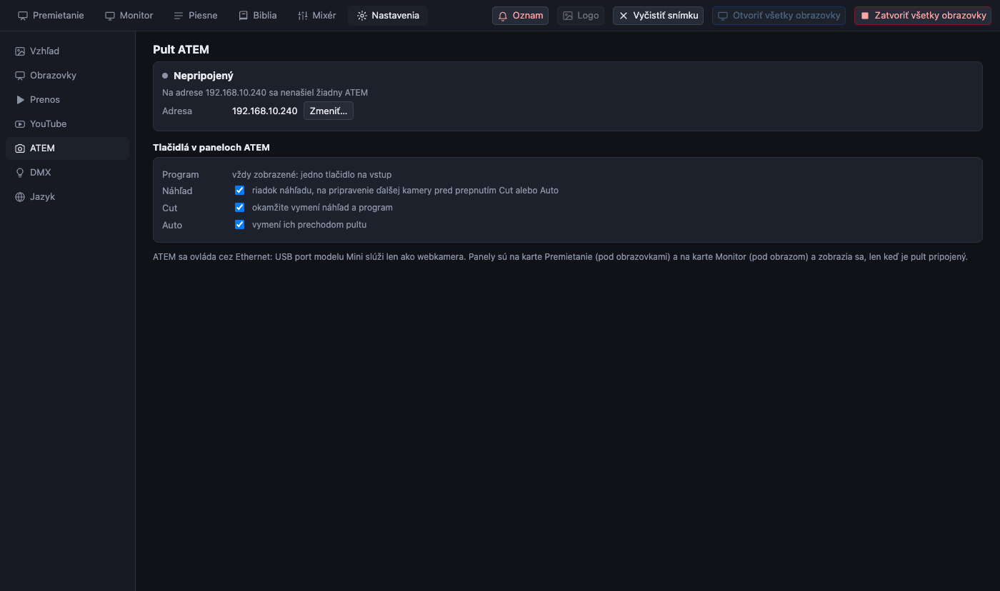

[← Domov](index.md) · [English](../atem.md)

# Video mixážny pult ATEM

PreStreamer vie prepínať kamery na pulte Blackmagic **ATEM** z kariet Premietanie a Monitor: jedno tlačidlo na každý vstup pre *program* (čo ide do vysielania) a *náhľad* (čo príde ďalej) a tlačidlá **Cut** a **Auto**.

> Vyskúšané so skutočným ATEM na macOS a v automatických testoch na simulovanom.

## Pripojenie

ATEM Mini pripojený cez **USB** vyzerá pre počítač ako webkamera: prenáša obraz, **nie ovládanie**. Ak ho chcete ovládať, pripojte ATEM do rovnakej siete aj cez **Ethernet** (kábel do rovnakého routera alebo switchu ako počítač).

1. Adresu IP pultu ATEM zistíte v *ATEM Software Control*. Nový ATEM odpovedá na `192.168.10.240`, čo PreStreamer skúša ako prvé.
2. Otvorte **Nastavenia → ATEM**, stlačte **Zmeniť…** a napíšte adresu. Zapamätá sa.
3. Uistite sa, že počítač a ATEM sú v rovnakom rozsahu siete (napríklad obaja `192.168.10.x`). Počítač na wifi v inej sieti sa k pultu nedostane.

Kým pult neodpovie, **nikde inde sa o ATEM nič nezobrazuje**; v Nastaveniach sa píše „Na adrese … sa nenašiel žiadny ATEM“ a hľadá sa ďalej každých pár sekúnd. Ak sa kábel odpojí, panely opäť zmiznú.

## Použitie

Keď pult odpovie, v karte Premietanie sa pod obrazovkami zobrazí panel **ATEM** (a v karte Monitor pod obrazom):

- Riadok **Program**: jedno tlačidlo na každý vstup, s názvom ako na pulte. **Červené** je práve vo vysielaní.
- Riadok **Náhľad**: **zelené** je to, čo príde ďalej.
- **Cut** okamžite vymení náhľad a program. **Auto** ich vymení vlastným prechodom pultu.
- Tlačidlá sledujú zmeny urobené priamo na pulte.

Ovláda sa prvý mix efekt (ME 1).

Bežný postup: kliknite na ďalšiu kameru v riadku **Náhľad** a vo vhodnej chvíli stlačte **Cut** alebo **Auto**.

## Výber tlačidiel na zobrazenie

V **Nastavenia → ATEM** môžete v časti *Tlačidlá v paneloch ATEM* skryť **Náhľad**, **Cut** alebo **Auto**. Kto potrebuje len prepnúť kameru, môže skryť všetko okrem riadku programu.

## Kamery a prenos

Výstup pultu ATEM (USB alebo HDMI do zachytávacieho zariadenia) je *Živý zdroj* za obrazovkou prenosu: pozrite [obrazovky](screens.md) a [text nad kamerou](screens.md).

Bezpečnosť: protokol ATEM nemá heslo. Používajte ho v sieti, ktorej dôverujete.
