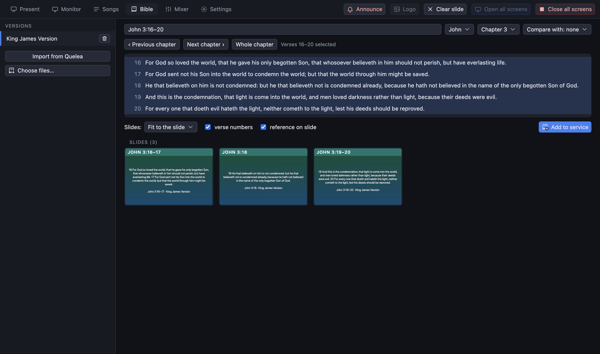

[← Domov](index.md) · [English](../bible.md)

# Čítania z Biblie

## Pred prvým čítaním

Karta **Biblia** potrebuje aspoň jeden preklad. Biblie sú súbory *Zefania XML*:

- Ak ste na tomto počítači používali Quelea, stlačte **Importovať z Quelea** (stane sa to aj samo pri prvom spustení aplikácie).
- Inak importujte súbory Zefania XML na tej istej karte.

Niektoré preklady (napríklad Roháček a Ekumenický) nemožno z licenčných dôvodov dodávať s programom; importujte si vlastnú kópiu.

## Nájdenie úryvku

- **Napíšte odkaz** do poľa a stlačte Enter: `Ján 3,16-20`, `Jn 3:16`, `1 Kor 13`. Program číta názvy kníh vybraného prekladu a bežné skratky.
- Alebo použite **výber**: vyberte knihu a kapitolu. Tlačidlá **‹ Predchádzajúca kapitola** a **Ďalšia kapitola ›** vás posúvajú Bibliou; **Celá kapitola** zobrazí všetky verše.
- **Kliknutím na verš** ho vyberiete, **Shift + kliknutím** výber rozšírite na rozsah.
- **Porovnať s** položí druhý preklad vedľa prvého, takže obrazovky zobrazia oba.

Ak program odkazu nerozumie, povie to a ukáže, čo očakával.

## Zobrazenie na obrazovkách

Úryvok sa rozdelí na snímky. **Kliknutím na snímku** ju zobrazíte na obrazovkách. Alebo stlačte **Pridať do bohoslužby**: čítanie sa stane položkou v programe (pomenovanou napríklad „Ján 3:16–20“) a potom sa správa ako pieseň: šípky prechádzajú jeho snímkami.

Čítania pridajte *pred* bohoslužbou, aby boli v programe na správnom mieste.

## Vzhľad

Čítania používajú pozadie **Písmo** zvolené v Nastavenia → Vzhľad, ak nejaké je; alebo vlastný obrázok, ktorý nastavíte rovnako ako pri piesni (tlačidlo *Pozadie* vedľa názvu čítania). Pozrite [médiá](media.md#pozadia).
