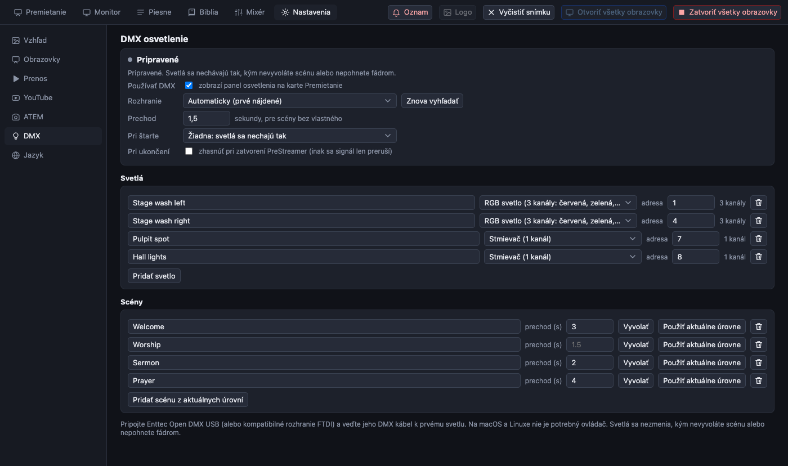
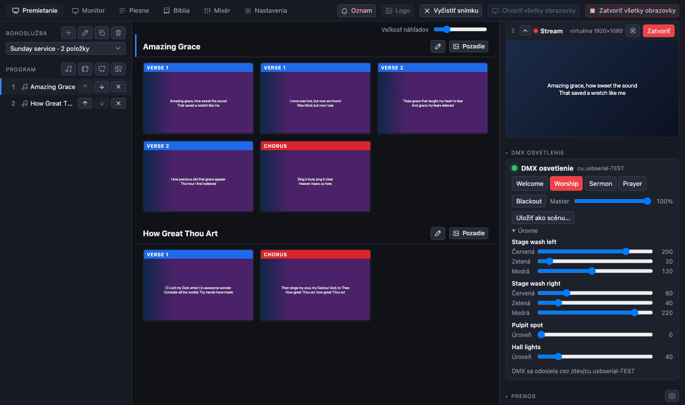

[← Domov](index.md) · [English](../dmx.md)

# DMX osvetlenie

PreStreamer vie ovládať svetlá v sále cez USB rozhranie DMX: svetlá popíšete raz, uložíte si niekoľko **scén** („Privítanie“, „Chvály“, „Kázeň“, „Modlitba“) a počas bohoslužby ich vyvoláte jedným kliknutím v karte Premietanie. Scény do seba plynulo prechádzajú a k dispozícii je tlačidlo **Blackout** a fáder **Master**.

Je vytvorený pre **Enttec Open DMX USB** (a mnohé kompatibilné kópie s čipom FTDI). Toto rozhranie nemá vlastnú elektroniku, ktorá by vytvárala signál DMX, takže ho PreStreamer vytvára sám cez malý pomocný program (`dmxsend`), ktorý stále posiela aktuálne úrovne asi 30-krát za sekundu.

> **Stav.** Softvérová časť je otestovaná (jednotkové testy a test od začiatku do konca, pri ktorom skutočný pomocný program zapisuje do súboru). **Zatiaľ nebola vyskúšaná so skutočným rozhraním Open DMX a skutočnými svetlami.** Časovanie signálu vytvára počítač, takže jeho stabilita môže závisieť od stroja. Pred prvou bohoslužbou ho vyskúšajte s náhradným svetlom. Funguje na **macOS a Linuxe**; Windows potrebuje vlastnú ovládaciu knižnicu FTDI a zatiaľ nie je podporovaný.

## Čo budete potrebovať

- Enttec Open DMX USB (alebo kompatibilné) a kábel DMX k prvému svetlu; svetlá sa zapájajú jedno za druhým a posledné dostane koncovú zátku (terminátor).
- **Adresu DMX** každého svetla nastavenú na samotnom svetle (na jeho displeji alebo prepínačoch dip). Adresy si zapíšte: rovnaké zadáte do PreStreamer.
- macOS alebo Linux. Na macOS nie je potrebný žiadny ovládač. Na Linuxe musí mať váš používateľ povolené otvárať sériové porty: pridajte sa do skupiny `dialout` (`sudo usermod -aG dialout $USER`) a znova sa prihláste.

## 1. Pripojte a zapnite

Pripojte rozhranie a potom otvorte **Nastavenia → DMX**.

1. Zaškrtnite **Používať DMX**. Zobrazí sa panel osvetlenia v karte Premietanie. Svetlám sa zatiaľ nič neposiela.
2. **Rozhranie**: nechajte *Automaticky*, čo vyberie prvý nájdený sériový USB adaptér (`/dev/cu.usbserial-…` na macOS, `/dev/ttyUSB0` na Linuxe). Ak ich máte viac alebo žiadny nie je v zozname, pripojte ho, stlačte **Znova vyhľadať** a vyberte ho zo zoznamu.
3. **Prechod**: za koľko sekúnd scéna nabehne (predvolene 1,5). Každá scéna môže mať vlastný.
4. **Pri štarte**: scéna, ktorá sa vyvolá pri štarte PreStreamer. Predvolená možnosť, *Žiadna*, nechá svetlá presne tak, ako sú, kým niečo neurobíte: otvorenie aplikácie nikdy nezmení sálu.
5. **Pri ukončení**: zaškrtnite *zhasnúť*, aby sa pri zatvorení PreStreamer poslala tma. Inak sa signál len preruší a čo svetlá urobia, závisí od svetla (mnohé si ponechajú poslednú úroveň, niektoré zhasnú).

## 2. Pridajte svetlá (patch)

V časti **Svetlá** stlačte **Pridať svetlo** pre každé svetlo alebo skupinu svetiel so spoločnou adresou a vyplňte:

| Pole | Čo zadať |
| --- | --- |
| Názov | Ako ho nazývate: „Pódium vľavo“, „Bodové svetlo na kazateľnicu“ |
| Druh | **Stmievač** (1 kanál), **RGB** (3: červená, zelená, modrá), **RGBW** (4: plus biela) alebo **Iné** (počet kanálov si zvolíte; každý dostane vlastný fáder) |
| Adresa | Prvá adresa DMX nastavená na svetle (1–512) |

Nové svetlo dostane prvú voľnú adresu. Ak dve svetlá používajú ten istý kanál alebo jedno presiahne kanál 512, pod zoznamom sa zobrazí varovanie. Poradie kanálov svojich svetiel RGB skontrolujte v ich návode; PreStreamer predpokladá červenú, zelenú, modrú (a bielu nakoniec). Svetlo s iným usporiadaním môžete pridať ako *Iné*.

## 3. Vytvorte scény

1. Prejdite na kartu **Premietanie**. Sekcia **DMX osvetlenie** je v pravom stĺpci (kliknutím na jej názov ju zbalíte). Otvorte **Úrovne**: každé svetlo má fáder pre každý kanál.
2. Nastavte svetlá tak, ako ich chcete.
3. Stlačte **Uložiť ako scénu…** a zadajte názov. Zobrazí sa ako tlačidlo.

V **Nastavenia → DMX → Scény** môžete scénu premenovať, dať jej vlastný **prechod** (nechajte prázdne pre predvolený, `0` pre okamžitú zmenu), stlačením **Použiť aktuálne úrovne** nahradiť scénu tým, čo je nastavené teraz, a scénu odstrániť.

## 4. Použitie počas bohoslužby

- Kliknutím na tlačidlo scény na ňu plynulo prejdete. Tlačidlo scény, ktorá práve svieti, je zvýraznené.
- Pohnutím fádra sa daný kanál zmení okamžite; zvýraznenie scény zmizne, pretože svetlá už nezodpovedajú uloženej scéne.
- **Master** škáluje každé svetlo, na stmievanie celej sály. **Blackout** naraz všetko vypne a zachová úrovne, takže ďalším stlačením sa svetlá vrátia.
- Malá zelená bodka a názov rozhrania ukazujú, že signál odchádza. Červená bodka a hlásenie povedia, čo je zle.

## Riešenie problémov

| Čo vidíte | Čo robiť |
| --- | --- |
| *Nenašlo sa žiadne rozhranie DMX* | Zapojte USB kábel a v Nastavenia → DMX stlačte **Znova vyhľadať**. Na macOS skontrolujte, či sa zobrazuje `/dev/cu.usbserial-…` (`ls /dev/cu.*`). |
| *cannot open the interface* (Linux) | Pridajte svojho používateľa do skupiny `dialout` a znova sa prihláste. |
| *the driver does not accept 250000 baud* alebo *does not support a break* | Adaptér alebo jeho ovládač nevie vytvoriť signál DMX. Použite Enttec Open DMX USB alebo adaptér s rovnakým čipom FTDI. |
| *The DMX sender is missing from this build* | Pri zostavení sa nepreložil `src/native/dmxsend.c` (potrebuje `cc`). Na Windows sa nezostavuje. |
| Panel sa nezobrazuje | Zaškrtnite **Používať DMX** v Nastavenia → DMX. |
| Svetlá blikajú | Lacné rozhranie závisí od časovania počítača. Zatvorte náročné programy, vyhnite sa dlhým káblom bez zakončenia a koncovú zátku dajte na posledné svetlo. |
| Svetlo nič nerobí | Skontrolujte jeho adresu a režim na samotnom svetle voči adrese v PreStreamer a či je v režime DMX (nie zvukovom alebo automatickom). |

Ak sa rozhranie odpojí, kým svetlá svietia, PreStreamer sa pokúša pripojiť znova sám každých pár sekúnd.

## Pre vývojárov

Poznámky pre vývojárov nájdete len v anglickej verzii: [English](../dmx.md).
