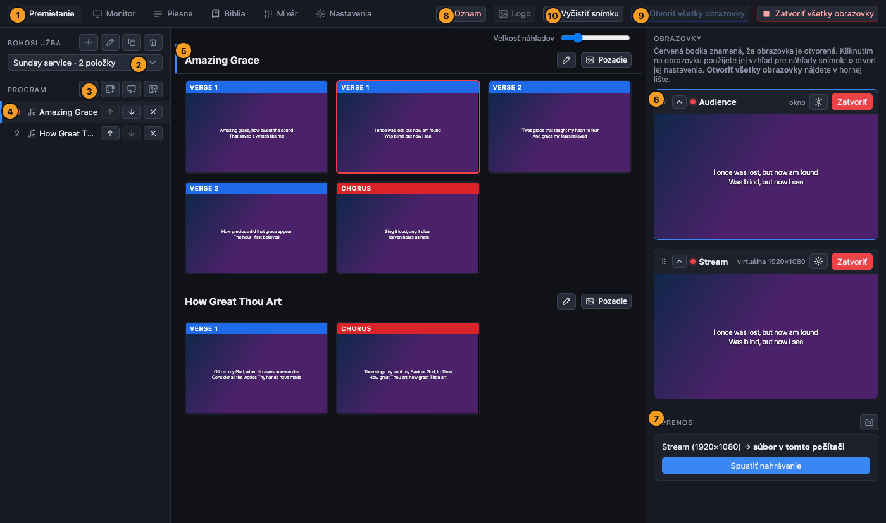

[← Domov](index.md) · [English](../getting-started.md)

# Prvé kroky

## Inštalácia

Stiahnite si inštalátor pre svoj počítač zo [stránky Releases](https://github.com/AC-Dubnica/prestreamer/releases):

| Počítač | Súbor | Prvé spustenie |
| --- | --- | --- |
| Mac (Apple silicon: M1 a novší) | `…-mac-arm64.dmg` | Otvorte ho a presuňte **PreStreamer** do *Aplikácií*. Prvýkrát na aplikáciu **kliknite pravým tlačidlom** a zvoľte **Otvoriť** (aplikácia zatiaľ nie je podpísaná). |
| Mac (Intel) | `…-mac-x64.dmg` | Rovnako. |
| Windows | inštalátor `…-win-x64` | Windows SmartScreen upozorní na neznámeho vydavateľa: zvoľte **Ďalšie informácie** a potom **Spustiť aj tak**. |
| Linux | `.deb` alebo `.AppImage` | AppImage potrebuje FUSE 2 (`libfuse2` / `libfuse2t64`). |

Ak Mac hlási, že aplikácia je poškodená, otvorte Terminál a spustite `xattr -cr /Applications/PreStreamer.app`. Na počítači spravovanom organizáciou môže upozornenie program úplne zablokovať; opýtajte sa toho, kto počítač spravuje.

macOS pri prvom použití kamery alebo zvukového rozhrania požiada o povolenie na používanie **kamery** a **mikrofónu**: povoľte ho.

## Prvé spustenie

1. Spustite PreStreamer. Nájdete v ňom ukážkovú bohoslužbu a dve ukážkové piesne, aby ste si veci mohli vyskúšať.
2. V hornej lište stlačte **Otvoriť všetky obrazovky**. Otvoria sa obrazovky v sále (na monitoroch, ktoré ste nastavili) a otvorí sa aj obrazovka prenosu, ale zatiaľ sa nič nevysiela.
3. Na karte **Premietanie** kliknite na snímku. Zobrazí sa na každej otvorenej obrazovke.

Ak ste na tomto počítači používali program *Quelea*, PreStreamer pri prvom spustení importuje preklady Biblie, ktoré tam nájde. (Tie súbory len číta.)

## Jazyk

PreStreamer hovorí po **anglicky** a **slovensky** (*Slovenčina*). Spustí sa v jazyku počítača, a ak pre tento jazyk nemá preklad, použije angličtinu.

Zmeníte ho v **Nastavenia → Jazyk**, kde zvolíte *Automaticky*, *English* alebo *Slovenčina*. Okno sa hneď znova načíta. Obrazovky, ktoré sú už otvorené, si ponechajú pôvodný jazyk, kým ich nezatvoríte a znova neotvoríte. Piesne, texty Biblie a názvy, ktoré ste napísali sami, sa nikdy neprekladajú.

## Prehliadka okna

| | |
| --- | --- |
| **1. Karty** | **Premietanie** (vedenie bohoslužby), **Monitor** (sledovanie všetkých obrazoviek veľké), **Piesne**, **Biblia**, **Mixér** (zvuk pre prenos) a **Nastavenia**. |
| **2. Bohoslužba** | Otvorená bohoslužba. Tlačidlá vedľa nej vytvoria novú, premenujú, duplikujú alebo vymažú aktuálnu. |
| **3. Pridanie do programu** | Štyri tlačidlá: **pieseň**, **video**, **prezentácia** (PowerPoint alebo PDF) a **obrázky**. Čítania z Biblie sa pridávajú z karty Biblia. |
| **4. Program** | Poriadok bohoslužby. Kliknutím na položku na ňu skočíte. Šípky ju presúvajú a ✕ ju odstráni. Červená bodka označuje, čo je práve na obrazovkách. |
| **5. Snímky** | Všetky snímky bohoslužby za sebou. **Kliknutím na snímku ju dáte na obrazovky.** Posuvník veľkosti náhľadov je nad nimi. |
| **6. Obrazovky** | Jedna karta pre každú obrazovku so živým náhľadom, červenou bodkou, keď je otvorená, tlačidlom **Otvoriť / Zatvoriť** a tlačidlom ⚙ pre jej vzhľad. |
| **7. Prenos** | Spúšťa a zastavuje vysielanie alebo nahrávanie. |
| **8. Oznam** | Živá správa cez obrazovky (kláves **A**). |
| **9. Otvoriť všetky obrazovky** | Otvorí každú zatvorenú obrazovku. **Zatvoriť všetky obrazovky** (vedľa) zatvorí všetky a najprv sa opýta. |
| **10. Vyčistiť snímku** | Odstráni snímku zo všetkých obrazoviek. Obrazovky zostanú otvorené (kláves **Esc**). |

Tlačidlo **Logo** vedľa tlačidla Oznam dá vaše logo na každú obrazovku (kláves **L**).

## Slová použité v tejto príručke

- **Bohoslužba**: uložený poriadok položiek pre jedno stretnutie. Môžete mať ich veľa a duplikovať tú z minulého týždňa.
- **Program**: zoznam položiek v bohoslužbe.
- **Položka**: pieseň, čítanie z Biblie, video, prezentácia alebo sada obrázkov.
- **Snímka**: to, čo je na obrazovkách v jednom okamihu: pár riadkov piesne, verš, jeden obrázok prezentácie.
- **Obrazovka**: výstup s vlastným vzhľadom. Obrazovka sa zobrazuje na monitore alebo projektore v sále, alebo je **virtuálna** (kreslí sa vo vnútri programu, pre prenos).
- **Obrazovka prenosu**: virtuálna obrazovka, ktorú vidia diváci doma.
- **Vzhľad**: pozadie, písmo, farby a rozloženie textu obrazovky.

Ďalej: [Nedeľný zoznam úloh](sunday.md) alebo [bohoslužba a program](service.md).
