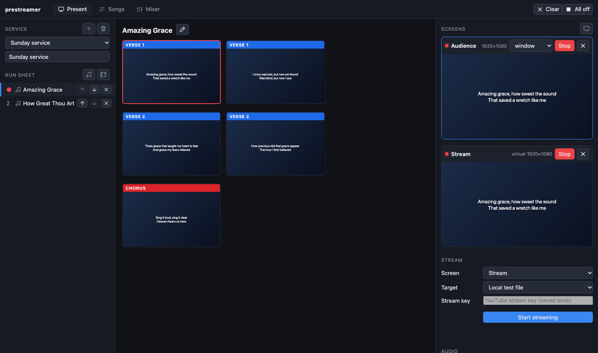

# Príručka k PreStreameru

*English: [PreStreamer guide](../index.md).*

PreStreamer vedie bohoslužbu z jedného okna: piesne, čítania z Biblie, videá a prezentácie na obrazovkách v sále, živý prenos na YouTube, zvukový mixér pre prenos, prepínač kamier a javiskové osvetlenie.

Táto príručka je pre ľudí, ktorí ho v nedeľu obsluhujú. Každá kapitola je jedna úloha, napísaná ako kroky, ktoré môžete sledovať pri otvorenej aplikácii. Začnite kapitolou **Prvé kroky**, vytlačte si **Nedeľný zoznam úloh** a ku kapitole sa vráťte, keď ju budete potrebovať.

## Kapitoly

| | |
| --- | --- |
| [Prvé kroky](getting-started.md) | Inštalácia, prvé spustenie a prehliadka okna |
| [Nedeľný zoznam úloh](sunday.md) | Pred bohoslužbou, počas nej, po nej a čo robiť, keď sa niečo pokazí |
| [Bohoslužba a program](service.md) | Zostavenie poriadku bohoslužby |
| [Piesne](songs.md) | Hľadanie, písanie, import a úpravy piesní a ich pozadí |
| [Čítania z Biblie](bible.md) | Ako dostať úryvok na obrazovky |
| [Videá, prezentácie, obrázky a logo](media.md) | Všetko, čo nie je pieseň ani verš |
| [Oznamy](announcements.md) | Živá správa cez obrazovky |
| [Obrazovky](screens.md) | Obrazovky v sále, pódiový monitor, obrazovka prenosu a ako každá vyzerá |
| [Vysielanie a nahrávanie](streaming.md) | Prenos na YouTube, nahrávanie do súboru, iba kamera, titulky cez kameru |
| [Zvuk pre prenos](sound.md) | Mixér, efekty a tri rôzne zvuky |
| [Video mixážny pult ATEM](atem.md) | Prepínanie kamier z PreStreameru |
| [Obrazovky NDI](ndi.md) | Obrazovka napájaná cez sieť |
| [Osvetlenie DMX](dmx.md) | Javiskové svetlá, scény a tlačidlo blackout |
| [Klávesové skratky](shortcuts.md) | Klávesy, ktoré sa oplatí poznať |
| [Riešenie problémov](troubleshooting.md) | Problémy, na ktoré narazíte najčastejšie |

## Kto ktorú kapitolu potrebuje

Na bohoslužbe je zvyčajne niekoľko ľudí; jeden človek môže robiť viac úloh.

| Úloha | Čítajte |
| --- | --- |
| **Premietanie**: piesne, verše a snímky na obrazovkách | [Prvé kroky](getting-started.md), [bohoslužba](service.md), [piesne](songs.md), [Biblia](bible.md), [médiá](media.md), [oznamy](announcements.md), [skratky](shortcuts.md) |
| **Príprava bohoslužby** počas týždňa | [bohoslužba](service.md), [piesne](songs.md), [médiá](media.md) |
| **Vysielanie**: spustenie a sledovanie prenosu | [vysielanie](streaming.md), [Nedeľný zoznam úloh](sunday.md), [riešenie problémov](troubleshooting.md) |
| **Zvuk**: čo počujú ľudia doma | [zvuk](sound.md) |
| **Kamery** | [ATEM](atem.md), [vysielanie](streaming.md) (iba kamera, titulky) |
| **Svetlá** | [DMX](dmx.md) |
| **Jednorazové nastavenie všetkého** (obrazovky, displeje, kľúč prenosu) | [obrazovky](screens.md), [vysielanie](streaming.md), [zvuk](sound.md) |

## Dobré vedieť na začiatok

- **Nič sa nedeje samo.** Aplikácia nikdy nespustí prenos, nikdy neotvorí celoobrazovkový výstup na vašom hlavnom displeji a nikdy nezmení svetlá bez vášho pričinenia.
- **Všetko, čo zmeníte, sa uloží.** Piesne, bohoslužby, obrazovky a mixér sa ukladajú priebežne (editor piesne má tlačidlo *Uložiť* a zobrazuje *Neuložené zmeny*, kým ho nestlačíte).
- **Pamätá si, ako ste ju nechali**: okno, kartu, bohoslužbu a to, ktoré obrazovky boli otvorené, nájdete pri ďalšom spustení tak, ako ste ich nechali.
- Časti programu boli odskúšané len na Macu. Tam, kde táto príručka opisuje niečo, čo sa ešte nevyskúšalo so skutočným vybavením (skutočný prenos na YouTube, ATEM, svetlá DMX, displeje NDI, Windows a Linux), hovorí to.
