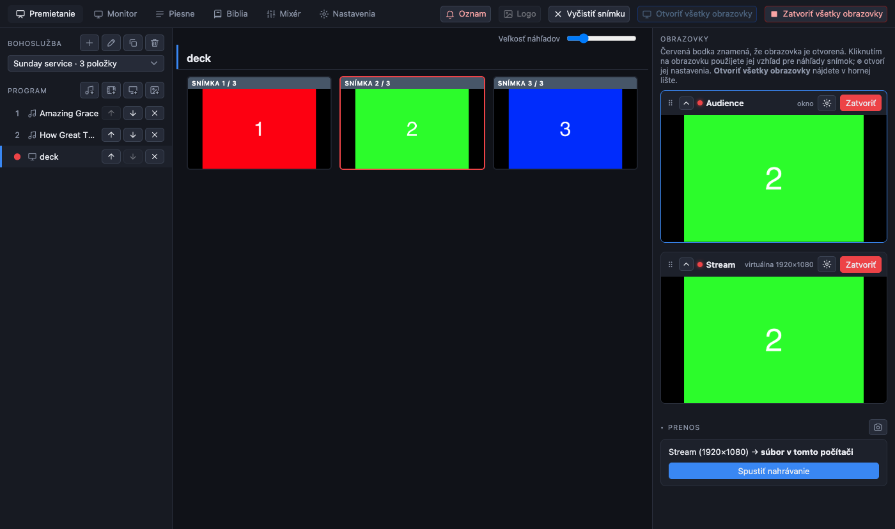
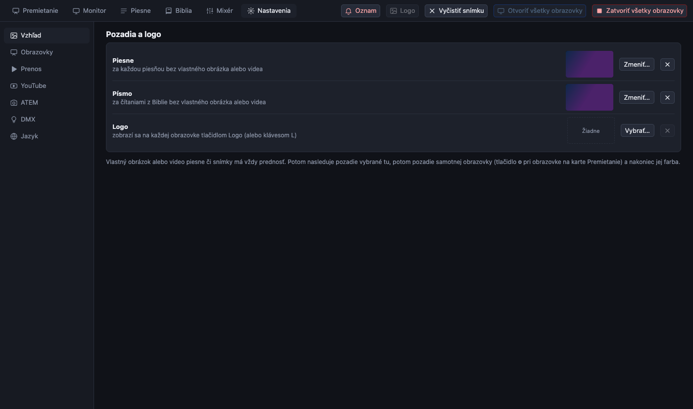

[← Domov](index.md) · [English](../media.md)

# Videá, prezentácie, obrázky a logo

## Videá

1. Na karte Premietanie stlačte **tlačidlo s filmom** pod nadpisom *Program* a vyberte súbor. Funguje väčšina formátov (mp4, mov, mkv, webm a ďalšie).
2. Súbor, ktorý program nevie prehrať priamo (HEVC, ProRes, nezvyčajné kontajnery), sa pri importe **raz prevedie**. Priebeh ukazuje stavový riadok pod programom. Urobte to pred bohoslužbou; dlhé videá chvíľu trvajú.
3. Video je teraz položkou. Kliknite naň a potom kliknutím na jeho snímku ho pripravte.
4. **Lišta prehrávania** má tlačidlá prehrať, pozastaviť, **Zastaviť** (zastaví a pretočí na začiatok) a posuvník polohy. **Medzerník** prehráva a pozastavuje. Každá obrazovka zostáva na tom istom zábere.

**Zvuk** videa predvolene nejde cez mixér prenosu; hrá v sále cez obrazovku, ktorú ste mu určili, a do prenosu sa dostane cez vstupy *Video* v mixéri. Pozrite [zvuk](sound.md#tri-zvuky).

## Prezentácie a obrázky

1. Stlačte **tlačidlo prezentácie** (obrazovka s plusom) a vyberte súbor. Tlačidlom **obrázkov** vyberiete naraz niekoľko obrázkov.
2. Každá strana alebo snímka sa stane obrázkom, zobrazeným **celý, nikdy orezaný**, nad kamerou, ak sa používa.
3. Kliknite na snímku, alebo použite šípky, ako pri každej inej položke.

Čo možno importovať:

| Súbor | Ako |
| --- | --- |
| PowerPoint `.pptx`, `.ppsx` | Číta ich PreStreamer sám. PowerPoint nie je potrebný a nikdy sa nespúšťa. Veľmi zložité prezentácie môžu vyzerať trochu inak: snímky sú približné, preto si ich pred bohoslužbou pozrite. |
| PDF | Každá strana je snímka. |
| Obrázky (png, jpg, …) | Každý obrázok je snímka. |
| Staré `.ppt`, OpenDocument, Keynote (`.key`, iba Mac) | Cez LibreOffice, PowerPoint alebo Keynote, ak sú nainštalované. **Ak niečo vyzerá zle, exportujte PDF z programu, v ktorom ste prezentáciu vytvorili, a importujte ho.** |

Importované snímky sú uložené v aplikácii; neskoršie presunutie alebo vymazanie pôvodného súboru nič nezmení.

## Pozadia

**Pozadie** je obrázok, opakované video alebo farba za slovami. Knižnica obrázkov a videí je spoločná pre všetko: súbor importujte raz a použite ho kdekoľvek.

Kde ho nastaviť (vyhráva to najkonkrétnejšie):

| Kde | Ako |
| --- | --- |
| Jedna snímka piesne | Malé tlačidlo s obrázkom na karte snímky |
| Celá pieseň | *Pozadie* vedľa názvu piesne na karte Premietanie, alebo *Obrázok alebo video…* v editore piesne |
| **Všetky piesne** a **všetky čítania z Biblie** | **Nastavenia → Vzhľad** (nižšie) |
| Celá obrazovka | ⚙ na obrazovke, *Obrázok alebo video…* |
| Farba | Farebné vzorky na tých istých miestach |

Poradie je: vlastné pozadie snímky, vlastné pozadie piesne, pozadie pre celú aplikáciu z Nastavenia → Vzhľad, vlastné pozadie obrazovky a nakoniec farba.

Výber ukazuje knižnicu. **Importovať obrázok…** a **Importovať video…** do nej pridávajú, **Bez obrázka alebo videa** pozadie zruší. Video na pozadí sa opakuje. Vymazanie súboru z knižnice ho odstráni aj zo všetkých miest, kde sa používal.

### Pozadia pre celú aplikáciu a logo

**Nastavenia → Vzhľad** má tri riadky:

- **Piesne**: pozadie za každou piesňou, ktorá nemá vlastné.
- **Písmo**: to isté pre čítania z Biblie.
- **Logo**: obrázok zobrazený tlačidlom **Logo**.

Pomocou *Zmeniť…* ho vyberiete, ✕ ho odstráni.

## Logo

Stlačením **Logo** v hornej lište, alebo klávesu **L**, zobrazíte logo na každej obrazovke. Ďalším stlačením ho odstránite. Je to snímka s obrázkom, takže **prenos v režime Iba kamera ho nezobrazí**.
