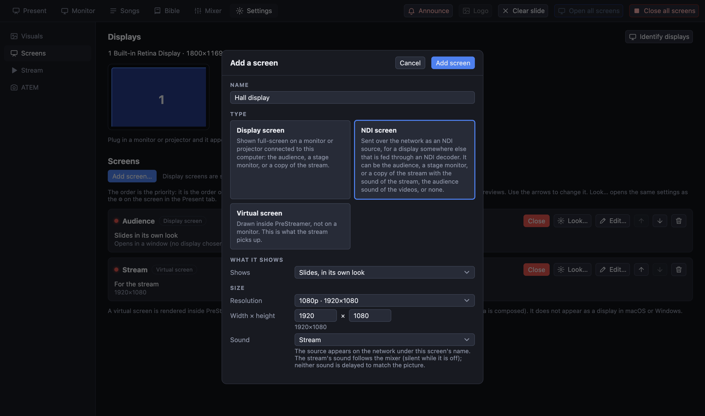

[← Domov](index.md) · [English](../ndi.md)

# Obrazovky NDI

**Obrazovka NDI** je obrazovka, ktorá sa namiesto na monitor posiela cez **sieť**. Použite ju pre displej, ktorý nie je blízko počítača a je napojený cez dekodér NDI (krabičku alebo displej s vstavaným NDI).

> **Vyskúšané na Macu cez vlastnú knižnicu NDI. Zatiaľ nevyskúšané so skutočným displejom ani dekodérom NDI a zatiaľ nie je k dispozícii pre Windows ani Linux.**

## Nastavenie

1. **Nastavenia → Obrazovky → Pridať obrazovku…**, druh **Obrazovka NDI**, zadajte názov („Displej v sále“) a veľkosť (zvyčajne 1080p).
2. Vyberte, čo *Zobrazuje*: vlastné snímky, **pódiový monitor** alebo **zrkadlenie** inej obrazovky (napríklad prenosu).
3. Vyberte jej **zvuk**: zvuk prenosu (mix mixéra), len zvuk videí, alebo žiadny.
4. Na jej karte stlačte **Otvoriť** (alebo *Otvoriť všetky obrazovky*). Začne vysielať; karta ukáže názov NDI alebo čo sa pokazilo.
5. Na dekodéri alebo displeji vyberte zdroj s týmto názvom.

## Čo je dobré vedieť

- NDI potrebuje dobrú **káblovú gigabitovú sieť**: asi 100 Mbit/s alebo viac na jednu obrazovku 1080p. Nepoužívajte wifi.
- Dekodéry, ktoré podporujú len **NDI|HX**, ho nedokážu prijať.
- Zvuk sa nezdržiava tak, aby zodpovedal obrazu.
- Knižnica NDI nie je súčasťou programu. Inštalátor ju obsahuje, len ak ju pri zostavovaní pridali ľudia, ktorí ho vytvorili; inak PreStreamer použije *NDI Tools* alebo *NDI Runtime* nainštalované v počítači a ak tam nie je, napíše to na karte. Ak karta hlási, že knižnica chýba, nainštalujte **NDI Tools** z ndi.video.
