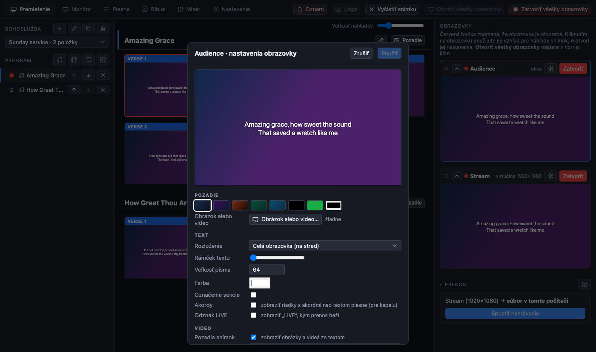
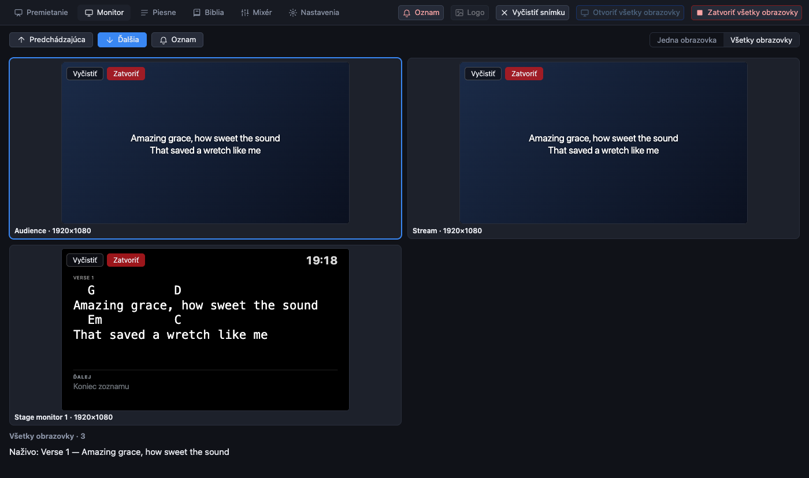
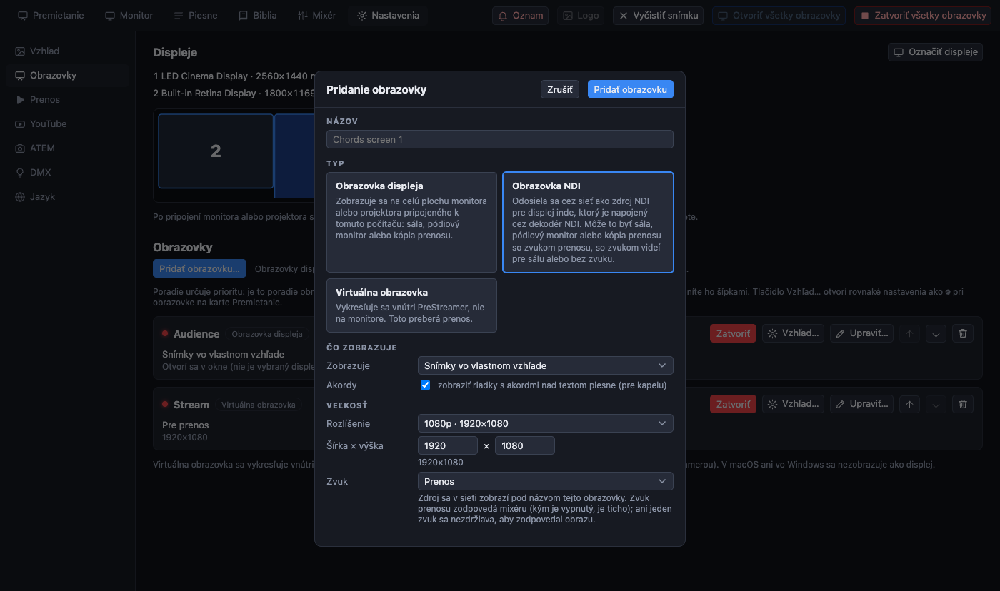
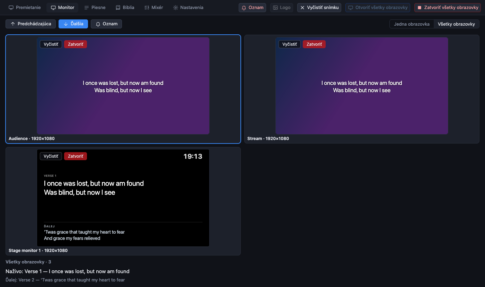
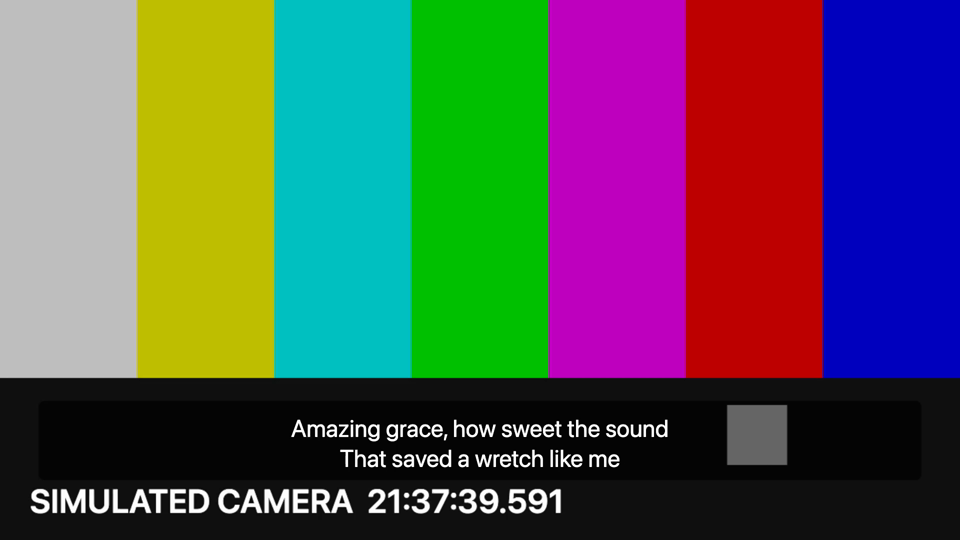

[← Domov](index.md) · [English](../screens.md)

# Obrazovky

**Obrazovka** je výstup s vlastným vzhľadom. Nie je to to isté ako monitor: sami určíte, čo každá obrazovka zobrazuje, a potom ju pripojíte k monitoru, alebo ju necháte žiť vnútri programu.

| Druh | Čo to je |
| --- | --- |
| **Obrazovka displeja** | Zobrazuje sa na celú plochu monitora alebo projektora, ktorý vyberiete. Kým nevyberiete, otvorí sa ako okno. |
| **Virtuálna obrazovka** | Vykresľuje sa vnútri PreStreamer v zvolenej veľkosti (1080p, 720p, 4K, na výšku alebo vlastnej). Je to **to, čo ukazuje prenos**, a miesto, kde sa skladá text nad kamerou. V nastaveniach displejov počítača sa nezobrazuje. |
| **Obrazovka NDI** | Odosiela sa cez sieť na displej, ktorý nie je pripojený k tomuto počítaču: pozrite [obrazovky NDI](ndi.md). |

Nová inštalácia má dve obrazovky: **Audience** (obrazovka displeja) a **Stream** (virtuálna).

## Čo obrazovka zobrazuje

Obrazovka displeja má **rolu**, ktorú vyberiete v poli *Zobrazuje*:

- **Snímky vo vlastnom vzhľade**: bežný prípad.
- **Pódiový monitor**: pre ľudí na pódiu. Zobrazuje aktuálnu snímku, **ďalšiu** snímku a hodiny.
- **Zrkadlenie** inej obrazovky: zobrazuje presne to, čo táto obrazovka, v jej vzhľade a veľkosti. Napríklad monitor v réžii, ktorý zrkadlí prenos.

## Pridanie alebo zmena obrazovky

Otvorte **Nastavenia → Obrazovky**. Pripojené monitory sú na mape nad zoznamom (stlačením **Označiť displeje** sa na každom skutočnom monitore zobrazí číslo).

- **Pridať obrazovku…** sa spýta na názov, druh (po pridaní sa nedá zmeniť) a pri obrazovke displeja na to, ktorý monitor a čo zobrazuje.
- **Upraviť…** pri obrazovke mení tie isté veci. Zmeny čakajú na *Použiť*.
- **Otvoriť / Zatvoriť** na karte obrazovku otvorí alebo zatvorí. **Otvoriť všetky obrazovky** a **Zatvoriť všetky obrazovky** sú v hornej lište.
- Šípky nastavujú **poradie**. Vzhľad hornej obrazovky sa používa pre náhľady snímok. Obrazovku môžete presúvať aj úchytom (⠿) na karte Premietanie a zmeniť tak poradie aj tam.
- **Odstrániť obrazovku** vymaže obrazovku a jej vzhľad (najprv sa opýta).

Pozor na displej, na ktorom je vaše operátorské okno: ak k nemu pripojíte obrazovku, živá obrazovka **zakryje ovládacie prvky**. Stránka vás na to upozorní. Program nikdy sám znova neotvorí výstup na celú plochu na hlavnom displeji.

## Vzhľad obrazovky

Stlačte **⚙** na karte obrazovky na karte Premietanie (alebo *Vzhľad…* v Nastaveniach).

- **Pozadie**: farba, alebo *Obrázok alebo video…*.
- **Rozloženie**: *Celá obrazovka (na stred)* pre texty piesní, alebo **Dolná tretina** pre titulky nad kamerou, s posuvníkom **Rámček textu**, ktorý určuje, aký plný je rámček za textom.
- **Veľkosť písma**, **Farba**, **Označenie sekcie** (zobrazí na snímke „Verš 1“), **Odznak LIVE** (zobrazí „LIVE“, kým prenos beží, aby to vedela aj sála).
- **Pozadia snímok**: odškrtnutím sa zobrazí iba farba a obrázky a videá za textom sa ignorujú.
- **Živý zdroj**: zobrazí kameru za textom. Použite **Vyhľadať kamery**.
- **Zvuk**: či táto obrazovka prehráva zvuk videí a na akom výstupe (pozrite [zvuk](sound.md#tri-zvuky)).

Náhľad v okne ukazuje výsledok. **Použiť** ho dá na obrazovku; **Zrušiť** alebo **Esc** ho zahodí.

## Akordy na obrazovke

Piesne môžu mať akordy (pozri [piesne](songs.md#akordy)). Ktoré obrazovky ich zobrazujú, je nastavenie každej obrazovky:

- **Obrazovka pre kapelu:** *Nastavenia → Obrazovky → Pridať*, zvoľte displej alebo NDI obrazovku a zaškrtnite **Akordy**. Každá snímka sa na nej zobrazí s akordmi nad textom, písmom s pevnou šírkou, aby zostali zarovnané.
- **Monitor pódia s akordmi:** otvorte nastavenia monitora pódia (ceruzka na jeho karte) a zaškrtnite **Akordy**; odškrtnutím ich opäť skryjete. *Ďalšia* snímka sa riadi rovnakou voľbou.
- Sálové obrazovky a prenos ho majú vypnuté, takže zbor ani diváci akordy nikdy nevidia.

Pieseň bez riadkov akordov vyzerá všade rovnako.

## Sledovanie obrazoviek: karta Monitor

Karta **Monitor** ukazuje obrazovky väčšie, než to dokáže karta Premietanie.

- **Jedna obrazovka**: vybraná obrazovka čo najväčšia, ostatné na výber vpravo.
- **Všetky obrazovky**: každá obrazovka v mriežke, ako kamerová stena. Kliknutím jednu vyberiete, dvojklikom ju zobrazíte veľkú.
- Nad obrazom: predchádzajúca a ďalšia snímka, prehrať a pozastaviť pre video, **Oznam** a **Iba kamera** pre prenos.
- Každá obrazovka má **Vyčistiť** (odoberie snímku iba z tejto obrazovky; zmení sa na **Zobraziť**, ktorým ju vrátite) a **Otvoriť / Zatvoriť**.

## Text nad kamerou

Pre titulky nad živou kamerou v prenose:

1. Karta Premietanie → ⚙ na obrazovke **Stream**.
2. **Živý zdroj**: vaša kamera. **Rozloženie**: *Dolná tretina*. **Rámček textu**: približne na polovicu.
3. Spustite prenos z tejto obrazovky.

Text sa s kamerou skladá priamo v PreStreamer. Nie je to samostatný kľúčovací signál. Ak by ste radšej, aby text prekryl ATEM, použite na obrazovke displeja pripojenej k ATEM pozadie jednej farby pre chroma key.
