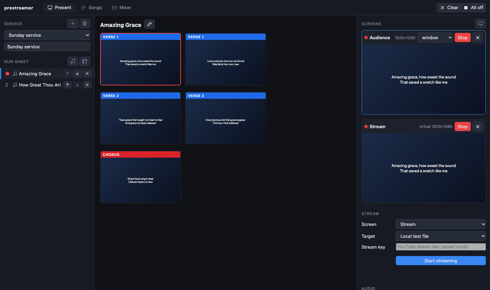

[← Domov](index.md) · [English](../service.md)

# Bohoslužba a program

**Bohoslužba** je poriadok jedného stretnutia. **Program** je zoznam jej položiek, vľavo na karte Premietanie.

## Vytvorenie bohoslužby

1. V poli **Bohoslužba** vľavo hore stlačte **+** (*Nová bohoslužba*) a zadajte názov, napríklad „Nedeľa 14. júna“.
2. Alebo začnite od minulého týždňa: vyberte minulotýždňovú bohoslužbu a stlačte tlačidlo **duplikovať** (*Duplikovať túto bohoslužbu*) a potom zmeňte, čo sa líši. Ceruzka premenúva, kôš maže (najprv sa opýta).
3. Bohoslužbu otvoríte výberom z rozbaľovacieho zoznamu. Tá, ktorú otvoríte, zostane otvorená aj nabudúce.

## Pridávanie vecí do programu

Štyri tlačidlá pod **Programom**:

| Tlačidlo | Pridá | Viac |
| --- | --- | --- |
| ♪ s plusom | **Pieseň** z knižnice | [Piesne](songs.md) |
| Film s plusom | **Video** | [Videá](media.md#videa) |
| Obrazovka s plusom | **Prezentáciu** (PowerPoint, PDF, Keynote) | [Prezentácie](media.md#prezentacie-a-obrazky) |
| Obrázok s plusom | **Obrázky**, každý zobrazený celý ako snímka | [Obrázky](media.md#prezentacie-a-obrazky) |

**Čítania z Biblie** sa pridávajú z karty Biblia pomocou *Pridať do bohoslužby*: pozrite [Čítania z Biblie](bible.md). Pieseň možno pridať aj z karty Piesne, tlačidlom **+** vedľa nej v zozname alebo *Pridať do bohoslužby* v jej editore.

## Zoradenie položiek

- Každý riadok má **↑** a **↓** na presun a **✕** na odstránenie z bohoslužby. (Odstránenie z bohoslužby nevymaže pieseň ani súbor.)
- Pieseň v programe len *odkazuje* na pieseň v knižnici. Ak pieseň neskôr opravíte, opravu uvidí každá bohoslužba, ktorá ju používa.

## Pohyb bohoslužbou

- Všetky snímky celej bohoslužby sú v jednom dlhom zozname v strede. **Kliknutím na snímku** ju dáte na obrazovky.
- **→**, **↓** alebo **medzerník** zobrazí ďalšiu snímku; **←** alebo **↑** predchádzajúcu. Klávesy pokračujú z poslednej snímky jednej položky na prvú snímku ďalšej.
- Kliknutím na položku v programe na ňu skočíte. Jej názov zostane hore v zozname.
- **Cmd + 1 … 9** (Ctrl + 1 … 9 vo Windowse a Linuxe) skočí priamo na 1. … 9. položku z ktorejkoľvek karty.
- **Esc** odstráni snímku zo všetkých obrazoviek (obrazovky zostanú otvorené).
- Posuvník **Veľkosť náhľadov** nad snímkami zmenší alebo zväčší náhľady. Dvojitým kliknutím sa vrátite na obvyklú veľkosť.

Bočné panely môžete rozšíriť alebo zúžiť potiahnutím ich okraja (dvojitým kliknutím na okraj ich vrátite). Šírky sa zapamätajú.

## Tipy

- Položky pridajte hneď na prvýkrát v správnom poradí; zmena poradia je jedno kliknutie na krok.
- Používajte jednu bohoslužbu na každú nedeľu a staré si nechajte: „Nedeľa Večere Pánovej“ o mesiac môže byť duplikát.
- Na začiatok dajte **obrázok** alebo snímku s **logom** ako „uvítaciu“ obrazovku, aby obrazovky neboli prázdne, kým ľudia prichádzajú.
