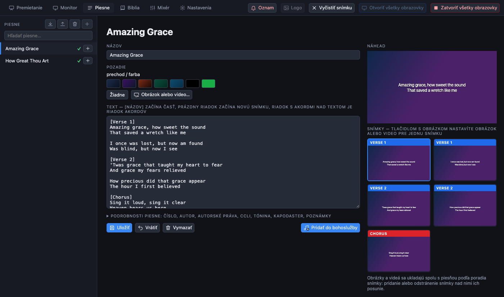
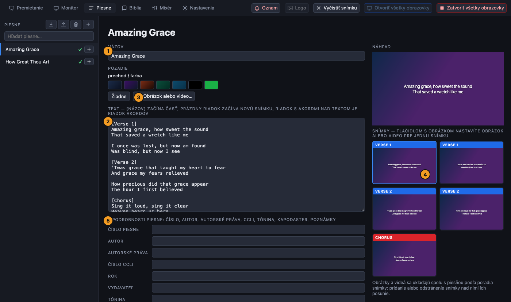
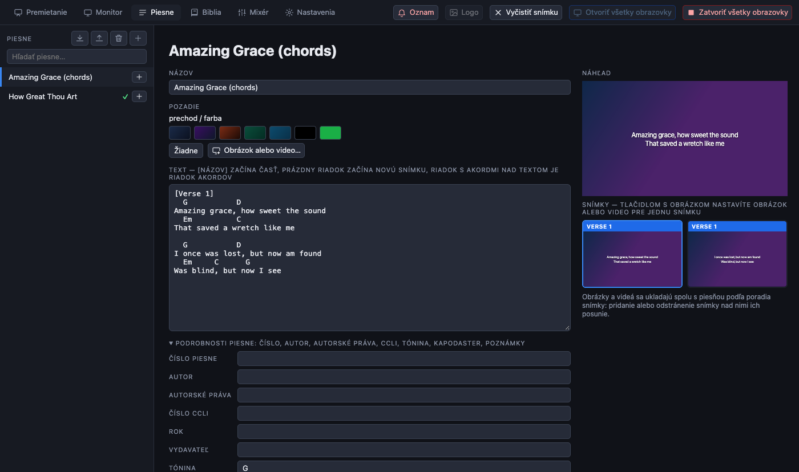

[← Domov](index.md) · [English](../songs.md)

# Piesne

Všetky piesne sú na karte **Piesne**. Sú uložené v jednej knižnici a môže ich použiť ktorákoľvek bohoslužba.



## Nájdenie piesne

Píšte do vyhľadávacieho poľa nad zoznamom. Vyhľadávanie nerozlišuje veľké písmená ani diakritiku a pieseň nájde aj podľa **čísla** (`53` nájde `053 Hosanna`). Tlačidlo **+** pri piesni ju pridá do otvorenej bohoslužby a zelená fajka označuje piesne, ktoré v nej už sú.

## Napísanie alebo zmena piesne

Kliknutím na pieseň otvoríte jej editor, alebo stlačením **+** v hornej časti zoznamu vytvoríte novú.



1. **Názov.**
2. **Text.** Riadok `[Verš 1]` napísaný samostatne začína novú časť; jej názov sa zobrazí v označení snímky. **Prázdny riadok začína novú snímku.** Každý odsek, za ktorým necháte medzeru, je teda na obrazovkách jedna snímka.
3. **Pozadie** celej piesne: farba, alebo **Obrázok alebo video…** z knižnice (pozrite [médiá](media.md#pozadia)).
4. **Karty snímok** vpravo sú náhľadom každej snímky. Malé tlačidlo s obrázkom na karte nastaví obrázok alebo video iba pre **túto snímku**.
5. **Podrobnosti piesne**: číslo piesne, autor, autorské práva, číslo CCLI, rok, vydavateľ, tónina, kapodaster a poznámky. Sú nepovinné.

Stlačte **Uložiť pieseň**. Kým to neurobíte, editor zobrazuje *Neuložené zmeny*; **Vrátiť** ich zahodí. **Vymazať pieseň** pieseň odstráni. *Pridať do bohoslužby* ju vloží do otvorenej bohoslužby.

### Zásady pre snímky

- Dva až štyri krátke riadky na snímke sa dobre čítajú aj zo zadnej časti sály.
- Program zobrazí presne tie časti, ktoré ste napísali, v poradí, v akom ste ich napísali. Ak sa refrén spieva po každej slohe, napíšte ho po každej slohe.
- Text skontrolujte na skutočnej obrazovke: veľkosť písma a farba sa nastavujú pre každú obrazovku zvlášť (pozrite [obrazovky](screens.md)).

## Akordy

Akordy patria **do textu piesne**, na vlastný riadok nad slová, ku ktorým patria (medzery ich zarovnajú):

```
  G           D
/: Hosanna, hosanna,
  Em          C    D
hosanna Bohu na nebi!:/
```



Riadok, ktorý obsahuje iba názvy akordov (`G`, `Em`, `C/G`, `A7`, `Hm` ...), je riadok akordov. Riadky akordov sa **nikdy nezobrazia** na obrazovke, ak nie je nastavená na zobrazenie akordov (pozri [obrazovky](screens.md#akordy-na-obrazovke)), a nepočítajú sa pri hľadaní, snímkach ani pri exporte do Quelea.

## Pozadia piesní

Od najvyššej priority:

1. **Vlastný** obrázok alebo video **snímky** (tlačidlo s obrázkom na karte).
2. Obrázok alebo video **piesne** (tlačidlo *Obrázok alebo video…* v editore, alebo *Pozadie* vedľa názvu piesne na karte Premietanie).
3. **Pozadie piesní pre celú aplikáciu**, pre každú pieseň, ktorá žiadne nemá: Nastavenia → Vzhľad (pozrite [médiá](media.md#pozadia)).
4. **Vlastné pozadie obrazovky**.
5. Farba obrazovky.

Obrázky a videá sa ukladajú **spolu s piesňou**, podľa poradia snímky: ak pridáte alebo odstránite snímku nad tou, ktorá má obrázok, obrázky sa posunú spolu s poradím.

## Import a export piesní

Nad zoznamom piesní:

| Tlačidlo | Čo robí |
| --- | --- |
| Import | Načíta piesne z programu **Quelea** (balík piesní `.qsp`) alebo z **ZIP súboru s PDF so spevníkovými textami**. Z PDF prečíta názov, tóninu a text; riadky s akordmi vynechá, značky ako `v1` alebo `Chorus` zmení na časti a prázdne riadky na nové snímky. Piesne, ktorých názov už v knižnici je, sa preskočia. PDF bez čitateľného textu (skeny) sa vypíšu, aby ste ich mohli prepísať ručne. |
| Export | Zapíše celú knižnicu ako balík piesní Quelea, ktorý vie Quelea importovať. Obrázky a videá sa nezahŕňajú. |
| Kôš | Po potvrdení vyprázdni knižnicu. |
| + | Nová pieseň. |

## Zobrazenie piesne

Na karte Premietanie sa pieseň zobrazí ako rad snímok pod svojím názvom. Kliknutím na snímku ju zobrazíte. Ceruzka vedľa názvu otvorí editor a **Pozadie** nastaví jeden obrázok alebo video pre všetky jej snímky.
