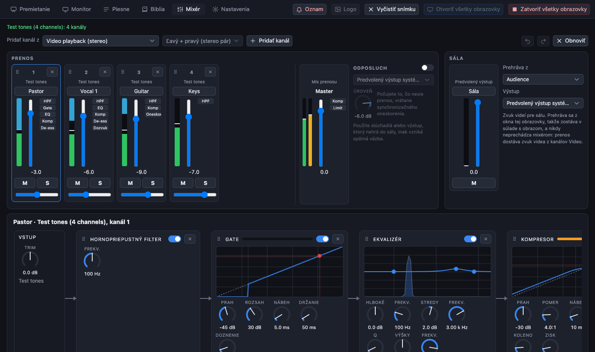

[← Domov](index.md) · [English](../sound.md)

# Zvuk pre prenos

Karta **Mixér** je malý mixážny pult, ktorý určuje, čo počujú diváci prenosu. Neovláda zvuk v budove kostola: ten zostáva na vašom vlastnom mixážnom pulte a reproduktoroch.

## Tri zvuky

PreStreamer drží tri zvuky oddelene, každý má vlastný výstup.

| Zvuk | Kam ide | Kde ho nastavíte |
| --- | --- | --- |
| **Sála**: zvuk videí, ktoré prehrávate | Do reproduktorov v sále, z obrazovky, ktorá prehráva zvuk videí | Panel **Sála** na karte Mixér: ktorá obrazovka ho prehráva (len jedna), výstupné zariadenie, fáder (môže len znižovať), stlmenie, merač |
| **Prenos**: celkový mix mixéra | Do prenosu a do nahrávania. Nikde sa nehrá nahlas. | Kanály a master v paneli **Prenos** |
| **Vaše slúchadlá**: **Odposluch** | Kópia mixu prenosu na výstupe, ktorý si vyberiete | **Odposluch** vedľa masteru: zapnite ho, vyberte výstup a hlasitosť |

Z toho vyplývajú tri veci:

- Zvuk **videa** sa dostane do prenosu cez kanály mixéra *Video L / R*. **Stlmte ich**, ak váš mixážny pult v sále posiela zvuk videa späť do tohto počítača, inak ho budete počuť dvakrát.
- **Odposluch** neprehrávajte tam, kde ho môže zachytiť mikrofón (výstup do sály alebo reproduktory pri otvorenom mikrofóne): vznikne spätná väzba.
- Odposluch nijako nemení to, čo nesie prenos.

## Ako dostať zvuk z kostola do počítača

Obvyklý spôsob je **výstup USB** mixážneho pultu: to, čo chcete v prenose (zbernicu alebo jednotlivé kanály), nasmerujte na USB výstupy pultu, pult pripojte k počítaču a v karte Mixér vyberte zariadenie.

- Viackanálové rozhranie sa zobrazí ako *Názov (všetkých N kanálov)*: každý kanál dostane vlastný kanál v mixéri, najviac 32. Pridáva to asi 60 ms oneskorenia; vyrovnáte ho synchronizačným oneskorením na masteri.
- Na Macu sa pri prvom použití zobrazí žiadosť o **povolenie mikrofónu**. Povoľte ho.
- Vyskúšané je to na Macu so skutočným **Behringer Wing** (32 kanálov, bez výpadkov). Čítače pre Linux a Windows sú zostavené, ale so zariadením ešte nebežali.
- *Multikanálové testovacie tóny* je zdroj, ktorý si môžete vybrať, ak chcete mixér vyskúšať bez akéhokoľvek zariadenia.

## Kanál

Každý kanál má **vstupný zisk (trim)**, **fáder**, **panorámu**, **stlmenie**, **solo** a **merač**. Vedľa merača je krátky stĺpec štítkov, ktorý ukazuje, aké efekty sú v reťazci. Kanály môžete preusporiadať potiahnutím.

Kliknutím na kanál ho vyberiete: jeho **reťazec** sa nakreslí nižšie ako karty spojené šípkami: *Vstup → efekt → efekt → … → Fáder*.

### Zostavenie reťazca

- **Pridať efekt** vloží efekt na koniec. Kartu presuniete za úchyt ⠿ (alebo klávesmi ← →) a zmeníte tak poradie.
- Vypínač na karte efekt **obíde** (signál prejde nezmenený a bez lupnutia). ✕ efekt odstráni.
- **Začať s…** naplní reťazec hotovým: *Spev na chválach*, *Rečník / kazateľ*, *Nástroj*, *Mikrofón miestnosti / publika*. Ak už reťazec existuje, najprv sa opýta.

| Efekt | načo slúži |
| --- | --- |
| **Hornopriepustný filter** | Odreže dunenie a nárazy pod danou frekvenciou. Takmer každý mikrofón na hlas ho potrebuje (okolo 100 Hz). |
| **Ekvalizér** | Tri pásma a graf, ktorý môžete ťahať. Odstráni kalnosť, pridá čistotu. |
| **Gate** | Stíši kanál, keď nikto nehovorí, aby sa hluk miestnosti a presluchy nedostali do prenosu. |
| **Kompresor** | Vyrovná hlasnú a tichú reč. Ukazuje, o koľko znižuje hlasitosť. Má zosilnenie na dorovnanie. |
| **Limiter** | Strop, ktorý nič neprekročí. |
| **De-esser** | Zjemní ostré zvuky „s“ v hlase. |
| **Dozvuk** | Pridá trochu priestoru mikrofónu, ktorý je v prenose príliš suchý. |
| **Oneskorenie** | Jemná ozvena, vhodná na chvály. |
| **Synchronizačné oneskorenie** | Zadrží signál o pevný čas a nič nepridáva. Na masteri zosúladí zvuk s obrazom (kamera a kódovanie obraz oneskorujú); na kanáli zosúladí tento kanál s ostatnými. |

### Master

Master vyzerá ako kanál, má vlastný reťazec a vyberá sa rovnako. Začína s **limiterom na −1 dB** a **synchronizačným oneskorením na 0 ms**. Predvoľby *Hlasitosť prenosu* a *Bezpečnostný limiter* sú určené pre efekty na celý mix.

### Vrátiť zmenu

Šípky v lište Mixéra alebo **Cmd/Ctrl + Z** a **Cmd/Ctrl + Shift + Z** vracajú zmeny späť a znova dopredu od otvorenia aplikácie. Celé potiahnutie otočného ovládača alebo nový efekt je jeden krok. Vrátenie zmeny funguje len na karte Mixér. Každá zmena sa použije okamžite a uloží sa.

## Zvuková skúška krok za krokom

1. Otvorte kartu Mixér. Nech každý hovorí alebo spieva do svojho mikrofónu.
2. **Merač** kanála sa má pohybovať a vrcholiť zhruba v dvoch tretinách stupnice. Ak narazí na vrch, znížte **vstupný zisk (trim)**.
3. **Merač masteru** musí zostať pod vrchom. Limiter bráni skresleniu, ale nechcete, aby pracoval stále.
4. Zapnite **Odposluch** so slúchadlami a počúvajte, čo ponesie prenos.
5. Zvuk videa skontrolujte raz: prehrajte video, skontrolujte sálu a mix prenosu v slúchadlách.

Ďalej: [Video mixážny pult ATEM](atem.md).
