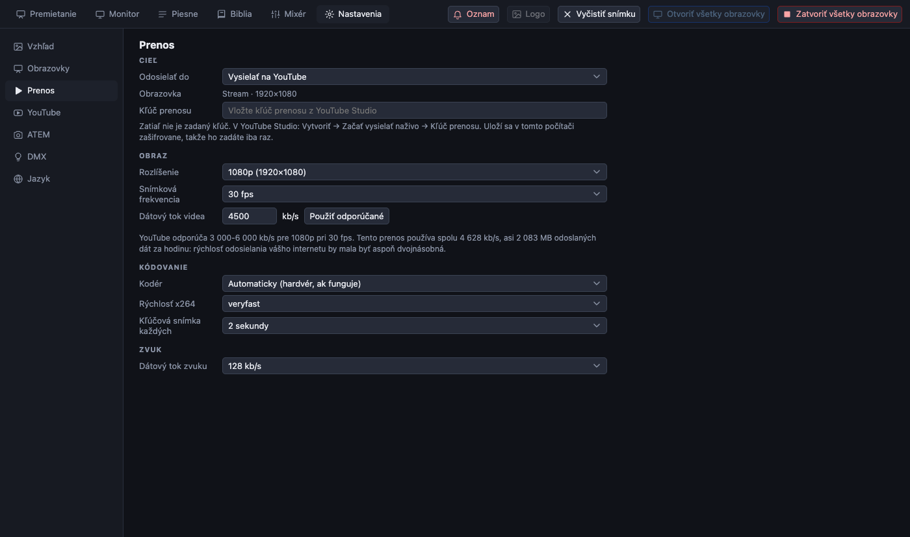

[← Domov](index.md) · [English](../streaming.md)

# Vysielanie a nahrávanie

PreStreamer odosiela **obrazovku prenosu** (to, čo vidia diváci) spolu so **stereo mixom mixéra** (to, čo počujú) na YouTube, alebo ten istý obsah nahráva do súboru v počítači.

> **Úprimná poznámka.** Vysielanie do súboru a na lokálny testovací server bolo dôkladne vyskúšané. Skutočný prenos na YouTube sa s týmto programom od začiatku do konca zatiaľ nevyskúšal. Pred prvou skutočnou bohoslužbou urobte súkromné alebo neverejné skúšobné vysielanie.

## Jednorazové nastavenie v YouTube

1. V **YouTube Studio** (*Vytvoriť → Začať vysielať naživo → Kľúč prenosu*) vytvorte **opakovane použiteľný kľúč prenosu** (rozlíšenie *Variabilné*, alebo 1080p30).
2. Pri vysielaní, ktoré kľúč používa, zapnite **automatický štart**. Bez neho sa prenos pripojí, ale vysielanie nezačne naživo.
3. Skopírujte kľúč. **Nikdy ho nezdieľajte ani nevkladajte do správy či súboru v repozitári.** Ak sa dostane niekam, kam nepatrí, resetujte ho v YouTube Studio.

## Jednorazové nastavenie v PreStreamer

Otvorte **Nastavenia → Prenos**.

1. **Odosielať do**: *Vysielať na YouTube*, alebo *Nahrávať do súboru v tomto počítači*.
2. **Obrazovka**: ktorá virtuálna obrazovka sa odosiela (zvyčajne *Stream*; vyberať treba, iba ak ste vytvorili niekoľko).
3. **Kľúč prenosu**: vložte ho raz. Uloží sa **zašifrovaný** v kľúčenke počítača a *Zabudnúť uložený kľúč* ho odstráni.
4. **Rozlíšenie, snímková frekvencia, dátový tok a kodér**: predvolené hodnoty sú dobrý začiatok (1080p, 30 snímok za sekundu). Kodér je *Automaticky*: použije sa hardvérový kodér, ak nejaký funguje (VideoToolbox na Macu; NVENC, Quick Sync alebo AMF vo Windowse), inak softvérový x264.

*Nahrávanie do súboru* kľúč nepotrebuje: zapíše súbor `.mkv` pomenovaný podľa dátumu a času do priečinka **Videá**.

## Spustenie vysielania

1. **Otvoriť všetky obrazovky**: obrazovka prenosu musí byť otvorená.
2. Na karte **Premietanie** pozrite panel **Prenos**. Hovorí, ktorá obrazovka ide kam.
3. Stlačte **Spustiť vysielanie** (alebo **Spustiť nahrávanie**). Mixér je zvuk prenosu: spúšťa sa sám spolu s aplikáciou a panel upozorní, ak je mixér vypnutý.
4. V YouTube Studio by sa prenos mal zobraziť ako *Prijímajú sa dáta* a pri automatickom štarte vysielanie po krátkej chvíli začne naživo.
5. Na konci stlačte **Zastaviť vysielanie** a počkajte, kým sa zobrazí, že prenos sa zastavil.

Naplánované vysielanie môžete spúšťať, kontrolovať a ukončovať priamo z aplikácie bez vkladania kľúča, ak pripojíte svoj kanál: pozrite [Vysielania na YouTube](youtube.md).

Prenos sa **nikdy nespúšťa automaticky**, ani keď bežal pri zatvorení aplikácie.

## Sledovanie stavu prenosu

Kým beží prenos alebo nahrávanie, zobrazí sa časť **Stav prenosu** s:

- **dátovým tokom** voči cieľu, s dvojminútovým grafom;
- **snímkovou frekvenciou**, **vynechanými snímkami** (a podielom vynechaným za poslednú minútu), **rýchlosťou kódovania** a odoslanými dátami;
- hodnotením a **radou**, ak niečo nie je v poriadku, napríklad keď sieť nestíha.

Kliknutím na jej názov ju zbalíte na jeden riadok.

Čo robiť podľa toho, čo vidíte:

| Znak | Pravdepodobná príčina | Skúste |
| --- | --- | --- |
| Dátový tok je výrazne pod cieľom, vynechané snímky pribúdajú | Odosielanie je príliš pomalé | Znížte dátový tok alebo rozlíšenie v Nastavenia → Prenos (potom prenos reštartujte); použite kábel namiesto wifi |
| Rýchlosť kódovania pod 1,0× | Počítač nestíha kódovať | Nižšie rozlíšenie alebo snímková frekvencia, alebo hardvérový kodér; zatvorte ostatné programy |
| Zvuk a obraz sa pomaly rozchádzajú | Hodiny zvuku a videa sa mierne líšia | Známe: niekoľko milisekúnd za 20 s; synchronizačné oneskorenie na masteri (pozrite [zvuk](sound.md)) nastaví pevný posun |

## Iba kamera

**Ikona kamery** v hlavičke panela Prenos spôsobí, že prenos nesie **iba živú kameru**: žiadny text, žiadne pozadia, žiadne videá, žiadne oznamy. Obrazovky v sále ďalej premietajú normálne. Ďalším stlačením všetko vrátite. Použite to počas modlitby alebo keď niečo na snímke nesmie byť v prenose.

## Titulky nad kamerou

Pozrite [text nad kamerou](screens.md#text-nad-kamerou): dajte kameru za obrazovku prenosu a vyberte rozloženie *Dolná tretina*.

## Kontrola pred bohoslužbou

- Na minútu spustite **nahrávanie** (nie prenos) a prehrajte si súbor: obraz, zvuk, titulky.
- Alebo vysielajte na **súkromné** vysielanie na YouTube a sledujte ho na telefóne v mobilnej sieti.

Ďalej: [Zvuk pre prenos](sound.md).
