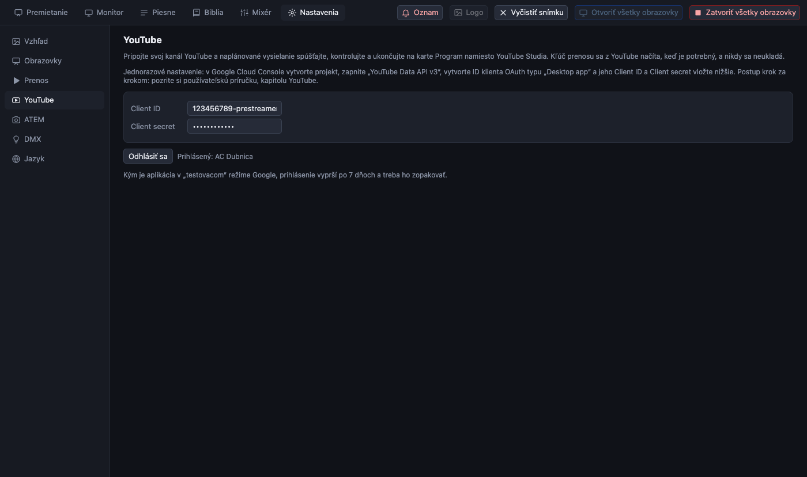
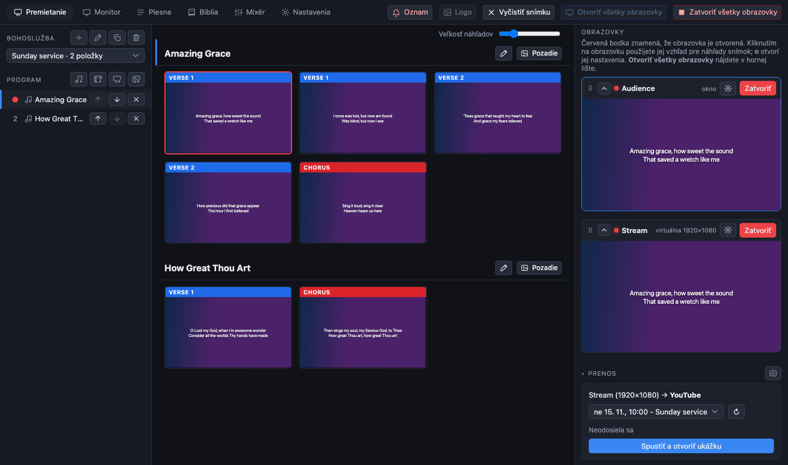

[← Domov](index.md) · [English](../youtube.md)

# Spustenie a ukončenie vysielania na YouTube z PreStreamera

Bežne naplánujete bohoslužbu v YouTube Studiu, v PreStreameri spustíte prenos a potom na webe YouTube stlačíte *Vysielať naživo* a na konci *Ukončiť vysielanie*. Keď je PreStreamer pripojený k vášmu kanálu, **všetko to prebehne na karte Program**: vyberiete naplánované vysielanie, spustíte, pozriete si ukážku, prejdete naživo a ukončíte.

> **Zatiaľ nevyskúšané so skutočným kanálom.** Kroky sú odskúšané na simulovanom YouTube. Pred prvou bohoslužbou vyskúšajte súkromné skúšobné vysielanie.

Čo robí a čo nerobí:

- Pracuje s vysielaním, ktoré ste **sami naplánovali v YouTube Studiu**. Vysielania nevytvára.
- Kľúč prenosu nevkladáte: PreStreamer si ho pri spustení vypýta od YouTube, drží ho len v pamäti a nikdy ho neukladá.
- Prihlásenie sa uchováva **zašifrované** kľúčenkou počítača; *Odhlásiť sa* ho odstráni.

## Jednorazové nastavenie v Google

YouTube dovolí aplikácii spravovať vysielania iba cez projekt Google Cloud. Je to zadarmo a trvá asi desať minút. Robí sa to raz.

1. Otvorte [Google Cloud Console](https://console.cloud.google.com/) s účtom Google, ktorý vlastní kanál YouTube, a vytvorte **projekt** (ľubovoľný názov, napríklad *PreStreamer*).
2. **APIs & Services → Library**: nájdite **YouTube Data API v3** a stlačte **Enable**.
3. **APIs & Services → OAuth consent screen** (v novších konzolách *Google Auth Platform*): vyberte **External**, zadajte názov aplikácie a pod **Test users** pridajte vlastný účet Google. Aplikáciu nechajte v režime **Testing**.
4. **APIs & Services → Credentials → Create credentials → OAuth client ID**: typ **Desktop app**. Skopírujte **Client ID** a **Client secret**.

> V režime *Testing* Google ukončí prihlásenie **po 7 dňoch**, takže sa prihlasujete znova približne raz týždenne (jedno kliknutie, pozri nižšie). Publikovaním aplikácie to zmizne, ale Google ju potom chce overiť, čo trvá a pre vlastný kanál to nie je potrebné.

## Jednorazové nastavenie v PreStreameri

1. Otvorte **Nastavenia → YouTube**.
2. Vložte **Client ID** a **Client secret**.
3. Stlačte **Prihlásiť sa cez Google**. Otvorí sa prehliadač. Google napíše *Google hasn't verified this app*: je to v poriadku, je to váš vlastný projekt. Zvoľte **Advanced → Continue**, povoľte prístup a po zobrazení správy o prihlásení kartu zavrite.

Stránka teraz ukazuje názov kanála. Odteraz panel Prenos na karte Program ukazuje vaše vysielania namiesto obyčajného tlačidla *Spustiť prenos* (keď je v **Nastavenia → Prenos** zvolené *Vysielať na YouTube*).

## Pred bohoslužbou: naplánujte vysielanie

V YouTube Studiu: **Vytvoriť → Vysielať naživo → Naplánovať vysielanie**. Vyberte **opakovane použiteľný kľúč prenosu** (aby malo vysielanie prenos) a nechajte zapnutú predvolenú súkromnú ukážku („monitor stream“). PreStreamer vypíše vysielania, ktoré ešte neskončili, najbližšie prvé.

## V nedeľu

Na karte **Program**, panel **Prenos** (vpravo dole):

1. Vyberte **vysielanie** (najbližšie je už vybrané). Tlačidlo ↻ obnoví zoznam.
2. Stlačte **Spustiť a otvoriť ukážku**. PreStreamer spustí prenos, počká, kým ho YouTube prijíma, a otvorí **ukážku** vysielania: vidíte ju len vy.
3. Skontrolujte obraz a zvuk v YouTube Studiu (vysielanie si tam otvorte).
4. Keď ste pripravení, stlačte **Vysielať naživo**. Diváci to odteraz vidia.
5. Na konci stlačte **Ukončiť vysielanie** a potvrďte. Vysielanie sa na YouTube skončí a prenos sa zastaví.

Ďalšie tlačidlá a situácie:

| Čo vidíte | Čo to znamená |
|---|---|
| **Prestať posielať** (počas ukážky) | Zastaví prenos, ale vysielanie nechá tak, ako je. *Spustiť* ukážku opäť prevezme. |
| *Pripája sa znova… (pokus 3)* | Prenos sa prerušil (zvyčajne internet). PreStreamer počká tri sekundy a potom to sám skúša každých päť sekúnd, kým sa prenos nevráti, a povie, prečo to ešte nešlo (napríklad *Žiadne spojenie s YouTube*). Snímky a sálové obrazovky medzitým fungujú ďalej. **Prestať posielať** alebo **Ukončiť vysielanie** to zruší. |
| **Pripojiť znova** | Pošle prenos do toho istého vysielania hneď, bez čakania na ďalší pokus (aj pri vysielaní, ktoré už bežalo pri otvorení aplikácie). |
| *Bez kroku ukážky* | Vysielanie má v YouTube ukážku vypnutú. Po spustení idete rovno naživo. |
| Červená správa | Posledný krok zlyhal a správa hovorí prečo (nepovolené vysielanie naživo, denný limit, odhlásenie ...). |

Prenos sa **nikdy nespustí sám**: ani pri otvorení aplikácie, ani podľa plánu. Po výpadku sa obnoví iba prenos, ktorý ste spustili sami, a iba do toho istého vysielania.

Ak je spojenie preč dlho, YouTube môže vysielanie sám ukončiť (keď je pre neho zapnuté *automatické zastavenie*). Obnovovanie sa potom zastaví so správou a treba nové vysielanie.

## Riešenie problémov

- **„Tento kanál YouTube nemá povolené vysielanie naživo“**: povoľte ho v YouTube Studiu (overenie nového kanála môže trvať až 24 hodín).
- **„YouTube Data API nie je zapnuté“**: krok 2 nastavenia v Google.
- **„Prihlásenie do YouTube už neplatí“**: prihláste sa znova v Nastavenia → YouTube (v režime Testing je to týždenné prihlásenie).
- **„Toto vysielanie nemá nastavený kľúč prenosu“**: v YouTube Studiu upravte vysielanie a vyberte kľúč prenosu.
- **Zoznam je prázdny**: naplánujte vysielanie a stlačte ↻.
- Starý spôsob (vložený kľúč prenosu v **Nastavenia → Prenos**) funguje ďalej, keď nie ste prihlásený.
