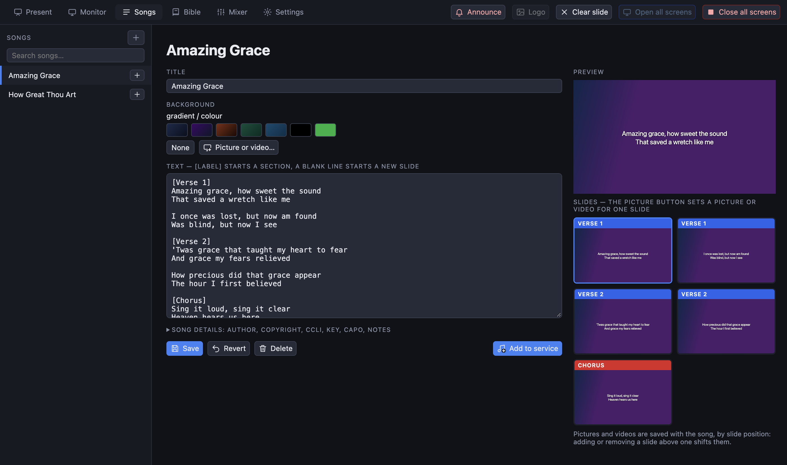
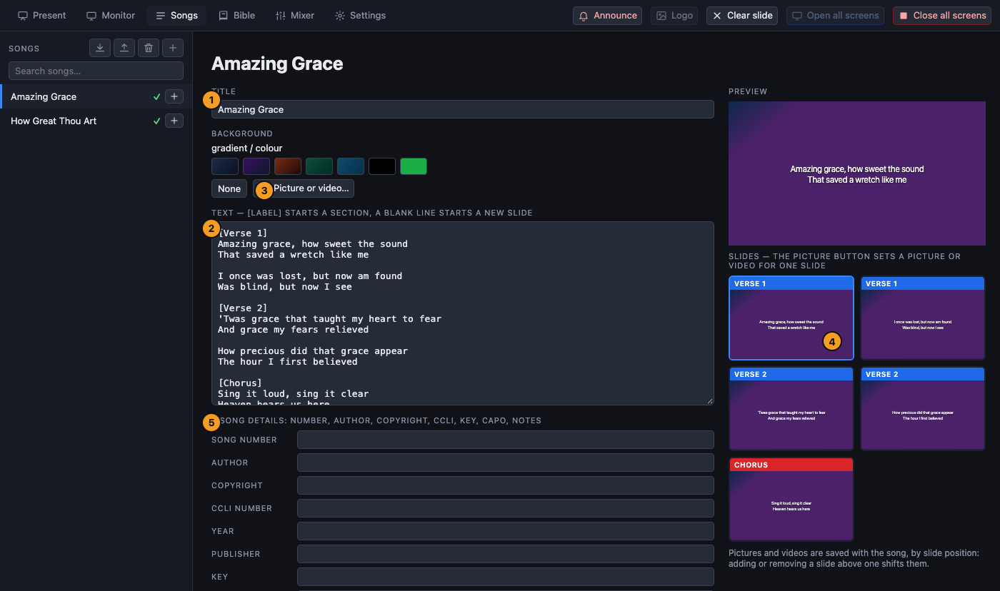

[← Guide home](index.md)

# Songs

All songs live in the **Songs** tab. They are kept in one library and any service can use them.

## Find a song

Type in the search box above the list. The search ignores capital letters and accents, and also finds a song by its **number** (`53` finds `053 Hosanna`). The **+** beside a song adds it to the open service, and a green tick shows songs that are already in it.

## Write or change a song

Click a song to open its editor, or press **+** at the top of the list for a new one.

1. **Title.**
2. **Text.** Write `[Verse 1]` on a line of its own to start a section; the name is shown on the slide's label. A **blank line starts a new slide**. So each paragraph you leave a gap after is one slide on the screens.
3. **Background** for the whole song: a colour, or **Picture or video…** from the library (see [media](media.md#backgrounds)).
4. The **slide cards** on the right are a preview of every slide. The small picture button on a card sets a picture or video for **that slide only**.
5. **Song details**: song number, author, copyright, CCLI number, year, publisher, key, capo and notes. They are optional.

Press **Save**. Until you do, the editor says *Unsaved changes*; **Revert** discards them. **Delete** removes the song. *Add to service* puts it in the open service.

### Rules of thumb for slides

- Two to four short lines per slide read well from the back of the room.
- The program shows exactly the sections you wrote, in the order you wrote them. If the chorus is sung after every verse, write it after every verse.
- Check the text on the real screen: font size and colour are set per screen (see [screens](screens.md)).

## Backgrounds for songs

From the highest priority:

1. A **slide's own** picture or video (the card's picture button).
2. The **song's** picture or video (the *Picture or video…* button in the editor, or *Background* beside the song title in the Present tab).
3. The **app-wide song background**, for every song that has none: Settings → Visuals (see [media](media.md#backgrounds)).
4. The **screen's own** background.
5. The screen's colour.

Pictures and videos are saved **with the song**, by slide position: if you add or remove a slide above one that has a picture, the pictures shift with the positions.

## Bring songs in and out

Above the song list:

| Button | What it does |
| --- | --- |
| Import | Reads songs from **Quelea** (a song pack `.qsp`) or a **ZIP of chord-sheet PDFs**. For a PDF it reads the title, key and lyrics; chord lines are dropped, markers like `v1` or `Chorus` become sections and blank lines become new slides. Songs whose title is already in the library are skipped. PDFs without readable text (scans) are listed so you can type them in. |
| Export | Writes the whole library as a Quelea song pack, which Quelea can import. Pictures and videos are not included. |
| Bin | Empties the library, after a confirmation. |
| + | A new song. |

## Show a song

In the Present tab the song appears as a row of slides under its title. Click a slide to show it. The pencil beside the title opens the editor and **Background** sets one picture or video for all its slides.
