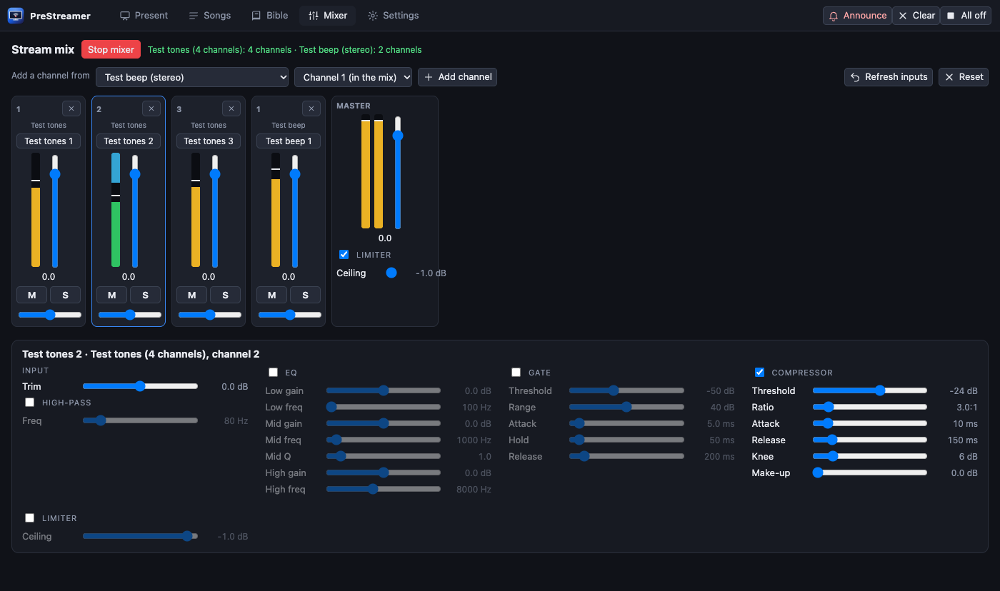

[← Guide home](index.md)

# Sound for the stream

The **Mixer** tab is a small mixing desk that decides what viewers of the stream hear. It does not control the sound in the church building: that is your own mixing desk and speakers.

## Three sounds

PreStreamer keeps three sounds apart, each with its own output.

| Sound | Where it goes | Where you set it |
| --- | --- | --- |
| **The room**: the sound of the videos you play | The room's speakers, from the screen that plays video sound | **Audience** panel in the Mixer tab: which screen plays it (only one), the output device, a fader (it can only turn down), mute, a meter |
| **The stream**: the mixer's master mix | The stream and the recording. Nothing plays it out loud. | The channel strips and the master in the **Stream** panel |
| **Your headphones**: the **Monitor** | A copy of the stream mix on an output you choose | The **Monitor** beside the master: switch it on, choose the output and level |

Three things follow from this:

- The sound of a **video** reaches the stream through the mixer's *Video L / R* strips. **Mute them** if your room mixing desk already sends the video's sound back to this computer, or it will be heard twice.
- Do not play the **Monitor** where a microphone can hear it (the room output or speakers by an open microphone): it will feed back.
- The Monitor changes nothing about what the stream carries.

## Getting the church sound into the computer

The usual way is the mixing desk's **USB output**: route what you want on the stream (a bus, or single channels) to the desk's USB outputs, plug it into the computer, and pick the device in the Mixer tab.

- A multichannel interface shows as *Name (all N channels)*: every channel gets its own strip, up to 32. This adds about 60 ms of delay; compensate with the master's sync delay.
- On a Mac the first use asks for **microphone permission**. Allow it.
- This has been tested on a Mac with a real **Behringer Wing** (32 channels, no dropouts). The Linux and Windows readers are built but have not been run against a device.
- *Multichannel test tones* is a source you can pick to try the mixer without any hardware.

## The channel strip

Each strip has a **trim**, a **fader**, **pan**, **mute**, **solo** and a **meter**. Beside the meter a short column of labels shows which effects are in the chain. Strips can be reordered by dragging.

Click a strip to select it: its **chain** is drawn below as cards joined by arrows: *Input → effect → effect → … → Fader*.

### Building a chain

- **Add effect** puts one at the end. Drag a card by its ⠿ handle (or use ← →) to change the order.
- The switch on a card **bypasses** it (the signal passes through unchanged, with no click). ✕ removes it.
- **Start from…** fills the chain with a ready-made one: *Worship vocal*, *Speaker / preacher*, *Instrument*, *Room / audience mic*. It asks first if there is already a chain.

| Effect | What it is for |
| --- | --- |
| **High-pass** | Cuts rumble and handling noise below a frequency. Almost every voice microphone wants one (around 100 Hz). |
| **EQ** | Three bands, with a graph you can drag. Cut mud, add clarity. |
| **Gate** | Silences the channel while nobody is talking, so the room noise and spill do not get on the stream. |
| **Compressor** | Evens out loud and quiet speech. It shows how much it is turning down. Has make-up gain. |
| **Limiter** | A ceiling that nothing can pass. |
| **De-esser** | Softens harsh "s" sounds on voices. |
| **Reverb** | Adds a little room to a microphone that is too dry on a stream. |
| **Delay** | A soft echo, for worship. |
| **Sync delay** | Holds the signal back by a fixed time and adds nothing. On the master it lines the sound up with the picture (the camera and the encoder delay the picture); on a channel it lines that channel up with the others. |

### The master

The master looks like a strip, has a chain of its own and is selected the same way. It starts with a **limiter at −1 dB** and a **sync delay at 0 ms**. The *Stream loudness* and *Safety limiter* presets are there for effects on the whole mix.

### Undo

The arrows in the Mixer bar, or **Cmd/Ctrl + Z** and **Cmd/Ctrl + Shift + Z**, step back and forward through what you changed since the app opened. A whole knob drag or a new effect is one step. Undo works on the Mixer tab only. Every change applies at once and is saved.

## A sound check, step by step

1. Open the Mixer tab. Have each person speak or sing into their microphone.
2. The strip's **meter** should move, peaking about two thirds up the scale. If it hits the top, lower the **trim**.
3. The **master meter** must stay below the top. The limiter prevents distortion but you do not want it working all the time.
4. Switch on the **Monitor** with headphones and listen to what the stream will carry.
5. Check the video sound once: play a video, check the room, check the stream mix in your headphones.

Next: [ATEM video switcher](atem.md).
