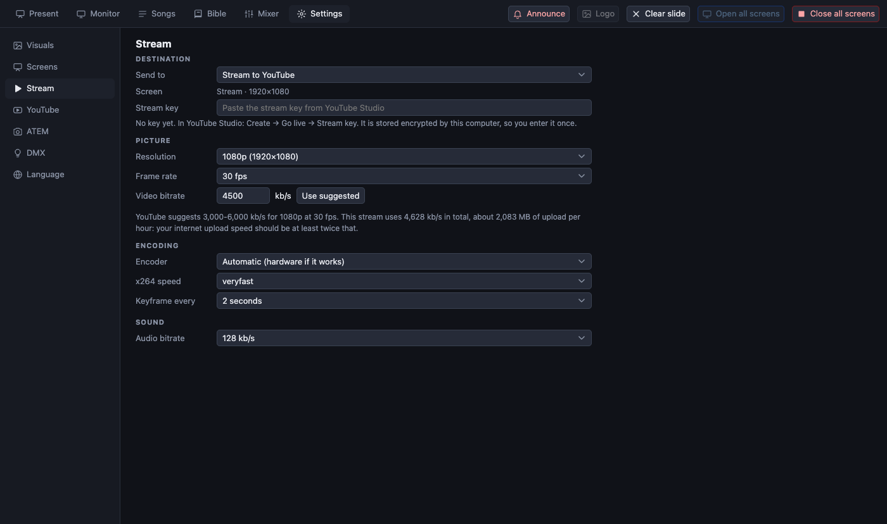

[← Guide home](index.md)

# Streaming and recording

PreStreamer sends the **stream screen** (what viewers see) together with the **mixer's stereo mix** (what they hear) to YouTube, or records the same thing to a file on the computer.

> **Honest note.** Streaming to a file and to a local test server has been tested thoroughly. A real YouTube stream has not yet been tested end to end with this program. Do a private or unlisted test broadcast before the first real service.

## One-time setup in YouTube

1. In **YouTube Studio** (*Create → Go live → Stream key*) create a **reusable stream key** (resolution *Variable*, or 1080p30).
2. On the broadcast that uses the key, switch on **auto-start**. Without it the stream connects, but the broadcast does not go live.
3. Copy the key. **Never share it or put it in a message or a file in the repository.** If it ends up somewhere it should not be, reset it in YouTube Studio.

## One-time setup in PreStreamer

Open **Settings → Stream**.

1. **Send to**: *Stream to YouTube*, or *Record to a file on this computer*.
2. **Screen**: which virtual screen goes out (normally *Stream*; only one needs choosing if you made several).
3. **Stream key**: paste it once. It is stored **encrypted** by the computer's keychain, and *Forget saved key* removes it.
4. **Resolution, frame rate, bitrate and encoder**: the defaults are a good start (1080p, 30 frames a second). The encoder is *Auto*: a hardware encoder is used when one works (VideoToolbox on a Mac; NVENC, Quick Sync or AMF on Windows), otherwise the software x264.

*Record to a file* needs no key: it writes an `.mkv` named with the date and time into the **Videos** folder.

## Going live

1. **Open all screens**: the stream screen must be open.
2. In the **Present** tab look at the **Stream** panel. It says which screen goes where.
3. Press **Start streaming** (or **Start recording**). The mixer is the stream's sound: it starts by itself with the app, and the panel warns if the mixer is off.
4. In YouTube Studio the stream should show as *Receiving data* and, with auto-start, the broadcast goes live after a short while.
5. Press **Stop streaming** at the end and wait for it to say the stream has stopped.

To start, preview and end a *scheduled* broadcast from the app without pasting a key, connect your channel: see [YouTube broadcasts](youtube.md).

A stream is **never started automatically**, not even if one was running when the app closed.

## Watching the health of the stream

While a stream or recording runs, a **Stream health** section appears with:

- the **bitrate** against the target, with a two-minute graph;
- the **frame rate**, **dropped frames** (and the share dropped in the last minute), **encoding speed**, data sent;
- a rating and **advice** if something is wrong, for example when the network cannot keep up.

Click its title to collapse it to one line.

What to do about what you see:

| Sign | Likely cause | Try |
| --- | --- | --- |
| Bitrate well below target, dropped frames grow | The upload is too slow | Lower the bitrate or resolution in Settings → Stream (then restart); use a cable instead of wifi |
| Encoding speed under 1.0× | The computer cannot encode fast enough | A lower resolution or frame rate, or a hardware encoder; close other programs |
| Sound and picture slowly drift | The audio and video clocks differ slightly | Known: a few milliseconds per 20 s; the sync delay on the master (see [sound](sound.md)) sets a fixed offset |

## Camera only

The **camera icon** in the Stream panel's header makes the stream carry **only the live camera**: no text, no backgrounds, no videos, no announcements. The room screens keep presenting normally. Press it again to bring everything back. Use it during prayer or when something on a slide must not be on the stream.

## Captions over the camera

See [text over the camera](screens.md#text-over-the-camera): put the camera behind the stream screen and choose the *Lower third* layout.

## Checking before the service

- Start a **recording** (not a stream) for a minute and play the file back: picture, sound, captions.
- Or stream to a **private** YouTube broadcast and watch it on a phone on the mobile network.

Next: [Sound for the stream](sound.md).
