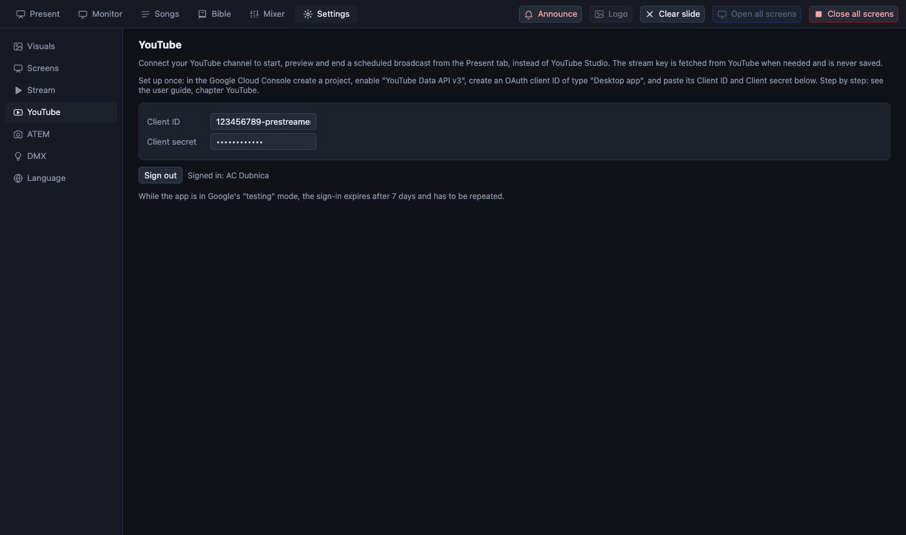
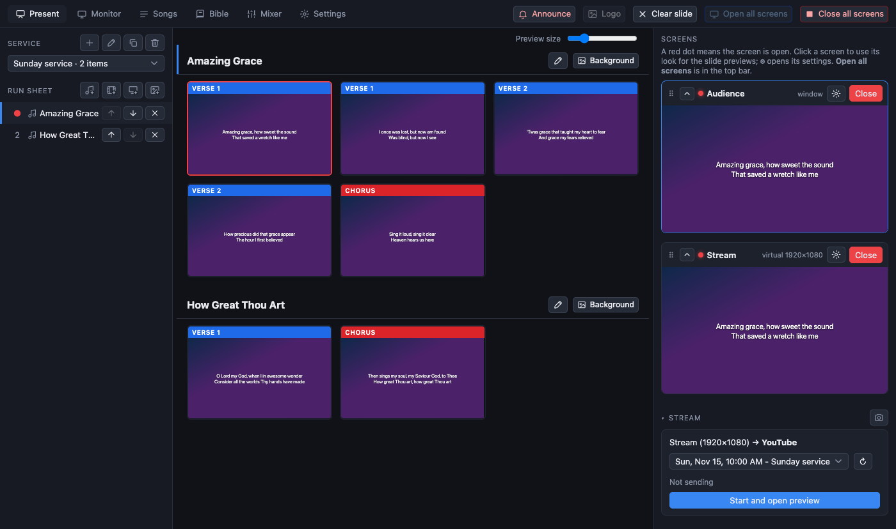

[← Guide home](index.md) · [Slovenčina](sk/youtube.md)

# Starting and ending a YouTube broadcast from PreStreamer

Normally you schedule the service in YouTube Studio, start streaming in PreStreamer, then press *Go live* and later *End stream* on the YouTube website. Once PreStreamer is connected to your channel, **all of that happens in the Present tab**: choose the scheduled broadcast, start, look at the preview, go live, end.

> **Not yet tried with a real channel.** The steps are tested against a simulated YouTube. Try a private test broadcast before the first service.

What it does and does not do:

- It works with a broadcast you **scheduled yourself in YouTube Studio**. It does not create broadcasts.
- You do not paste a stream key: PreStreamer asks YouTube for it when you start, keeps it only in memory, and never saves it.
- The sign-in is kept **encrypted** by the computer's keychain; *Sign out* removes it.

## One-time setup in Google

YouTube only lets an app manage broadcasts through a Google Cloud project. It is free and takes about ten minutes. You do it once.

1. Open the [Google Cloud Console](https://console.cloud.google.com/) with the Google account that owns the YouTube channel and create a **project** (any name, for example *PreStreamer*).
2. **APIs & Services → Library**: find **YouTube Data API v3** and press **Enable**.
3. **APIs & Services → OAuth consent screen** (called *Google Auth Platform* in newer consoles): choose **External**, give the app a name, and add your own Google account under **Test users**. Leave the app in **Testing**.
4. **APIs & Services → Credentials → Create credentials → OAuth client ID**: type **Desktop app**. Copy the **Client ID** and the **Client secret**.

> In *Testing* mode Google ends the sign-in **after 7 days**, so you sign in again about once a week (one click, see below). Publishing the app removes that, but Google then wants to verify it, which takes time and is not needed for your own channel.

## One-time setup in PreStreamer

1. Open **Settings → YouTube**.
2. Paste the **Client ID** and the **Client secret**.
3. Press **Sign in with Google**. Your browser opens. Google says *Google hasn't verified this app*: that is expected, it is your own project. Choose **Advanced → Continue**, allow the access, and close the tab when it says you are signed in.

The page now shows the channel's name. From now on the Present tab's Stream panel shows your broadcasts instead of the plain *Start streaming* button (when **Settings → Stream** is set to *Stream to YouTube*).

## Before the service: schedule the broadcast

In YouTube Studio: **Create → Go live → Schedule stream**. Choose the **reusable stream key** (so the broadcast has a stream), and keep the default of a private preview ("monitor stream") switched on. PreStreamer lists the broadcasts that have not finished, the soonest first.

## On Sunday

In the **Present** tab, **Stream** panel (bottom right):

1. Pick the **broadcast** (the next one is already selected). The ↻ button reloads the list.
2. Press **Start and open preview**. PreStreamer starts the stream, waits until YouTube is receiving it, and opens the broadcast's **preview**: only you can see it.
3. Check the picture and sound in YouTube Studio (open the broadcast there).
4. Press **Go live** when you are ready. The audience now sees it.
5. At the end press **End stream**, and confirm. The broadcast is finished on YouTube and the stream stops.

Other buttons and situations:

| What you see | What it means |
|---|---|
| **Stop sending** (during the preview) | Stops the stream but leaves the broadcast as it is. *Start* picks the preview up again. |
| *Reconnecting… (attempt 3)* | The stream dropped (the internet, usually). PreStreamer waits three seconds, then tries again every five seconds by itself until the stream is back, and says why it could not yet (for example *No connection to YouTube*). Slides and the room screens keep working meanwhile. **Stop sending** or **End stream** cancels it. |
| **Reconnect** | Sends the stream to the same broadcast at once, without waiting for the next attempt (also for a broadcast that was already live when you opened the app). |
| *No preview step* | The broadcast has the preview switched off in YouTube. You go live directly after starting. |
| A message in red | The last step failed and the message says why (not enabled for live streaming, the daily limit, signed out ...). |

A stream is **never started automatically**: not when the app opens, and not on a schedule. Only a stream you started yourself is brought back after a drop, and only into the same broadcast.

If the connection is away for long, YouTube may end the broadcast by itself (when *auto-stop* is on for it). Then reconnecting stops with a message, and a new broadcast is needed.

## Troubleshooting

- **"This YouTube channel is not enabled for live streaming"**: enable live streaming in YouTube Studio (verification of a new channel can take up to 24 hours).
- **"The YouTube Data API is not switched on"**: step 2 of the Google setup.
- **"The YouTube sign-in is no longer valid"**: sign in again in Settings → YouTube (this is the weekly sign-in in Testing mode).
- **"This broadcast has no stream key set up"**: edit the broadcast in YouTube Studio and choose a stream key.
- **Nothing in the list**: schedule a broadcast and press ↻.
- The old way (a pasted stream key in **Settings → Stream**) still works when you are not signed in.
